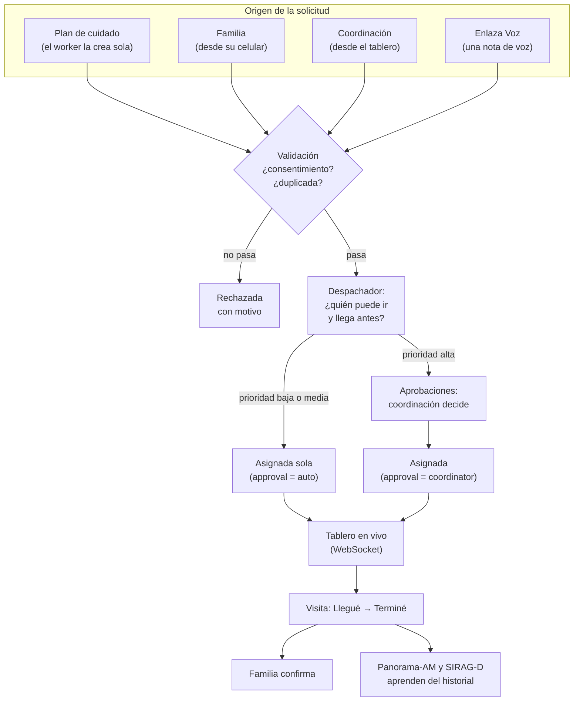

# Qué es Enlaza y qué problema resuelve {#cap-que-es}

## En una frase

!!! frase "Enlaza en una frase"
    **Enlaza es una plataforma web, por suscripción, con la que una institución que cuida a personas mayores en la
    Ciudad de México recibe solicitudes de servicio, asigna sola a la persona adecuada, sigue cada visita en vivo,
    decide con datos y escucha notas de voz que pueden ser una emergencia.**

## Explicado sin tecnicismos

Piensa en doña Rosa, de 82 años, que vive en Iztapalapa con diabetes e hipertensión. Su hija trabaja todo el
día. Una clínica de la zona le manda una enfermera dos veces por semana y, a veces, una consulta del geriatra.

**Hoy, sin Enlaza**, así se coordina eso en muchas instituciones:

- la hija manda un WhatsApp a la coordinadora: «¿Puede ir alguien mañana a las 11?»;
- la coordinadora revisa una hoja de cálculo para ver quién está libre, llama a dos enfermeras, una no contesta;
- nadie sabe si la enfermera ya salió, si va tarde por el tráfico o si llegó;
- si ese día hay contingencia ambiental, nadie piensa en que doña Rosa es sensible a la contaminación;
- al final del mes nadie puede decir cuántas visitas se quedaron sin atender ni por qué.

**Con Enlaza**, la misma historia se ve así:

1. La hija entra a Enlaza desde su celular y pide la visita. Ve de inmediato quién va a ir y a qué hora.
2. El sistema eligió solo a la enfermera **libre, con la habilidad necesaria y que llega más rápido con el
   tráfico de esa hora**. Si la visita es de prioridad alta, la coordinadora la aprueba con un clic.
3. La coordinadora ve en una pantalla, **en vivo**, qué visitas están en camino, en curso o en espera.
4. La enfermera toca «Llegué» y «Terminé» en su celular. La hija confirma que la visita se hizo.
5. Si la hija graba una nota de voz que dice «mi mamá no puede respirar», la pantalla se pone roja con un botón
   grande para llamar al 911 **al instante, sin esperar a ningún reporte**, y la coordinación recibe el aviso.
6. La dirección ve tableros con indicadores y puede simular «¿qué pasaría si mañana hay contingencia en el
   oriente?» antes de que ocurra.

Eso es Enlaza: **una sola página web** donde la institución, su personal y las familias se *enlazan* alrededor
de cada persona mayor. El nombre viene de ahí.

!!! nota "Un prototipo escolar, con datos inventados pero realistas"
    Enlaza es el proyecto integrador del 6.º semestre de la Licenciatura en Ciencia de Datos para Negocios
    (Universidad Nacional “Rosario Castellanos”, UNRC, 2026-2). «Enlaza Cuidado Coordinado» es una **empresa ficticia**. Ninguna persona del sistema existe:
    todos los datos son [[datos sintéticos]], creados por computadora para que se parezcan, en sus proporciones, a
    lo que dicen el INEGI, la ENSANUT y otras fuentes oficiales (ver @ref(cap-datos)).

### El problema, con números

En la Ciudad de México viven {{ seed.pop60_cdmx }} personas de 60 años o más (Censo 2020, suma de las
{{ seed.districts }} alcaldías). Quienes las cuidan fuera de casa son, entre otros, las residencias y asilos: el
directorio oficial de negocios del INEGI ([[DENUE]]) registra {{ neg.market_care_residences_cdmx }} «asilos y otras
residencias para el cuidado de ancianos» en la CDMX, y {{ neg.market_residential_care_cdmx }} establecimientos si
se cuentan todas las residencias de asistencia social y cuidado de la salud.

El problema que atacamos no es médico: es de **coordinación**. Cuando las visitas se organizan con llamadas y
hojas de cálculo:

- se pierden solicitudes o se duplican;
- no se sabe quién está libre, ni cuánto tarda en llegar con el tráfico;
- lo urgente compite con lo rutinario en el mismo chat;
- no queda registro para mejorar ni para rendir cuentas.

En el historial sintético con el que arranca el sistema ({{ seed.history_days }} días, {{ seed.service_requests }}
solicitudes), el {{ seed.requests_unattended_pct }} de las solicitudes quedaron **sin atender por falta de
personal disponible**. Ese porcentaje es un dato **sintético**, puesto a propósito: es el problema que Enlaza
debe reducir. La simulación (SIRAG-D, @ref(cap-sirag)) mide cuánto lo reduce cada forma de asignar.

### Seis módulos, seis materias, un solo sistema

El proyecto integra seis materias del semestre. Cada una aporta un módulo, pero **no son seis programas**: es una
sola aplicación web en la que cada módulo usa los datos de los demás.

| Módulo | Materia | Qué hace | En una palabra |
|---|---|---|---|
| **Operación** | Sistemas de Información Empresarial | Solicitudes, pacientes, personal, asignación automática, aprobaciones, visitas | Hacer |
| **[[Panorama-AM]]** | Visualización | Tableros, mapas y indicadores para decidir | Ver |
| **[[SIRAG-D]]** | Modelado y Simulación | Simula semanas completas de operación para comparar formas de asignar | Probar |
| **[[Enlaza Voz]]** (antes ORACLE-Voz) | Cómputo Cognitivo | Voz → texto → ¿es emergencia? → reporte para el médico o pantalla 911 | Escuchar |
| **Modelo de negocio** | Emprendimiento | Planes de suscripción, costos, punto de equilibrio, mercado real | Vender |
| **Ética y privacidad** | Práctica Profesional | Consentimientos, aviso de privacidad, derechos ARCO, bitácora | Cuidar |

En términos de la materia de Sistemas de Información Empresarial, la Operación junta tres tipos de sistema: un
[[TPS]] (registra cada transacción: solicitudes, asignaciones, llegadas), un [[CRM]] (la relación con pacientes y
familias) y un [[ERP]] (los recursos: personal, turnos, servicios). Panorama-AM es el [[MIS]] y el [[DSS]]: resume
para la dirección y ayuda a decidir. Todo eso se explica desde cero en la Parte III.

### Cinco personas distintas usan Enlaza

| Rol | Quién es | Qué hace en Enlaza | Pantalla de inicio |
|---|---|---|---|
| **Dirección** | La empresa Enlaza (dueña de la plataforma) | Ve todas las instituciones juntas, el negocio, la simulación y el panel de demostración | Panorama |
| **Coordinación** | La coordinadora de una institución cliente | Aprueba asignaciones de prioridad alta, sigue el tablero en vivo, decide en contingencias | Tablero en vivo |
| **Medicina** | Médico de la institución | Lee los reportes de las notas de voz y ajusta planes de cuidado de sus pacientes | Reportes de voz |
| **Cuidado / enfermería** | Personal que hace las visitas | Ve su agenda, marca «Llegué» y «Terminé», graba notas | Mis visitas |
| **Familia** | Familiar responsable del paciente | Pide servicios, ve quién va, confirma la visita, usa el asistente de voz | Familia |

@ref(cap-recorrido) recorre, pantalla por pantalla, lo que ve cada uno.

## Por qué lo hicimos así

Cada decisión grande tuvo alternativas. Estas son las que más preguntan:

| Decidimos | En lugar de | Por qué |
|---|---|---|
| Una plataforma [[SaaS]]: una sola instalación que usan muchas instituciones, cada una con su suscripción | Un programa que cada institución instala en su computadora | Una institución pequeña no tiene área de sistemas; con SaaS paga una mensualidad y no instala nada. Para nosotros es un solo sistema que mantener. El reto es que una institución nunca vea a otra: lo resuelve la seguridad por fila (@ref(cap-seguridad)). |
| **Una sola aplicación** con seis módulos | Seis proyectos separados, uno por materia | Así cada módulo usa datos reales de los otros: la simulación prueba el **mismo** código de asignación que la operación; la voz crea solicitudes reales; el negocio cuenta pacientes reales del sistema. |
| **Asignación automática** con aprobación humana en lo de prioridad alta | Que la coordinadora asigne todo a mano | Asignar a mano es lento y depende de quién esté. Pero en lo delicado decide una persona. La única excepción (urgente sin respuesta en {{ cfg.auto_apply_after }}) salió de la simulación (@ref(cap-sirag) y @ref(cap-bitacora)). |
| [[Datos sintéticos]] calibrados con fuentes oficiales | Pedir datos reales a una institución | Los datos de salud son **datos personales sensibles** (LFPDPPP 2025). Para un proyecto escolar no es ético ni legal usarlos. Los datos sintéticos se pueden publicar, repetir y explicar. |
| Todo corre **en una laptop**, con IA local | Servicios en la nube de pago (servidores, modelos de lenguaje) | Costo cero, nada sale de la computadora (privacidad) y no dependemos de una tarjeta de crédito. Para mostrarlo al público usamos un túnel gratuito de Cloudflare (@ref(cap-arquitectura)). |
| Reloj **real** (hora de la Ciudad de México) | Un reloj simulado que avanza rápido | Así la demostración es creíble: lo que pasa en pantalla pasa de verdad, a la hora real. Lo acelerado vive solo en la simulación, fuera de línea. |

### Del nombre «Vela» al nombre «Enlaza»

El proyecto se llamó **Vela** hasta el 23 de noviembre de 2026 (una vela acompaña y alumbra). Ese día el equipo
adoptó una identidad nueva: **Enlaza · cuidado coordinado**, con logotipo, colores y tipografía propios
(`docs/brand.md`). El módulo de voz, que se llamaba **ORACLE-Voz**, pasó a llamarse **Enlaza Voz** como parte de ese
mismo cambio de identidad: todos los módulos quedaron bajo una sola marca. Además, el nombre nuevo evita confusiones con
Oracle, que es una marca registrada de software. Para no romper nada, **el código conserva los nombres internos viejos**: la base de datos
se llama `vela`, el rol de la API `vela_api`, el archivo `oracle.py`. Solo cambió lo que lee una persona. Si un
profesor ve «vela» en el código, esa es la razón.

## Cómo funciona por dentro

Un día de operación, de punta a punta. Cada caja es una parte del sistema que se explica en su capítulo.

En palabras:

1. **Nace una solicitud.** Puede venir del [[plan de cuidado]] (la frecuencia de servicios de cada paciente, que
   el [[worker]] convierte en visitas concretas cada minuto), de la familia, de coordinación o de una nota de voz.
2. **Se valida.** Paciente activo, [[consentimiento]] vigente, servicio activo y que no exista otra igual
   {{ code.duplicate_window_h }} antes o después.
3. **El [[despachador]] elige.** Busca a quién tiene la habilidad, está en turno, no tiene otra visita a esa hora
   y llega más rápido con el tráfico de esa hora.
4. **Se aplica o se propone.** Lo de prioridad baja y media se asigna en el momento; lo de prioridad alta queda
   en la pantalla de Aprobaciones para que una persona decida.
5. **Todos lo ven en vivo.** El tablero de coordinación se actualiza solo, sin recargar la página.
6. **La visita ocurre.** El personal marca llegada y término, la familia confirma, y todo queda en el historial
   que usan los tableros y la simulación.

## Dónde está en el código

| Qué | Dónde |
|---|---|
| Presentación del proyecto (para cualquier visitante) | `README.md` y la página pública `/` (`frontend/src/pages/LandingPage.tsx`) |
| Especificación completa, en español | `docs/spec/00_indice.md` y los documentos `01` a `11` |
| Reglas para trabajar en el repositorio | `CLAUDE.md` |
| Decisiones técnicas tomadas en cada paso | `docs/dev/decisiones_*.md` y `docs/dev/sirag_d_modelo.md` |
| Identidad visual (nombre, logo, colores) | `docs/brand.md`, `assets/brand/` |
| Pantallas | `frontend/src/pages/` ({{ repo.pages }} pantallas) |
| Reglas de negocio del servidor | `backend/app/services/` ({{ repo.services }} módulos) |
| Rutas de la API | `backend/app/routers/` ({{ repo.routers }} grupos de rutas) |

## Números clave

{{ tabla seed.pop60_cdmx neg.market_care_residences_cdmx neg.market_residential_care_cdmx seed.institutions seed.patients seed.caregivers seed.persons seed.service_requests seed.requests_unattended_pct seed.users repo.pages repo.tests_summary }}

!!! nota "¿Por qué hay más pruebas que funciones de prueba?"
    Una función de prueba puede correr varias veces con datos distintos: se marca con `@pytest.mark.parametrize` y pytest la
    cuenta una vez por cada juego de datos. Por eso pytest reporta {{ repo.pytest_collected }} pruebas aunque en el código
    haya {{ repo.backend_tests }} funciones `def test_…`. Las dos cifras se recalculan al generar el libro.

## Limitaciones honestas

- **Es un prototipo.** Funciona de punta a punta, pero no se ha probado con una institución real ni con
  personas reales. No hay pagos, facturación electrónica (CFDI), aplicación móvil nativa, llamada real al 911 ni
  conexión con expedientes clínicos: eso quedó fuera de alcance desde el inicio (`docs/spec/01`).
- **Los datos son sintéticos.** Se parecen a la realidad en sus proporciones, pero los resultados (por ejemplo,
  cuánto mejora la asignación automática) valen para ese mundo simulado, no son una promesa para una institución
  real.
- **Corre en una laptop.** Para la defensa es suficiente; para clientes reales haría falta un servidor, respaldos
  y un dominio propio.
- **El {{ seed.requests_unattended_pct }} «sin atender» del historial es inventado a propósito.** No es un dato del sector: es el punto de
  partida del mundo sintético.

## Preguntas que te pueden hacer

!!! pregunta "¿Qué es Enlaza, en una frase?"
    Una plataforma web por suscripción para que las instituciones que cuidan personas mayores en la CDMX coordinen
    visitas: reciben solicitudes, el sistema asigna solo a la persona adecuada, todos lo siguen en vivo, la
    dirección decide con tableros y simulación, y un asistente de voz detecta emergencias.

!!! pregunta "¿Por qué no usaron datos reales?"
    Porque los datos de salud son datos personales sensibles: la Ley Federal de Protección de Datos Personales
    (2025) exige consentimiento expreso y por escrito. Un proyecto escolar no debe tenerlos. Generamos
    {{ seed.persons }} personas sintéticas cuyas proporciones (edad, sexo, alcaldía, enfermedades) coinciden con el
    Censo 2020, la ENSANUT y la ENASEM. Así el repositorio puede ser público y cualquiera puede repetir los
    resultados.

!!! pregunta "¿No son seis proyectos pegados?"
    No. Es una sola aplicación y los módulos se usan entre sí: la simulación importa el **mismo** despachador que la
    operación; Enlaza Voz crea solicitudes y alertas reales en el tablero; Panorama-AM lee el historial de la
    operación; el modelo de negocio cuenta pacientes del sistema. Si quitas un módulo, los otros pierden algo.

!!! pregunta "¿Qué problema resuelve exactamente?"
    La coordinación de visitas. No diagnosticamos ni sustituimos al médico. Resolvemos que la solicitud no se
    pierda, que la asigne quien está libre y llega antes, que lo urgente no espere en un chat, que haya registro y
    que la dirección vea indicadores. En el historial sintético el {{ seed.requests_unattended_pct }} quedó sin
    atender; la simulación mide cuánto lo cambia cada forma de asignar.

!!! pregunta "¿Por qué el código dice «vela» si el proyecto se llama Enlaza?"
    El proyecto se llamó Vela hasta el 23 de noviembre de 2026 (y su módulo de voz, ORACLE-Voz). Al cambiar la identidad
    se cambió todo lo que lee
    una persona (interfaz, documentos, logo), pero no los nombres internos (base `vela`, rol `vela_api`), porque
    cambiarlos a días de la defensa podía romper la base de datos y las pruebas sin aportar nada al usuario.

!!! pregunta "¿Quién paga Enlaza?"
    La institución, con una suscripción mensual según su tamaño (planes Básico, Profesional e Institucional). La
    familia no paga a Enlaza. El detalle, con el punto de equilibrio y el mercado del DENUE, está en el capítulo de
    modelo de negocio (@ref(cap-negocio)).

!!! pregunta "¿Qué pasa si se cae el internet durante la defensa?"
    Todo corre en la laptop: base de datos, servidor, voz e inteligencia artificial. Sin internet solo se pierde el
    enlace público de Cloudflare y las calles del mapa (que cae a un mapa simple de alcaldías). La demostración
    sigue en `localhost:8080`. El plan B completo está en la Parte V.
