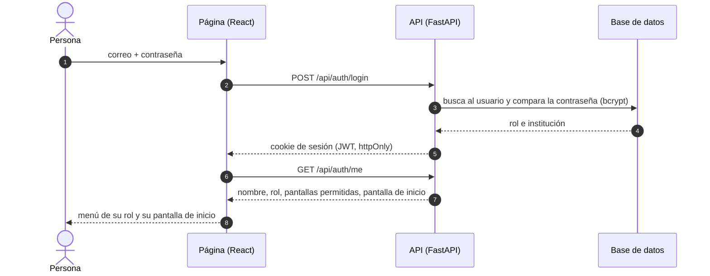

# Recorrido completo por rol, pantalla por pantalla {#cap-recorrido}

## En una frase

!!! frase "En una frase"
    **Cada persona entra con su correo y Enlaza le muestra solo lo que su papel necesita: la familia pide y sigue
    visitas, el personal las hace, el médico lee los reportes de voz, coordinación opera y aprueba, y Dirección ve
    el conjunto y decide.**

## Explicado sin tecnicismos

Piensa en un hospital: la recepcionista, la enfermera, el médico, el director y el familiar entran al mismo edificio,
pero cada uno va a un área distinta y ve papeles distintos. Enlaza es ese edificio, en una página web. Al iniciar
sesión, el sistema sabe **quién eres** (tu cuenta) y **qué papel tienes** (tu [[rol]]), y te lleva directo a tu
pantalla de inicio. El menú solo muestra las pantallas que tu rol puede abrir.

Las capturas de este capítulo son **reales**: se tomaron con el sistema funcionando, con los datos sintéticos de la
semilla, justo después de limpiar la operación con `scripts/reset_demo.py` (ver Parte V). Las horas y fechas que se
ven son las del momento de la captura. Las cuentas de prueba usan la contraseña pública de demostración `Demo2026!`
(la lista completa está en los anexos).

## Por qué lo hicimos así

- **Un menú por rol, decidido en un solo lugar.** El mapa «rol → pantallas» vive en
  `backend/app/core/roles.py`. La API se lo manda a la página al iniciar sesión y **además** revisa el rol en cada
  petición. Ocultar un botón no es seguridad: si alguien escribe a mano la dirección de una pantalla que no le toca,
  la API responde que no tiene permiso (@ref(cap-seguridad)).
- **El celular primero para familia y personal.** Quien hace visitas o cuida a un familiar usa el teléfono; por eso
  sus pantallas son de una columna, con botones grandes. Coordinación y Dirección trabajan en computadora o en el
  proyector.
- **[[Accesibilidad]].** Letra Atkinson Hyperlegible (diseñada para baja visión) a 18 px, y 24 px en el
  [[modo sencillo]]; contraste [[WCAG]] AA comprobado con `scripts/check_contrast.py`; botones de al menos 48 px de
  alto; y **nada se comunica solo con color**: cada estado lleva ícono y palabra («Asignada», «En espera»,
  «No cerrada»). Personas mayores y familiares con prisa no deben adivinar.
- **Todo en español, en un solo archivo.** Todos los textos de la interfaz están en `frontend/src/i18n/es.ts`
  ({{ repo.es_lines }} líneas). Ningún componente lleva español escrito adentro: así se revisan y corrigen en un
  solo lugar.
- **Alternativa descartada: una app por rol** (una para familias, otra para personal). Habría que instalar y
  mantener varias aplicaciones; una web adaptable funciona en cualquier teléfono y se comparte con un enlace o un QR.

## Cómo funciona por dentro

### Entrar: la página pública y el inicio de sesión

La página de presentación es pública y no muestra datos de nadie. Su pie dice «Prototipo académico · datos
sintéticos». El botón **Entrar** lleva a `/entrar`.

{.media}

El detalle de la cookie, la contraseña y el límite de intentos está en @ref(cap-seguridad).

### Familia: pedir, seguir y confirmar visitas

Cuenta de ejemplo: `fam-0001@ejemplo.test`, familiar de María Romero (Clínica Oriente, INS-A).

- **Próximas visitas**: lo que ya está asignado y lo que el plan de cuidado tiene programado («Programada · se
  asigna el mismo día»).
- **Solicitar servicio**: la familia elige servicio, fecha y hora. **No elige prioridad**: se usa la prioridad base
  del paciente, para que nadie marque todo como urgente.
- **Confirmar visita**: cuando la visita termina, la familia confirma que sí se hizo. Es un control de calidad que
  no depende solo de lo que dice el personal.

{.media}

{.celular}

{.media}

### Familia y personal: el asistente de voz

{.media}

Enlaza Voz (antes ORACLE-Voz) convierte la voz en texto, revisa si hay señales de emergencia y prepara un reporte
para el médico. Lo que ve la persona depende de lo que encontró:

{.media}

{.media}

{.media}

!!! cuidado "Lo que muestra esta última captura, dicho con honestidad"
    El mensaje de esa captura fue **«Hoy mi mamá comió bien y durmió su siesta.»**, que es rutinario. El
    clasificador de texto lo marcó como emergencia: es una **falsa alarma real**, no preparada. Pasa porque el
    clasificador se eligió para no perder emergencias aunque dé falsas alarmas: en el conjunto de prueba que nunca se
    usó para entrenar (holdout) detectó el {{ voz.holdout.sens }} de las emergencias, con {{ voz.holdout.fa100 }}
    falsas alarmas por cada 100 notas. Por eso existe el aviso ámbar (menos alarmante que el rojo) y una persona de
    coordinación revisa cada caso. La evaluación completa y lo que se decidió están en la Parte II.

### Personal de cuidado y enfermería: mis visitas

Cuenta de ejemplo: `cui-003@ejemplo.test` (Alejandro González, enfermería, INS-A).

- **Llegué** y **Terminé** registran la hora real (el reloj del servidor, no el del teléfono). Antes de aceptarlos,
  la API vuelve a revisar que el consentimiento de atención a domicilio siga vigente.
- **Nota de voz**: el mismo asistente de voz, ya con el paciente elegido.
- Si una visita dura más que un turno legal, la cubren dos personas en **relevo**; cada una ve su parte («Te
  releva…» / «Relevas a…»). Se explica en la Parte II.

{.celular}

### Medicina: reportes de voz y pacientes

Cuenta de ejemplo: `cui-001@ejemplo.test` (Laura Medina, médica de INS-A).

- El reporte lo escribe un [[modelo de lenguaje]] ([[LLM]]) que corre en la misma laptop (Ollama). **Nunca
  diagnostica**: resume lo que se dijo para que el médico decida.
- El médico solo ve **sus** pacientes (los que tiene o tuvo asignados) y solo si hay consentimiento de datos de salud.
- Desde la ficha del paciente puede **ajustar el plan de cuidado** (servicio y veces por semana). El plan viejo no se
  borra: termina y uno nuevo lo reemplaza, y todo queda en la bitácora.

### Coordinación: el centro de la operación

Cuenta de ejemplo: `coordinacion.a@ejemplo.test` (Coordinación Clínica Oriente, INS-A).

El tablero es la pantalla más importante de la demostración:

- **«¿Quién espera más?»**: la solicitud que lleva más tiempo esperando; si es de prioridad alta, el botón
  **Revisar y aprobar** lleva a Aprobaciones.
- **Alertas** agrupadas por tipo: franjas sin personal, turnos que exceden la jornada legal, visitas no cerradas,
  notas de voz por revisar.
- **Mapa** con calles (OpenStreetMap): cada punto tiene **forma y palabra** (triángulo = en espera, círculo =
  asignada), y la lista de abajo repite la información para quien no ve bien el mapa.
- El indicador **«En vivo»** cambia a «Reconectando…» si se pierde la conexión (@ref(cap-arquitectura)).

Esa solicitud se creó desde el panel de demostración («Crear solicitud urgente»). Si es urgente y nadie responde en
{{ cfg.auto_apply_after }}, se aplica el candidato propuesto («aprobada por tiempo»), se avisa a coordinación y queda en
la bitácora. Mientras espera, el horario del candidato queda **reservado** durante {{ cfg.hold_minutes }} para que una
solicitud rutinaria no se lo gane.

Coordinación también ve Panorama-AM, la simulación y la contingencia de su institución (abajo, con Dirección), y
`/privacidad`, donde registra o revoca consentimientos.

{.celular}

### Dirección: el conjunto, la simulación, el negocio y la demostración

Cuenta de ejemplo: `owner@ejemplo.test` (Dirección Enlaza). Es el único rol que ve **todas** las instituciones.

### Mapa completo de pantallas por rol

| Pantalla | Ruta | Dirección | Coordinación | Medicina | Cuidado | Familia |
|---|---|:-:|:-:|:-:|:-:|:-:|
| Tablero en vivo | `/tablero` | | ✔ | | | |
| Aprobaciones | `/aprobaciones` | | ✔ | | | |
| Pacientes y ficha | `/pacientes`, `/pacientes/:id` | | ✔ | ✔ | | |
| Personal | `/personal` | | ✔ | | | |
| Mis visitas | `/mis-visitas` | | | ✔ | ✔ | |
| Familia | `/familia` | | | | | ✔ |
| Voz | `/voz` | | | | ✔ | ✔ |
| Reportes de voz | `/reportes-voz` | | | ✔ | | |
| Panorama-AM | `/panorama` | ✔ | ✔ | | | |
| Simulación | `/simulacion` | ✔ | ✔ | | | |
| Contingencia | `/contingencia` | ✔ | ✔ | | | |
| Negocio | `/negocio` | ✔ | | | | |
| Privacidad | `/privacidad` | ✔ | ✔ | ✔ | ✔ | ✔ |
| Panel de demostración | `/demo` | ✔ | | | | |

El médico también ve «Mis visitas» porque los médicos hacen consultas a domicilio.

## Dónde está en el código

| Qué | Dónde |
|---|---|
| Qué pantallas puede abrir cada rol y su pantalla de inicio | `backend/app/core/roles.py` |
| Rutas de la página y protección por rol | `frontend/src/App.tsx` |
| Cada pantalla | `frontend/src/pages/*Page.tsx` (por ejemplo `BoardPage.tsx`, `FamilyPage.tsx`, `VoicePage.tsx`) |
| Componentes comunes (botones, tarjetas, mapa) | `frontend/src/components/` (`ui.tsx`, `StreetMap.tsx`) |
| Todos los textos | `frontend/src/i18n/es.ts` |
| Modo sencillo | `frontend/src/auth/simpleMode.ts` |
| Pruebas de navegador (formularios, gráficas, encabezado) | `frontend/scripts/ui_checks.mjs` |
| Las capturas de este libro | `docs/biblia/build/capture.cjs` |

## Números clave

{{ tabla seed.users seed.users_owner seed.users_coordinator seed.users_physician seed.users_caregiver seed.users_family repo.pages repo.es_lines cfg.auto_apply_after cfg.hold_minutes cfg.escalate_after }}

## Limitaciones honestas

- **Hay una cuenta por rol de ejemplo, no gestión de usuarios.** No existe una pantalla para dar de alta cuentas
  nuevas: las {{ seed.users }} cuentas vienen en la semilla.
- **El mapa necesita internet** para las calles; sin él cae a un mapa simple de alcaldías con un aviso.
- **El micrófono solo funciona con https o en la propia laptop** (regla de los navegadores). Por el enlace de
  Cloudflare sí hay https; en una red local sin https se puede escribir el mensaje.
- **El aviso ámbar puede aparecer con mensajes rutinarios** (la captura lo muestra): es el costo de no perder
  emergencias, y por eso lo revisa una persona.
- **La familia no elige la prioridad.** Es a propósito, pero una familia con una urgencia real debe llamar al 911 o
  usar la voz, no el formulario.

## Preguntas que te pueden hacer

!!! pregunta "¿Cómo sabe el sistema qué mostrarle a cada persona?"
    Al iniciar sesión la API lee el rol de la cuenta y responde con la lista de pantallas permitidas y la pantalla de
    inicio, tomadas de `backend/app/core/roles.py`. Pero el menú no es la seguridad: cada ruta de la API vuelve a
    revisar el rol, y la base de datos solo entrega filas de la institución de la sesión.

!!! pregunta "¿Por qué la familia no puede elegir la prioridad?"
    Porque todo el mundo marcaría «alta». Se usa la prioridad base del paciente, que depende de su estado de salud.
    Lo urgente de verdad entra por la voz (que puede dar la pantalla 911) o por coordinación.

!!! pregunta "¿Qué pasa si el médico intenta ver a un paciente que no es suyo?"
    La API responde que está fuera de su alcance (403) y deja el intento en la bitácora (`blocked_out_of_scope`).
    Lo mismo un cuidador con visitas ajenas o un familiar con otro paciente.

!!! pregunta "¿Las capturas son reales o son diseños?"
    Reales. Las tomó un script (`docs/biblia/build/capture.cjs`) con un navegador de verdad, entrando con cada cuenta
    después de limpiar la operación. Algunas muestran acciones hechas solo para la captura (una solicitud urgente,
    notas de voz); al terminar se vuelve a limpiar todo con `reset_demo.py`.

!!! pregunta "¿Por qué la nota «comió bien y durmió su siesta» dio un aviso de emergencia?"
    Porque el clasificador de texto tiene falsas alarmas: se ajustó para no perder emergencias. Por eso no se muestra
    la pantalla roja (esa es solo para reglas), sino un aviso ámbar con los signos concretos de peligro, y una persona
    de coordinación revisa el caso. Lo decimos abiertamente porque es la decisión ética que tomamos: preferimos una
    falsa alarma revisada a una emergencia perdida.

!!! pregunta "¿Es accesible para personas mayores?"
    Se diseñó para eso: letra para baja visión, modo sencillo de 24 px, contraste AA comprobado con un script,
    botones grandes, textos cortos y estados con ícono y palabra, nunca solo con color. Lo que no hicimos es probarlo
    con personas mayores reales; sería el siguiente paso.

!!! pregunta "¿Qué hace exactamente el panel de demostración? ¿No es trampa?"
    Solo cambia datos de entrada: sube las lecturas de PM2.5 de unas estaciones, agrega tráfico o pone a alguien fuera
    de servicio. Lo que pasa después (detectar la contingencia, proponer ajustes, reasignar) lo hace el sistema igual
    que en la operación real, y todo queda marcado `origin='demo_scenario'` para no mezclarlo con lo real.
