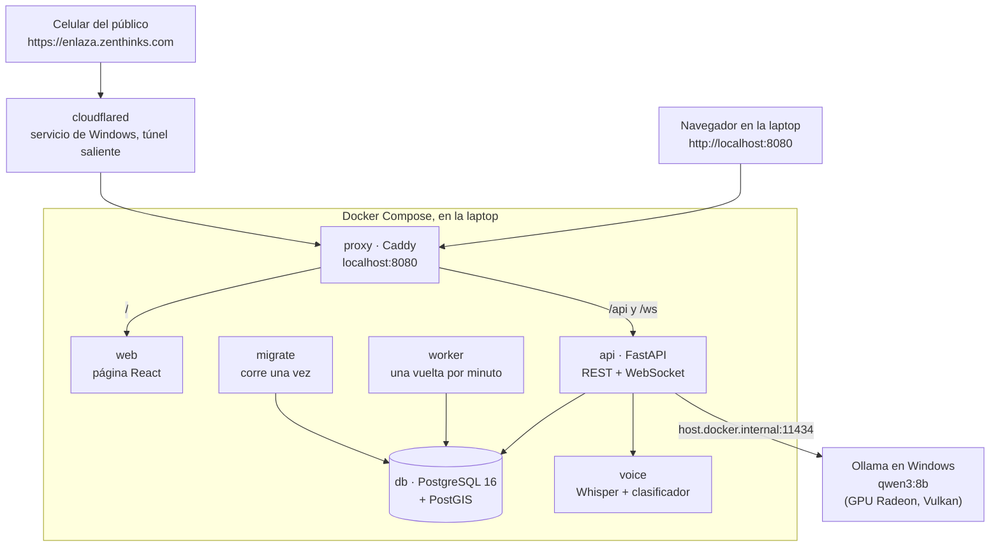
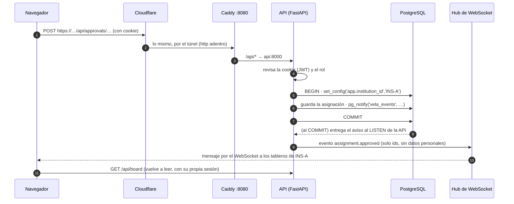
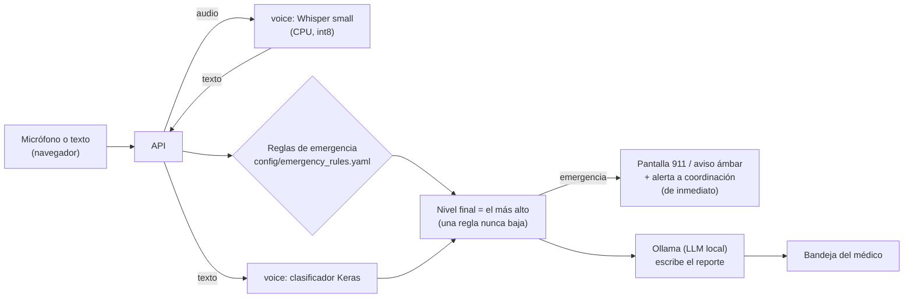

# Arquitectura: de lo simple a lo técnico {#cap-arquitectura}

## En una frase

!!! frase "En una frase"
    **Enlaza son varios programas pequeños que corren juntos en la laptop dentro de Docker (base de datos, API,
    worker, página web, voz y un portero que los une en un solo puerto), más dos piezas fuera de Docker: la
    inteligencia artificial local (Ollama con {{ mod.llm_nombre }}) y el túnel de Cloudflare que lo publica en internet,
    en {{ ops.public_url }}.**

## Explicado sin tecnicismos

Imagina un **restaurante**:

| En el restaurante | En Enlaza | Qué hace |
|---|---|---|
| El comedor, el menú y las mesas | La **página web** (frontend, React) | Lo que la persona ve y toca en su navegador |
| El mesero | La **[[API]]** (FastAPI) | Recibe cada pedido de la página, revisa que esté permitido y trae la respuesta |
| La bodega con su libreta de inventario | La **base de datos** (PostgreSQL) | Guarda todo: pacientes, solicitudes, visitas, bitácora |
| El ayudante de cocina que cada minuto revisa pendientes | El **[[worker]]** | Una vuelta por minuto: crea visitas del plan, reintenta la cola, revisa el aire, crea alertas |
| La campanita que suena cuando sale un plato | El **[[WebSocket]]** | Avisa al tablero, al instante, que algo cambió |
| El capitán de meseros en la puerta | **Caddy** ([[proxy inverso]]) | Una sola puerta de entrada que manda a cada quien a donde va |
| Quien toma los recados por teléfono y los escribe | **Whisper** (servicio de voz) | Convierte la voz en texto |
| El chef que escribe un resumen para el doctor | **Ollama** con **{{ mod.llm_nombre }}** (modelo de lenguaje local) | Escribe el reporte de la nota de voz |
| El letrero con la dirección del restaurante | El **[[dominio]]** `enlaza.zenthinks.com` | Un nombre fácil de recordar que no cambia |
| El repartidor que lleva el restaurante a otra ciudad | **Cloudflare** ([[túnel]]) | Hace que el público entre desde su celular, por internet, sin abrir puertas de la casa |

Y todo el restaurante cabe en una **lonchera**: [[Docker]]. Docker empaqueta cada programa con lo que necesita, de modo
que se enciende igual en cualquier computadora con un solo comando: `docker compose up -d`.

## Por qué lo hicimos así

| Decidimos | En lugar de | Por qué |
|---|---|---|
| **Docker Compose**: cada pieza en su contenedor | Instalar Python, PostgreSQL, Node y Caddy directamente en Windows | Se enciende igual en cualquier laptop del equipo; nadie pelea con versiones. Si algo se rompe, se borra el contenedor y se vuelve a crear. |
| **PostgreSQL** con PostGIS | SQLite, MySQL o archivos Excel | PostgreSQL tiene **seguridad por fila** (la base misma separa a las instituciones), restricciones que impiden traslapes de horario, `LISTEN/NOTIFY` para avisos en tiempo real y PostGIS para mapas. SQLite no tiene nada de eso. |
| **FastAPI** (Python) | Django, Node.js | El equipo solo sabe Python. FastAPI es simple, valida datos automáticamente (Pydantic) y maneja WebSockets. |
| **React + Vite + TypeScript** para la página | Plantillas HTML de Python | Pantallas que se actualizan solas (tablero en vivo), mapas (MapLibre) y gráficas (ECharts). TypeScript avisa errores antes de correr. |
| **WebSocket** para el tiempo real | Server-Sent Events (SSE) o recargar cada pocos segundos | Los túneles rápidos de Cloudflare **no soportan SSE**. Recargar a cada rato gasta y llega tarde. El WebSocket deja una línea abierta por la que el servidor avisa en cuanto pasa algo. |
| **Un solo puerto** (8080) detrás de Caddy | Exponer la página en un puerto y la API en otro | Un solo túnel de Cloudflare alcanza para todo, y la página y la API comparten dirección (las cookies funcionan sin trucos). |
| **Túnel de Cloudflare** | Abrir puertos del router, rentar un servidor | Gratis, con https automático, sin tocar el módem de la escuela. El túnel lo abre la laptop **hacia afuera**. |
| **IA local** (Ollama y Whisper en la laptop) | APIs de pago en la nube | Costo cero y las notas de voz **no salen de la computadora**. El precio es que el reporte tarda decenas de segundos; por eso la pantalla 911 no lo espera. |
| **Ollama en Windows** (fuera de Docker) | Ollama dentro de un contenedor | En Windows, Ollama usa la GPU integrada Radeon de la laptop (backend Vulkan); dentro de WSL2/Docker solo tendría CPU y sería mucho más lento. Los contenedores lo alcanzan en `host.docker.internal:11434`. |
| Servicio de **voz aparte** (`voice`) | Meter Whisper y TensorFlow dentro de la API | Esas librerías pesan varios GB; separadas, la API sigue ligera y arranca rápido, y si la voz falla, el resto sigue funcionando. |

## Cómo funciona por dentro

### Las piezas y cómo se conectan

### Los servicios de Docker Compose, uno por uno

| Servicio | Imagen | Qué hace | ¿Puerto público? |
|---|---|---|---|
| `db` | `postgis/postgis:16-3.4` | La base de datos. La primera vez carga el esquema y la semilla (`infra/db-init.sh` → `database/sql/001…005`) | Solo `127.0.0.1:5432` (la propia laptop) |
| `migrate` | la del backend | Aplica las [[migraciones]] de Alembic como dueño de las tablas y se apaga | No |
| `api` | la del backend (`python:3.12-slim`) | FastAPI: rutas `/api/...`, WebSocket `/ws/board`, reglas de negocio | No (solo por Caddy) |
| `worker` | la del backend | El ciclo de cada minuto | No |
| `web` | `node:22` para compilar, luego Caddy | Sirve la página React ya compilada | No |
| `voice` | `python:3.12-slim` + faster-whisper + TensorFlow | Transcribe y clasifica (puerto interno 8001) | No |
| `proxy` | `caddy:2` | La única puerta: `localhost:8080` | Sí, solo en la laptop |
| `sim` | la de simulación | SIRAG-D, se corre a mano (`docker compose run --rm sim`) | No |

Fuera de Docker: **Ollama** (Windows nativo, con {{ mod.llm_nombre }}) y **cloudflared** (el túnel, como servicio de Windows).

!!! nota "Por qué `api` y `worker` no conocen la contraseña del dueño de la base"
    Solo `db` y `migrate` reciben la contraseña de `vela_owner`, el dueño de las tablas. La API y el worker se
    conectan como `vela_api`, un usuario **sujeto a la seguridad por fila**. Si alguien encontrara un error en la API,
    ni así podría saltarse el aislamiento entre instituciones (@ref(cap-seguridad)).

### Una petición, de punta a punta

Qué pasa cuando la coordinadora aprueba una asignación desde su celular, por el enlace público:

Tres ideas clave de ese diagrama:

1. **El aviso sale solo si el cambio se guardó.** `pg_notify` dentro de una transacción se entrega al hacer
   [[COMMIT]]; si algo falla y se deshace, no hay aviso falso.
2. **El aviso no lleva datos personales**, solo el tipo de evento, la institución e identificadores. El tablero, al
   recibirlo, vuelve a pedir los datos por la API, con toda su seguridad. El WebSocket no es una segunda puerta.
3. **Cada institución solo oye lo suyo.** El Hub reparte cada evento solo a los tableros de esa institución;
   Dirección los recibe todos.

### El tiempo real, con números

- El WebSocket manda un `ping` cada {{ code.ws_ping }}, porque Cloudflare cierra las conexiones que pasan un rato sin
  tráfico (`backend/app/ws/board.py`).
- Cada {{ code.ws_recheck }} el servidor vuelve a revisar en la base que la sesión siga válida.
- Si la conexión se cae, la página muestra «Reconectando…» y reintenta cada {{ code.ws_retry_s }}; al volver, recarga
  todo.
- Del COMMIT al mensaje en el navegador, por el túnel: {{ man.evento_tunel_s }} (medición manual; el criterio de
  aceptación A4 de `docs/spec/10` pide menos de 2 s).
- Si PostgreSQL se reinicia, la API vuelve a escuchar en {{ man.reconexion_listen_s }} y pide a todos los tableros
  que recarguen (`board.resync`).

### El reloj real

Enlaza no tiene reloj simulado: usa la hora real de la Ciudad de México (`America/Mexico_City`). La página pide la
hora al servidor (`GET /api/time`), calcula la diferencia con el reloj del dispositivo y avanza cada segundo, así
que un celular con la hora mal puesta igual muestra la hora correcta. Las llegadas y salidas usan
`clock_timestamp()` de PostgreSQL, que es la hora del instante exacto (y no `now()`, que en PostgreSQL es la hora en
que **empezó** la transacción).

### El worker: el ayudante que da una vuelta cada minuto

Cada {{ code.worker_tick }}, alineado al inicio de cada minuto, el worker (`backend/app/worker.py`) hace, en este
orden:

1. asegura que haya lecturas de calidad del aire del momento y **detecta contingencias**;
2. crea las solicitudes del **plan de cuidado** que ya toca publicar ({{ code.care_plan_release_h }} antes de la visita);
3. **reintenta la cola** (solicitudes sin personal todavía);
4. aplica «aprobada por tiempo» a las urgentes sin respuesta;
5. crea alertas de espera y marca «sin atender» lo que ya pasó la tolerancia;
6. alertas de **jornada legal** y de **cobertura** de la semana;
7. **escala a Dirección** las revisiones de voz que nadie atendió;
8. marca **«No cerrada»** la visita que nadie terminó.

Si una vuelta falla, la siguiente lo vuelve a intentar: el worker nunca se detiene por un error.

### La voz y la inteligencia artificial

Enlaza Voz usa **tres modelos**, cada uno para una sola cosa (el detalle, en @ref(cap-voz)):

| Modelo | Qué hace | Tamaño | Dónde corre | Tiempo medido en la laptop |
|---|---|---|---|---|
| **Whisper {{ mod.whisper_modelo }}** | Voz → texto ([[ASR]]) | {{ ctx.whisper_small_params }} parámetros, {{ mod.whisper_tipo }} | contenedor `voice`, CPU | nota de ~10 s: {{ voz.t_transcribe_10 }} |
| **Clasificador de Keras** | Texto → rutina, urgente o emergencia | {{ mod.clasificador_parametros }} parámetros | contenedor `voice`, CPU | {{ mod.clasificador_ms }} |
| **{{ mod.llm_nombre }}** ([[modelo de lenguaje]]) | Texto → reporte para el médico, en JSON | {{ mod.llm_parametros }} parámetros, {{ mod.llm_cuantizacion }} | Ollama en Windows, GPU integrada | {{ mod.llm_gpu_reporte }} por reporte |

- Un **modelo de lenguaje** aprendió a adivinar la siguiente palabra leyendo muchísimo texto, como el teclado del celular
  que sugiere palabras, pero mucho más grande. Por eso solo **resume**: no diagnostica ni decide el nivel de emergencia.
- **{{ mod.llm_nombre }}** es del equipo Qwen de Alibaba Cloud (Yang et al., 2025), licencia Apache 2.0. En la GPU integrada
  ocupa {{ mod.llm_gpu_memoria }} de los {{ mod.laptop_ram }} de la laptop y tarda {{ mod.llm_gpu_reporte }} por reporte; en CPU,
  {{ mod.llm_cpu_reporte }}. Se le pide con el razonamiento {{ mod.llm_think }}, temperatura {{ mod.llm_temperatura }} y salida JSON
  validada. Como tarda, **nada urgente espera al modelo de lenguaje**.

### El dominio y el enlace público: {{ ops.public_url }}

**Qué es un dominio.** Es un nombre fácil de recordar que apunta a una computadora, como el nombre de una calle en lugar de
coordenadas. El equipo compró el [[dominio]] `zenthinks.com` en Cloudflare y usa solo el subdominio `enlaza`; la raíz
`zenthinks.com` queda libre.

**Qué es un túnel.** La laptop abre una conexión **hacia afuera** con Cloudflare (`cloudflared`) y la deja abierta. Cuando
alguien escribe la dirección en su celular, Cloudflare le manda la petición a la laptop por ese túnel. Por eso no hay que
abrir puertos del módem ni tener una IP fija, y Cloudflare pone el certificado https.

**Por qué no es «hosting».** Un hosting es rentar una computadora que está siempre prendida en un centro de datos. Aquí la
aplicación **corre en la laptop**: si la laptop se apaga, se suspende o pierde internet, la dirección deja de responder
(error 502 o 1033). La dirección es fija; la computadora detrás no es un servidor.

**Por qué un túnel administrado con token.** Hay dos formas de crear un [[túnel]] con nombre: con archivos de configuración en
la laptop (`cloudflared tunnel login/create/route`) o desde el panel de Cloudflare, que da un **token**. En Windows el túnel
corre como servicio del sistema, que busca sus archivos en una carpeta escondida; con el token todo va dentro del servicio y
la regla «`enlaza.zenthinks.com` → `http://127.0.0.1:8080`» vive en Cloudflare, así que se cambia sin tocar la laptop. Es la
forma más estable. El token es una llave: no se sube a Git.

**Arranque automático.** Para que funcione con solo prender la laptop e iniciar sesión en Windows:

| Pieza | Cómo arranca |
|---|---|
| Túnel `enlaza` | servicio de Windows `cloudflared`, automático desde que prende la laptop |
| Docker Desktop | «Start Docker Desktop when you sign in» |
| Contenedores | `restart: unless-stopped` en `docker-compose.yml` |
| Ollama ({{ mod.llm_nombre }}) | acceso directo en la carpeta Inicio de Windows |
| Tarea «Enlaza - arranque» | {{ code.autostart_delay }} después de iniciar sesión corre `scripts/autostart.sh`: espera a Docker, revisa que cada contenedor vea sus archivos y reinicia los que no |
| Tarea «Enlaza - reloj de WSL» | copia la hora de Windows a WSL al iniciar sesión, al despertar y cada {{ code.clock_task_min }}; evita el «Inicia sesión para continuar» por el reloj atrasado |

**Lo que encontró el primer reinicio** (25 nov 2026). En la primera prueba de apagar y prender la laptop:
{{ hist.reinicio1_carrera }}. La causa es una **carrera**: Docker Desktop levanta los contenedores antes de que
Ubuntu (WSL) termine de arrancar, y lo que cada contenedor toma de la carpeta del proyecto sale vacío o falla.
`restart: unless-stopped` no lo cubre, porque Docker no reintenta un contenedor que ni siquiera se pudo crear. Lo más
peligroso: `api` se veía «sana» sin las reglas de emergencia. Se corrigió con la tarea «Enlaza - arranque»; en el segundo
reinicio quedó {{ hist.reinicio2_reparado }}, y la prueba completa por la dirección pública dio {{ hist.prueba_publica }}.

**https afuera, http adentro.** El público entra por https; dentro de la laptop todo viaja por http. Para que la API sepa que
la persona entró por https (y marque la cookie como `Secure`), se usan dos señales: el encabezado `Cf-Visitor` que agrega
Cloudflare y `X-Forwarded-Proto`, que Caddy respeta solo si viene de una dirección privada (`trusted_proxies static
private_ranges` en `infra/Caddyfile`). La revisión de `Origin` del WebSocket compara contra el dominio que pidió el
navegador, así que el dominio nuevo funcionó **sin cambiar código**.

**Plan B: el túnel rápido.** Si la dirección fija falla, `bash scripts/enlaza.sh rapido` abre un túnel rápido
(`https://palabras-al-azar.trycloudflare.com`, sin cuenta ni dominio) y `uv run scripts/make_qr.py <enlace>` hace su QR.
Cambia cada vez que se abre y no garantiza disponibilidad; sirve para salir del paso (@ref(cap-planb)).

**Trabajo futuro: que funcione con la laptop apagada.** Haría falta un **servidor en la nube** (una máquina virtual o un
servicio de contenedores) con la base de datos administrada, respaldos automáticos y monitoreo; el mismo
`docker-compose.yml` serviría de punto de partida. El modelo de lenguaje necesitaría una GPU en ese servidor o un servicio
con contrato de privacidad, porque las notas de voz son datos sensibles. El costo de ese servidor está en el modelo de negocio
(@ref(cap-negocio)).

## Dónde está en el código

| Qué | Dónde |
|---|---|
| Todos los servicios | `docker-compose.yml` |
| La puerta única | `infra/Caddyfile` |
| Carga inicial de la base | `infra/db-init.sh`, `database/sql/001_schema.sql` … `005_postgis.sql` |
| Cambios de esquema posteriores | `backend/migrations/versions/` ({{ repo.migrations }} migraciones) |
| Arranque de la API | `backend/app/main.py` |
| Conexión y sesión por institución | `backend/app/core/db.py` |
| WebSocket del tablero y su Hub | `backend/app/ws/` |
| El worker | `backend/app/worker.py` |
| Servicio de voz | `voice/triage/service.py`, `voice/Dockerfile` |
| Reporte con Ollama ({{ mod.llm_nombre }}) | `backend/app/services/llm_report.py` |
| Enlace público y arranque automático | `scripts/enlaza.sh`, `scripts/autostart.sh`, `scripts/windows/`, `scripts/check_public_url.py` |
| Variables (sin secretos) | `.env.example` (el `.env` real no se sube a Git) |
| Arquitectura en la especificación | `docs/spec/02_arquitectura.md`, `docs/dev/decisiones_paso_4.md` |

## Números clave

{{ tabla ops.public_url code.worker_tick code.ws_ping code.ws_recheck code.ws_retry_s man.evento_tunel_s man.reconexion_listen_s voz.t_whisper_load voz.t_transcribe_10 mod.llm_nombre mod.llm_gpu_memoria mod.llm_gpu_reporte mod.llm_cpu_reporte mod.laptop_ram code.clock_task_min repo.migrations db.tables_total db.views_total }}

## Limitaciones honestas

- **Todo depende de una laptop.** {{ ops.public_url }} es una dirección fija, no un hosting: si la laptop se apaga o se
  suspende, se apaga Enlaza. Un producto real necesitaría un servidor en la nube, respaldos automáticos y monitoreo.
- **El arranque automático depende de iniciar sesión en Windows**: Docker Desktop y Ollama arrancan con la sesión, no con la
  laptop.
- **El LLM es lento** en una laptop (decenas de segundos por reporte). Para muchas notas a la vez haría falta una GPU
  dedicada o un servicio en la nube con contrato de privacidad.
- **WSL2 tiene su propio reloj**, que a veces se atrasa cuando Windows suspende la máquina. Eso causó un error
  intermitente de sesión que ya se corrigió (@ref(cap-bitacora)).
- **El tiempo de un evento por el túnel se midió a mano una vez**, no de forma continua.

## Preguntas que te pueden hacer

!!! pregunta "¿Por qué Docker?"
    Porque así todo se enciende igual en cualquier laptop con un comando (`docker compose up -d`): la base de datos,
    la API, el worker, la página, la voz y el proxy, cada uno con sus versiones exactas. Sin Docker cada integrante
    tendría que instalar y configurar PostgreSQL, Python, Node y Caddy a mano.

!!! pregunta "¿Por qué WebSocket y no que la página pregunte cada cinco segundos?"
    Preguntar cada cinco segundos llega tarde y gasta: treinta personas en la defensa harían cientos de peticiones
    por minuto. Con WebSocket la conexión queda abierta y el servidor avisa en cuanto algo se guarda. Y no usamos
    Server-Sent Events porque los túneles rápidos de Cloudflare no los soportan.

!!! pregunta "¿Qué es un proxy inverso y para qué sirve Caddy?"
    Es un programa que recibe todas las peticiones en una sola puerta y las reparte: lo que empieza con `/api` va a
    la API, `/ws` al WebSocket y todo lo demás a la página. Gracias a eso hay un solo puerto (8080), un solo túnel y
    una sola dirección para todo.

!!! pregunta "¿Los datos de voz salen de la laptop?"
    No. Whisper corre en un contenedor de la laptop y el modelo de lenguaje corre en Ollama, también en la laptop.
    Ninguna nota se manda a un servicio externo. Lo único que pasa por Cloudflare es el tráfico cifrado (https) entre
    el celular y la laptop.

!!! pregunta "¿Enlaza está en la nube?"
    No. {{ ops.public_url }} es un dominio con un túnel de Cloudflare que llega a la laptop: la app corre aquí. Si la
    laptop se apaga, la dirección deja de responder. Para que funcione siempre haría falta un servidor en la nube; es trabajo
    futuro y está en el modelo de negocio.

!!! pregunta "¿Qué pasa si el servicio de voz o Ollama se caen?"
    El resto sigue funcionando. Si la voz no responde, la pantalla ofrece escribir el mensaje. Si Ollama no responde,
    la pantalla 911 y la alerta salen igual (no esperan al reporte) y el médico recibe la transcripción y el nivel,
    con el reporte marcado como fallido (`llm_report.py` guarda el estado `failed`).

!!! pregunta "¿Por qué la API no se conecta como dueña de la base de datos?"
    Porque el dueño se salta la seguridad por fila. La API usa `vela_api`, que está sujeta a ella: aunque el código
    tuviera un error, la base no le entregaría filas de otra institución. Solo el servicio `migrate` conoce la
    contraseña del dueño.

!!! pregunta "¿Qué hace el worker?"
    Es un proceso que da una vuelta por minuto, a la hora real: crea las visitas del plan de cuidado, reintenta la
    cola, aplica «aprobada por tiempo», detecta contingencias, crea alertas, escala revisiones de voz y marca visitas no
    cerradas. Si una vuelta falla, la siguiente reintenta.

!!! pregunta "¿Cuántos usuarios aguanta?"
    No hicimos una prueba de carga formal. PostgreSQL y FastAPI en la laptop sobran para cinco instituciones y unas
    decenas de personas conectadas; el límite práctico es el túnel rápido de Cloudflare y la velocidad del LLM para
    los reportes de voz. Es una limitación que decimos abiertamente.
