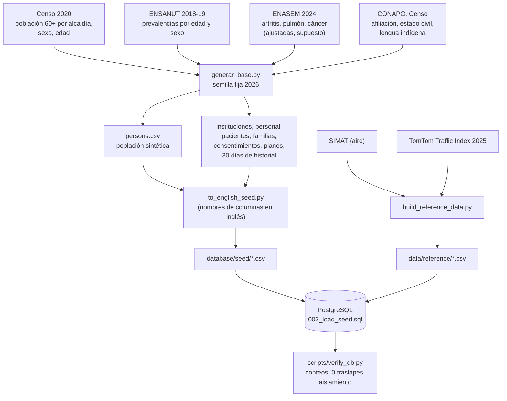

# Datos sintéticos: cómo se generaron y con qué se calibraron {#cap-datos}

## En una frase

!!! frase "En una frase"
    **Ninguna persona de Enlaza existe: un programa en Python fabricó {{ seed.persons }} personas mayores, cinco
    instituciones y un mes de historial, sorteando cada dato con probabilidades sacadas del Censo, la ENSANUT, la
    ENASEM, la red de monitoreo del aire y el índice de tráfico, de modo que el conjunto se parece a la Ciudad de México
    real.**

## Explicado sin tecnicismos

Imagina que quieres practicar cómo atender una tienda, pero no puedes usar a clientes reales. Inventas clientes
**con lógica**: si sabes que en tu colonia la mitad son mujeres y que una de cada cuatro personas mayores tiene
diabetes, al inventar 100 clientes haces que unas 50 sean mujeres y unas 25 tengan diabetes. Ningún cliente es real,
pero el **conjunto** se comporta como el de verdad.

Eso son los [[datos sintéticos]]. Y hay un detalle importante: las enfermedades no se reparten al azar una por una.
En la vida real, quien tiene hipertensión tiene más probabilidad de tener diabetes o problemas del corazón (se juntan).
Para imitar eso usamos una técnica llamada [[cópula gaussiana]]: a cada persona le damos unas «tendencias ocultas»
(una general, una cardiometabólica y una funcional) y de ellas dependen sus enfermedades. Así aparece la
[[multimorbilidad]] (tener dos o más enfermedades crónicas) en proporciones realistas.

## Por qué lo hicimos así

| Decidimos | En lugar de | Por qué |
|---|---|---|
| **Datos sintéticos** | Datos reales de una institución | Los datos de salud son sensibles (LFPDPPP 2025): exigen consentimiento expreso y por escrito. Un proyecto escolar público no debe tenerlos. Con datos sintéticos el repositorio puede ser público. |
| **Calibrar con fuentes oficiales** | Inventar porcentajes «razonables» | Regla del proyecto: todo número tiene fuente o dice «supuesto». Así un profesor puede comprobar que el mundo simulado se parece al real. |
| **Semilla fija** ({{ gen.seed }}: siempre los mismos datos) | Generar datos distintos cada vez | Cualquiera que corra el generador obtiene exactamente lo mismo: los resultados se pueden repetir y revisar. |
| **Cópula gaussiana** para las enfermedades | Sortear cada enfermedad por separado | Por separado, casi nadie tendría varias enfermedades a la vez; la multimorbilidad saldría muy baja. Con factores comunes sale cercana a la ENSANUT. |
| **Pacientes con sesgo de selección** | Pacientes al azar de la población | Quien recibe cuidado institucional suele ser mayor y más dependiente. Elegir al azar daría pacientes demasiado sanos. Los pesos del sesgo son un **supuesto** documentado. |
| **Un mes de historial con un {{ seed.requests_unattended_pct }} sin atender** | Historial perfecto | El historial representa la operación «antes de Enlaza»: con huecos, a propósito, para tener contra qué comparar. |

## Cómo funciona por dentro

### Paso 1. La población: {{ seed.persons }} personas de 60 años o más

El generador (`data/generator/legacy_es/generar_base.py`, escrito originalmente en español) hace, para cada persona:

1. **Alcaldía**, sorteada en proporción a su población de 60+ del Censo 2020 (Iztapalapa tiene más peso que Milpa
   Alta). Le da una ubicación aproximada dentro de la alcaldía.
2. **Edad y sexo**, con las proporciones del Censo 2020 para la CDMX, ajustadas por grupo de edad con la ENASEM 2024.
3. **Enfermedades**, con la cópula gaussiana: tres factores comunes (general {{ gen.load_general }}, cardiometabólico {{ gen.load_cardio }}, funcional
   {{ gen.load_functional }}) más un componente propio. Para cada enfermedad, el umbral se fija para que la proporción coincida con la
   ENSANUT de su edad y sexo.
4. **Estado cognitivo**, **dependencia** (independiente, leve, moderada o severa, con una regla documentada),
   **afiliación a servicios de salud**, **estado civil** y **lengua indígena** (proporcional a cada alcaldía).
5. **Nombre y fecha de nacimiento** ficticios, de listas de nombres comunes.

!!! ejemplo "La idea de la cópula, con números chicos"
    Supón que una persona tiene alto el factor cardiometabólico. Entonces su «puntaje oculto» de hipertensión, de
    diabetes y de colesterol sale más alto de lo normal, y es más fácil que pase el umbral de las tres. Otra persona
    con el factor bajo probablemente no tendrá ninguna. Así, sin decirlo explícitamente, las enfermedades se agrupan
    como en la realidad.

### Paso 2. Las instituciones, el personal y los pacientes

- **{{ seed.institutions }} instituciones ficticias** (INS-A a INS-E): Clínica Oriente (Iztapalapa), Residencia
  Coyoacán, Centro de Día Aragón, Red Cuidar Tlalpan y Red Vecinal Iztacalco; unas de día y otras de 24 horas.
- **{{ seed.caregivers }} personas de personal**: {{ seed.caregivers_nurse }} de enfermería, {{ seed.caregivers_caregiver }}
  de cuidado, {{ seed.caregivers_therapist }} de terapia y {{ seed.caregivers_physician }} médicos, con turnos y una base.
- **{{ seed.patients }} pacientes**, elegidos de la población de la alcaldía de cada institución, **con sesgo de
  selección**: es más probable que entre quien tiene más dependencia, más enfermedades y más edad (pesos =
  **supuesto**). Cada paciente tiene un familiar responsable y **tres consentimientos** (datos de salud, atención a
  domicilio y asistente de voz), en total {{ seed.consents }}.
- **{{ seed.care_plans }} planes de cuidado**: qué servicio necesita cada paciente y cuántas veces por semana.
- **{{ seed.services }} servicios** con precios de referencia de mercado (consulta geriátrica, visita de enfermería,
  turnos de 8 y 12 horas, terapia, atención respiratoria, toma de muestras…).

El efecto del sesgo de selección se ve claramente:

| Grupo | En la población | Entre los pacientes |
|---|---|---|
| Dependencia severa | {{ cal.dep_pop_severe }} | {{ cal.dep_pat_severe }} |
| Dependencia moderada | {{ cal.dep_pop_moderate }} | {{ cal.dep_pat_moderate }} |
| Independientes | {{ cal.dep_pop_independent }} | {{ cal.dep_pat_independent }} |
| 80 años o más (aprox.) | {{ cal.pct_80plus }} | {{ cal.pct_80plus_patients }} |

### Paso 3. El historial: {{ seed.history_days }} días de operación «antes de Enlaza»

A partir de los planes de cuidado se sortea cuántas visitas tuvo cada paciente en el mes (distribución de
[[Poisson]] con la frecuencia del plan) y a qué hora. Luego un asignador simple reparte las visitas entre el personal
con la habilidad, sin traslapes y con {{ gen.travel_gap }} de traslado entre visitas. Si nadie puede, la visita queda
**«No atendida (sin personal disponible)»**. Se agregan retrasos al azar, cancelaciones de la familia y
confirmaciones.

Resultado: {{ seed.service_requests }} solicitudes y {{ seed.assignments }} asignaciones (unas {{ seed.requests_per_day }}
al día). El {{ seed.requests_unattended_pct }} quedó sin atender ({{ seed.requests_unattended }} solicitudes) y
{{ seed.requests_cancelled }} se cancelaron. De las asignaciones, {{ seed.assign_auto }} fueron automáticas y
{{ seed.assign_coordinator }} aprobadas por coordinación.

!!! nota "Los traslapes «planeados» que no son error"
    Si se mide el historial con la hora **planeada**, hay {{ gen.planned_overlaps }} pares de visitas del mismo cuidador que se cruzan; con la
    hora **real** de llegada y salida, ninguno. Es historial con retrasos y visitas que se recorrieron: realista. Por
    eso la regla «nunca hay traslapes» la garantiza la base de datos para toda asignación **nueva** (con una
    restricción `EXCLUDE`, @ref(cap-operacion)), y `verify_db.py` comprueba 0 traslapes con los horarios reales.

### Paso 4. Aire y tráfico

- **Calidad del aire** ({{ ref.air_stations }} estaciones, {{ ref.air_rows }} lecturas horarias de O₃ y PM2.5):
  serie sintética calibrada con reportes de la red de monitoreo de la CDMX (SIMAT), con episodios parecidos a los
  reales. El máximo horario de ozono en la serie es {{ ref.air_o3_max }} y el de PM2.5 {{ ref.air_pm25_max }}. Las
  coordenadas de las estaciones son aproximadas (`location_source = approximate`) hasta descargar el catálogo oficial.
- **Tráfico** ({{ ref.traffic_rows }} filas: cada hora, laborable y fin de semana): perfil construido para que la
  congestión promedio de un día laborable, de 6 a 22 h, sea la del índice de TomTom 2025 para la CDMX
  ({{ ref.traffic_day_mean }}). En la hora más lenta la velocidad promedio es {{ ref.traffic_peak_speed }}, frente a
  {{ ref.traffic_free_speed }} sin tráfico.

### Paso 5. Fechas vivas

El historial se generó con fechas fijas (octubre–noviembre de 2026). Para que siempre parezca «el mes pasado», el
script `scripts/rebase_dates.py` lo mueve por **semanas completas** (así se conserva el día de la semana) hasta
dejarlo terminando unos días antes de ayer. No toca la bitácora, que es cronología real.

### ¿Se parece a la realidad? La calibración, comprobada

Cada valor de esta tabla se recalcula al generar este libro, desde `database/seed/persons.csv` y
`data/reference/prevalence_reference.csv`:

| Condición | Referencia oficial | Población sintética |
|---|---|---|
| Diabetes (ENSANUT) | {{ cal.ref_diabetes }} | {{ cal.syn_diabetes }} |
| Hipertensión (ENSANUT) | {{ cal.ref_hypertension }} | {{ cal.syn_hypertension }} |
| Colesterol alto (ENSANUT) | {{ cal.ref_high_cholesterol }} | {{ cal.syn_high_cholesterol }} |
| Enfermedad del corazón (ENSANUT) | {{ cal.ref_heart_disease }} | {{ cal.syn_heart_disease }} |
| Embolia, EVC (ENSANUT) | {{ cal.ref_stroke }} | {{ cal.syn_stroke }} |
| Enfermedad renal (ENSANUT) | {{ cal.ref_kidney_disease }} | {{ cal.syn_kidney_disease }} |
| Síntomas depresivos (ENSANUT) | {{ cal.ref_depressive_symptoms }} | {{ cal.syn_depressive_symptoms }} |
| Fragilidad (ENSANUT) | {{ cal.ref_frailty }} | {{ cal.syn_frailty }} |
| Obesidad (ENSANUT) | {{ cal.ref_obesity }} | {{ cal.syn_obesity }} |
| Artritis (ENASEM, ajustada) | {{ cal.ref_arthritis }} | {{ cal.syn_arthritis }} |
| Enfermedad pulmonar crónica (ENASEM, ajustada) | {{ cal.ref_chronic_lung_disease }} | {{ cal.syn_chronic_lung_disease }} |
| Cáncer (ENASEM, ajustada) | {{ cal.ref_cancer }} | {{ cal.syn_cancer }} |
| Multimorbilidad (ENSANUT, definición distinta) | {{ cal.ref_multimorbidity }} | {{ seed.broad_multimorbidity_pct }} (amplia) |
| Mujeres | Censo 2020 | {{ seed.women_pct }} |

!!! cuidado "Dos matices que hay que saber decir"
    1. **La ENASEM 2024 publica artritis, pulmón y cáncer «entre quienes reportaron alguna enfermedad»**, no sobre toda
       la población. Para convertirlas se multiplicaron por un factor (hipertensión ENSANUT ÷ hipertensión ENASEM entre
       quienes reportan enfermedad). Ese factor ({{ gen.enasem_factor }}) es un **supuesto** del generador, y lo decimos así.
    2. **La multimorbilidad no se compara exactamente.** La ENSANUT cuenta 2 o más de 7 condiciones específicas; nuestra
       «multimorbilidad amplia» cuenta 9 crónicas más obesidad y síntomas depresivos. Están cerca, pero la comparación es
       aproximada.

### La comprobación automática

`scripts/verify_db.py` (criterio de aceptación A1) revisa, con la base ya cargada: que cada tabla tenga exactamente
las filas de la semilla, **0 traslapes** reales por cuidador, que sin institución la API vea **0 filas** y que las
contraseñas de las cuentas de demostración verifiquen. Debe terminar con «Todo correcto».

## Dónde está en el código

| Qué | Dónde |
|---|---|
| Generador de la población y la operación | `data/generator/legacy_es/generar_base.py` |
| Traducción de columnas al inglés | `data/generator/to_english_seed.py` |
| Aire y tráfico calibrados | `data/generator/build_reference_data.py` → `data/reference/` |
| Frases de voz | `data/generator/build_triage_phrases.py` → `data/voice/` |
| Semilla que carga la base | `database/seed/*.csv`, `database/sql/002_load_seed.sql` |
| Referencias que muestra Panorama-AM | `data/reference/prevalence_reference.csv` |
| Descarga de datos oficiales (opcional) | `scripts/download_reference_data.py` |
| Fechas vivas | `scripts/rebase_dates.py` |
| Comprobación | `scripts/verify_db.py` |
| Fuentes, con enlaces | `docs/spec/09_datos.md` y el anexo de fuentes de este libro |

## Números clave

{{ tabla seed.persons seed.pop60_cdmx seed.institutions seed.patients seed.caregivers seed.consents seed.care_plans seed.service_requests seed.requests_unattended_pct seed.broad_multimorbidity_pct cal.ref_multimorbidity ref.air_rows ref.traffic_day_mean }}

## Limitaciones honestas

- **Las proporciones se parecen; los individuos no.** Cada persona sintética es plausible, pero las relaciones
  finas (por ejemplo, entre ingreso, colonia y enfermedad) no se modelaron.
- **Varios pesos son supuestos**: los factores de la cópula, el sesgo de selección de pacientes, el factor {{ gen.enasem_factor }} de la
  ENASEM, la regla de dependencia, los horarios de visita. Están documentados en el código, pero no salen de una fuente.
- **Las prevalencias de la ENSANUT son nacionales**, no de la CDMX; se usaron porque son las que se publican por edad
  y sexo.
- **Las ubicaciones son aproximadas** (un punto central por alcaldía más dispersión), no direcciones ni AGEB reales.
- **El aire y el tráfico son series sintéticas calibradas**, no las mediciones horarias oficiales de octubre de 2026.
- **El historial «antes de Enlaza» lo generó un asignador simple** que nosotros escribimos; no es el comportamiento
  real de una coordinadora.

## Preguntas que te pueden hacer

!!! pregunta "¿Cómo saben que sus datos se parecen a la realidad?"
    Porque cada proporción importante se calibró con una fuente oficial y la comparamos: diabetes {{ cal.syn_diabetes }}
    contra {{ cal.ref_diabetes }} de la ENSANUT, hipertensión {{ cal.syn_hypertension }} contra
    {{ cal.ref_hypertension }}, y así cada enfermedad. Pero solo afirmamos que se parecen **las proporciones**; no
    decimos que una persona sintética represente a alguien real.

!!! pregunta "¿Qué es una cópula gaussiana, en palabras sencillas?"
    Una forma de sortear varias cosas que están relacionadas. A cada persona se le asignan unos factores ocultos
    (salud general, cardiometabólica, funcional) y cada enfermedad depende de ellos más un poco de azar. Así quien
    tiene hipertensión tiende a tener también diabetes, como pasa en la realidad, y la multimorbilidad sale realista.

!!! pregunta "¿Por qué los pacientes están más enfermos que la población?"
    Porque es lo que pasa en la vida real: quien llega a una institución de cuidado suele ser más mayor y más
    dependiente. Por eso los elegimos con más probabilidad para quien tiene más dependencia y enfermedades. Sin ese
    sesgo, la dependencia severa entre pacientes sería la de la población ({{ cal.dep_pop_severe }}), y con él es
    {{ cal.dep_pat_severe }}. Los pesos son un supuesto y lo decimos.

!!! pregunta "Si los datos son inventados, ¿para qué sirven los resultados?"
    Para comparar alternativas dentro del mismo mundo: si dos formas de asignar se prueban con los mismos pacientes, el
    mismo personal y el mismo tráfico, la diferencia entre ellas sí dice algo. Lo que no hacemos es prometer que una
    institución real verá exactamente esos números; para eso habría que probar con datos reales y consentimiento.

!!! pregunta "¿Se pueden reproducir los datos?"
    Sí. El generador usa una semilla fija ({{ gen.seed }}): siempre produce exactamente los mismos archivos. Y la base se carga
    desde `database/seed/`, que está en el repositorio. Cualquiera puede borrar la base, volver a crearla y comprobarla
    con `verify_db.py`.

!!! pregunta "¿Por qué el historial tiene tantas solicitudes sin atender?"
    Porque representa la operación «antes de Enlaza», con huecos a propósito ({{ seed.requests_unattended_pct }}). No
    es un dato del sector: es el punto de partida del mundo sintético. Sirve para validar la simulación (SIRAG-D debe
    reproducir algo parecido con las reglas de antes) y para medir cuánto mejora cada forma de asignar.

!!! pregunta "¿Y las frases de voz también son sintéticas?"
    Sí: {{ ref.triage_phrases }} frases generadas para entrenar y probar, más {{ ref.external_phrases }} externas y
    {{ ref.holdout_phrases }} reservadas (holdout) que nunca se usaron para entrenar. Las frases que grabe el equipo
    servirán como evaluación final (pendiente). Se explica en @ref(cap-voz).
