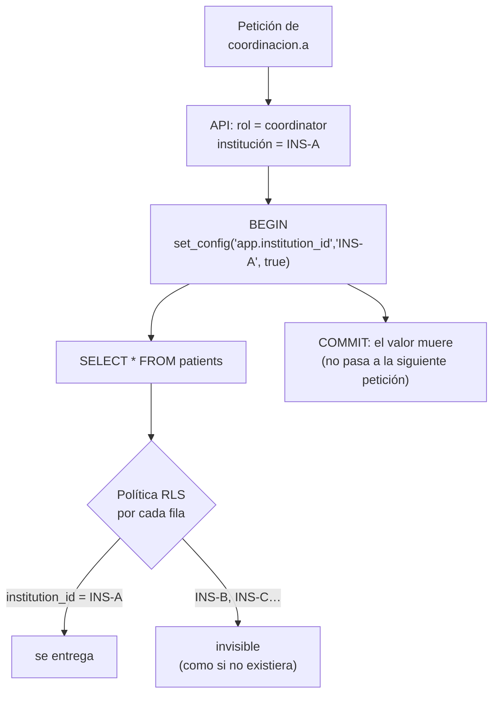
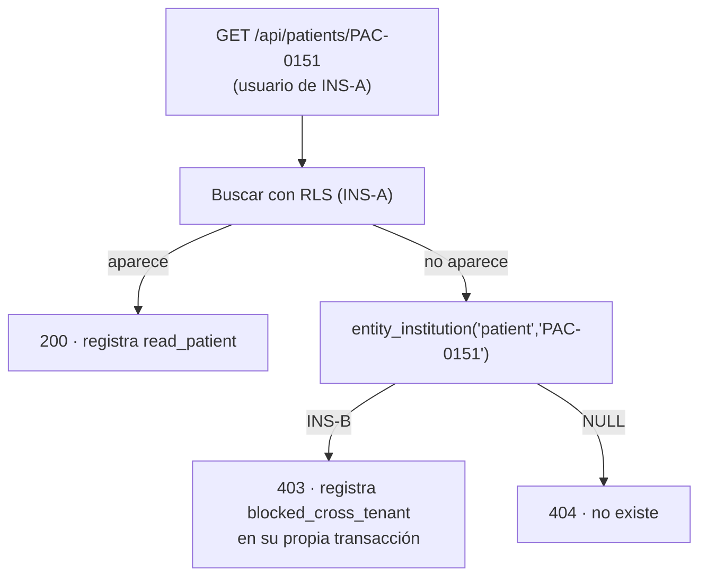

# Seguridad: sesión, roles, seguridad por fila, bitácora y consentimientos {#cap-seguridad}

## En una frase

!!! frase "En una frase"
    **Enlaza protege la información en cinco capas: una sesión segura, permisos por rol revisados en cada petición, la
    base de datos que solo entrega las filas de tu institución, una bitácora que nadie puede borrar y consentimientos
    sin los cuales no se graba voz, no se hace la visita ni se muestran datos de salud.**

## Explicado sin tecnicismos

Piensa en un edificio de oficinas compartido por cinco empresas:

1. **En la entrada te dan un gafete** con tu nombre, tu empresa y tu puesto (la **sesión**). El gafete caduca y no se
   puede copiar a mano.
2. **Cada puerta revisa tu gafete** y tu puesto: la bodega de medicamentos solo abre para enfermería (los **roles**).
3. **El archivero de cada empresa está en su propio piso y el elevador solo te lleva al tuyo.** Aunque te equivoques
   de botón, el elevador no te deja en el piso de otra empresa (la **seguridad por fila**: la base de datos misma no te
   entrega lo que no es tuyo).
4. **Una cámara graba quién abrió qué archivo y quién intentó abrir uno ajeno**, y nadie puede borrar la grabación
   (la **bitácora**).
5. **Algunos archivos solo se abren si el dueño firmó una autorización vigente** (los **consentimientos**).

La idea más importante de este capítulo: **no basta con esconder botones**. Si la seguridad estuviera solo en la
pantalla, cualquiera que supiera escribir una dirección a mano se la saltaría. En Enlaza cada capa vuelve a revisar,
y la última, la base de datos, **falla cerrada**: si algo no está claro, no entrega nada.

## Por qué lo hicimos así

| Decidimos | En lugar de | Por qué |
|---|---|---|
| **Seguridad por fila** ([[RLS]]) en PostgreSQL | Filtrar por institución en cada consulta del código (`WHERE institution_id = …`) | Basta un olvido en una consulta para mezclar instituciones. Con RLS la base filtra siempre, aunque el código se equivoque. |
| API conectada como **`vela_api`** | Conectar la API como dueña de las tablas | El dueño se salta la RLS. Un usuario que no es dueño queda sujeto a ella. |
| **Sin institución en la sesión = 0 filas** | Que sin filtro se vea todo | Falla cerrada: un error de configuración esconde datos en vez de mostrarlos. |
| Responder **403 y registrar** el intento entre instituciones | Responder 404 («no existe») | Con 404 nadie sabría que alguien lo intentó. La institución prefiere saberlo; el identificador (`PAC-0151`) no revela datos personales. Si el paciente no existe en ninguna institución, sí es 404. |
| Sesión en **cookie [[httpOnly]]** con [[JWT]] | Guardar el token en el almacenamiento del navegador | Una cookie httpOnly no la puede leer ningún código JavaScript, ni uno malicioso inyectado en la página. |
| Revisar al usuario **en la base en cada petición** | Confiar solo en el JWT hasta que caduque | Si se desactiva una cuenta o le cambian el rol, pierde el acceso en la siguiente petición, no en ocho horas. |
| Contraseñas con **[[bcrypt]]** | Guardar la contraseña tal cual o con un resumen rápido | bcrypt es lento a propósito y agrega «sal»: aunque alguien robara la tabla, adivinar contraseñas sería muy costoso. |
| Consentimiento **revisado en la API** | Solo ocultar botones en la pantalla | Regla 5 del proyecto: la API vuelve a revisar `v_consents.is_valid` antes de grabar voz, registrar una visita o mostrar datos de salud. |

## Cómo funciona por dentro

### Capa 1. La sesión

- Al entrar, la API busca al usuario y compara la contraseña con su resumen **bcrypt**.
- Si es correcta, crea un **JWT** (un texto firmado con una clave secreta del servidor, `JWT_SECRET`) que dice
  `user_id`, `role` e `institution_id`, y caduca en {{ code.jwt_hours }}. Va en una cookie `httpOnly`, `SameSite=Lax`
  y `Secure` cuando se entra por https.
- **El token no basta:** en cada petición se revisa en la base que el usuario siga activo, con el mismo rol y la
  misma institución.
- **Límite de intentos:** {{ code.login_attempts }} intentos **fallidos** por minuto por dirección IP. Solo cuentan los
  fallidos, porque en la defensa mucha gente entra desde la misma red (misma IP pública) y un inicio correcto no debe
  bloquearse.
- **Mismo mensaje** para correo inexistente y contraseña incorrecta: así no se puede averiguar qué cuentas existen.

### Capa 2. Los roles

- El mapa «rol → pantallas» está en `backend/app/core/roles.py` y cada ruta de la API declara qué roles aceptan con
  `require_role(...)` (`backend/app/core/deps.py`).
- Además del rol, hay **alcance**: coordinación ve toda su institución; el médico solo los pacientes que tiene o tuvo
  asignados; el personal solo sus visitas; la familia solo a su paciente. Fuera de alcance → **403** y
  `blocked_out_of_scope` en la bitácora.

### Capa 3. La seguridad por fila (RLS)

Cada tabla que pertenece a una institución tiene una **política** (`database/sql/004_row_level_security.sql`):

```sql
CREATE POLICY tenant_isolation ON patients
  USING (current_setting('app.institution_id', true) = '*'
         OR institution_id = current_setting('app.institution_id', true));
```

Se lee así: «una fila solo es visible si la institución de la sesión es `*` (Dirección) o es la misma de la fila».
Y en **cada petición** la API abre una transacción y fija la institución:

```sql
BEGIN;
SELECT set_config('app.institution_id', 'INS-A', true);  -- igual que SET LOCAL, pero con parámetro
SELECT ... FROM patients ...;                            -- solo ve los de INS-A
COMMIT;                                                  -- el valor desaparece aquí
```



Lo que eso produce, medido **ahora**, al generar este libro, con el mismo usuario `vela_api` que usa la API:

| La API consulta `patients`… | Filas que ve |
|---|---|
| sin institución en la sesión | {{ db.rls_patients_none }} |
| con `INS-A` | {{ db.rls_patients_insa }} |
| con `*` (Dirección) | {{ db.rls_patients_all }} |

Detalles que preguntan:

- **El `true` de `set_config`** hace que el valor sea local a la transacción: al terminar, desaparece y no se «hereda»
  a la siguiente petición que reutilice la conexión. Hay una prueba para eso.
- **`users` y `audit_log` no tienen RLS**: el inicio de sesión necesita encontrar al usuario antes de saber su
  institución, y la bitácora es de toda la plataforma (la API no puede modificarla ni borrarla).
- **¿Cómo responde 403 si la base le esconde el paciente?** Con una función mínima, `entity_institution('patient', id)`,
  que corre con permisos del dueño pero devuelve **solo** el identificador de la institución (por ejemplo `INS-B`),
  nunca nombre ni salud. Tiene una lista fija de entidades (sin SQL dinámico, sin inyección), un `search_path` fijo y
  solo `vela_api` puede ejecutarla.



!!! cuidado "La fuga que encontramos y corregimos: las vistas que saltaban la seguridad"
    Las vistas de la carga inicial (`v_patients`, `v_consents`, `v_persons`, `v_service_requests`) corrían, como hace
    PostgreSQL por omisión, con los permisos de **su dueño**, y el dueño no está sujeto a RLS. Resultado: `vela_api`
    sin institución leía por la vista **todas** las fichas, aunque la tabla estuviera protegida. Lo encontramos al
    construir la operación, lo reprodujimos y lo corregimos con `security_invoker = true` (la vista aplica la seguridad
    de **quien consulta**) y agregando RLS a `persons`. Hoy, sin institución, `v_patients` devuelve
    {{ db.rls_vpatients_none }} filas y `v_persons` {{ db.rls_persons_none }}. La historia completa está en la Parte IV.

**Tableros sin datos personales.** Panorama-AM necesita a toda la población, pero no nombres. Para eso hay dos
vistas **agregadas** (`v_district_population`, `v_population_conditions`) que, a propósito, sí corren con permisos del
dueño: solo devuelven conteos y porcentajes por alcaldía o condición, sin identificadores, y **ocultan cualquier grupo
de menos de {{ code.small_cell }}** (regla de celdas pequeñas, para que nadie pueda reidentificar a alguien).

En total, {{ db.tables_with_rls }} de las {{ db.tables_total }} tablas tienen la seguridad por fila activada.

### Capa 4. La bitácora (`audit_log`)

Regla 10 del proyecto: se registran las lecturas de expedientes, los cambios de asignación, las aprobaciones, las
decisiones de contingencia y los intentos bloqueados. Algunas de las acciones que se guardan:

| Acción | Cuándo |
|---|---|
| `login`, `login_failed` | inicio de sesión correcto o fallido |
| `read_patient`, `read_voice_reports` | alguien abrió una ficha o la bandeja de reportes |
| `blocked_cross_tenant`, `blocked_out_of_scope` | intento de ver algo de otra institución o fuera de su alcance |
| `health_data_blocked`, `voice_blocked_no_consent` | se negó algo por falta de consentimiento |
| `assignment_auto`, `assignment_approved_by_timeout`, `assignment_reassigned` | asignaciones automáticas, por tiempo y reasignaciones |
| `consent_recorded`, `consent_revoked` | registro o revocación de un consentimiento |
| `contingency_detected`, `contingency_decided`, `contingency_applied` | el ciclo de una contingencia |
| `emergency_review_confirmed`, `emergency_review_dismissed`, `emergency_review_escalated` | la revisión de un aviso de voz |
| `demo_reset` | alguien limpió la operación con `reset_demo.py` |

- La bitácora es **de solo agregar**: `vela_api` no tiene permiso de `UPDATE` ni `DELETE` sobre ella.
- Los intentos bloqueados se guardan **en una transacción propia**, para que queden aunque la petición falle.
- Dirección la consulta en `/privacidad`, en lenguaje legible.

### Capa 5. Los consentimientos

Cada paciente tiene tres tipos de consentimiento, cada uno con fecha de firma y de vencimiento:

| Tipo | Sin él vigente… |
|---|---|
| `health_data` (datos de salud) | la ficha no muestra enfermedades ni riesgo («Falta consentimiento»), y **el despachador no usa el riesgo calculado con datos de salud** (la solicitud compite solo con su prioridad) |
| `home_care` (atención a domicilio) | no se puede pedir una visita ni registrar «Llegué» o «Terminé»; si se revoca, las visitas pendientes se cancelan y coordinación recibe una alerta |
| `voice_assistant` (asistente de voz) | no se graba ni se procesa ninguna nota («Falta autorización… No se grabó nada») |

- «Vigente» lo calcula la base: `v_consents.is_valid = granted AND expires_on >= current_date`.
- Si la persona no puede decidir, firma su **representante legal** (un familiar de ese paciente) y se registra su
  **asentimiento** (si lo expresó).
- **Revocar surte efecto al instante**, porque cada función revisa la vista en cada petición.
- **El consentimiento también cuenta en las decisiones automáticas** (decisión del equipo, 22 nov 2026): sin
  `health_data`, ni el despachador, ni la cola, ni la contingencia usan los datos de salud de esa persona.

### Otras protecciones

- **WebSocket:** usa la misma cookie, la revisa al conectar y cada {{ code.ws_recheck }}; solo entran coordinación y
  Dirección; revisa el `Origin` para que otra página no pueda abrir el socket con la cookie del usuario.
- **Secretos fuera de Git:** el repositorio es público. Las contraseñas reales y `JWT_SECRET` están en `.env`, que Git
  ignora; `.env.example` solo trae valores de ejemplo. La contraseña `Demo2026!` es pública **a propósito** y solo sirve
  para cuentas sintéticas.
- **La base de datos solo escucha en la laptop** (`127.0.0.1:5432`): desde internet no se puede llegar a ella.

## Dónde está en el código

| Qué | Dónde |
|---|---|
| Políticas de seguridad por fila | `database/sql/004_row_level_security.sql` y las migraciones que agregan tablas |
| Usuario `vela_api` y permisos | `infra/db-init.sh` |
| Sesión por institución (`set_config`) | `backend/app/core/db.py` |
| JWT, cookie y contraseñas | `backend/app/core/security.py`, `backend/app/routers/auth.py` |
| Límite de intentos | `backend/app/core/ratelimit.py` |
| Roles | `backend/app/core/roles.py`, `require_role` en `backend/app/core/deps.py` |
| Bitácora | `backend/app/core/audit.py` |
| `entity_institution` | `backend/migrations/versions/0001_entity_institution.py` |
| Vistas corregidas (`security_invoker`) | `backend/migrations/versions/0002_operations.py` |
| Consentimientos y ARCO | `backend/app/services/privacy.py`, `backend/app/routers/privacy.py` |
| Aviso de privacidad y formato de consentimiento | `docs/legal/` |
| Pruebas | `backend/tests/test_tenant_isolation.py`, `test_privacy.py`, `test_auth.py`, `test_consents.py` |
| Decisiones explicadas | `docs/dev/decisiones_paso_1_2.md`, `docs/dev/decisiones_paso_3.md` |

## Números clave

{{ tabla db.rls_patients_none db.rls_patients_insa db.rls_patients_all db.rls_vpatients_none db.rls_persons_none db.tables_with_rls db.tables_total code.jwt_hours code.login_attempts code.ws_recheck seed.consents neg.arco_response_days repo.tests_tenant_isolation repo.testfuncs_tenant_isolation repo.tests_privacy repo.testfuncs_privacy repo.tests_auth repo.testfuncs_auth repo.tests_consents repo.testfuncs_consents }}

Las «pruebas que corre pytest» pueden ser más que las «funciones de prueba»: una función marcada con
`@pytest.mark.parametrize` corre una vez por cada juego de datos.

## Limitaciones honestas

- **No hubo una auditoría de seguridad externa** ni pruebas de penetración: las protecciones se comprobaron con
  nuestras propias pruebas automáticas.
- **El límite de intentos vive en memoria** de la API: si la API se reinicia, se pone en cero, y no se comparte entre
  varias copias de la API (hoy solo hay una).
- **No hay verificación en dos pasos** ni recuperación de contraseña.
- **El JWT no se puede «revocar» por sí mismo**; lo compensamos revisando al usuario en la base en cada petición.
- **La bitácora no está firmada criptográficamente**: el dueño de la base (no la API) sí podría alterarla.
- **Las cuentas de demostración comparten una contraseña pública.** Es a propósito, porque los datos son sintéticos;
  con datos reales cada persona tendría la suya.
- **No sustituye un expediente clínico** (NOM-004-SSA3-2012): Enlaza coordina visitas; no es el expediente del
  paciente.

## Preguntas que te pueden hacer

!!! pregunta "¿Cómo evitan que una institución vea los datos de otra?"
    Con seguridad a nivel de fila en PostgreSQL. La API se conecta con un usuario que no es dueño de las tablas y, en
    cada petición, fija la institución de la sesión. Cada tabla tiene una política que solo deja ver filas de esa
    institución. Sin institución, la API ve {{ db.rls_patients_none }} pacientes; con INS-A, {{ db.rls_patients_insa }};
    y Dirección, con `*`, los {{ db.rls_patients_all }}. Hay pruebas automáticas que lo comprueban.

!!! pregunta "¿Y si hay un error en el código de la API?"
    Por eso el filtro está en la base y no en el código. Aunque una consulta olvide filtrar, PostgreSQL no entrega
    filas de otra institución. Y si falta la institución en la sesión, entrega cero filas: falla cerrada.

!!! pregunta "¿Por qué responden 403 y no 404 cuando alguien pide un paciente de otra institución?"
    Porque queremos que el intento quede registrado y la institución pueda auditarlo. Con 404 no distinguiríamos un
    intento indebido de un error de dedo. El identificador del paciente no contiene datos personales, así que confirmar
    que existe en otra institución no revela nada sensible.

!!! pregunta "¿Encontraron algún problema de seguridad?"
    Sí, y es de lo que más aprendimos: las vistas de la base corrían con permisos del dueño y se saltaban la seguridad
    por fila, de modo que sin institución se podían leer todas las fichas por la vista. Lo detectamos, lo reprodujimos,
    lo corregimos con `security_invoker` y agregamos pruebas que lo vigilan.

!!! pregunta "¿Qué es un JWT y por qué en una cookie httpOnly?"
    Es un texto firmado por el servidor que dice quién eres, tu rol y tu institución, con fecha de caducidad. Nadie lo
    puede modificar sin la clave secreta. Va en una cookie httpOnly porque así ningún JavaScript de la página puede
    leerlo, ni siquiera uno malicioso. Además, en cada petición revisamos en la base que la cuenta siga activa.

!!! pregunta "¿Qué pasa si una familia revoca el consentimiento?"
    Surte efecto en la siguiente petición. Si revoca atención a domicilio, las visitas pendientes se cancelan y
    coordinación recibe una alerta (una visita que ya está en curso la decide una persona). Si revoca datos de salud,
    la ficha deja de mostrarlos y el despachador deja de usarlos para priorizar. Todo queda en la bitácora.

!!! pregunta "¿El repositorio es público? ¿No es peligroso?"
    Es público y no contiene secretos: las contraseñas reales y la clave del JWT están en `.env`, que Git ignora. Lo
    único público es la contraseña de las cuentas de demostración, a propósito, porque todos los datos son sintéticos.
    Hay un criterio de aceptación (A12) que lo revisa en todo el historial de Git.

!!! pregunta "¿Quién puede ver la bitácora y quién puede borrarla?"
    La ve Dirección en `/privacidad`. Nadie la puede borrar desde la aplicación: el usuario de la API solo puede agregar
    filas. Solo el dueño de la base de datos podría alterarla, y esa contraseña no la tiene la API.
