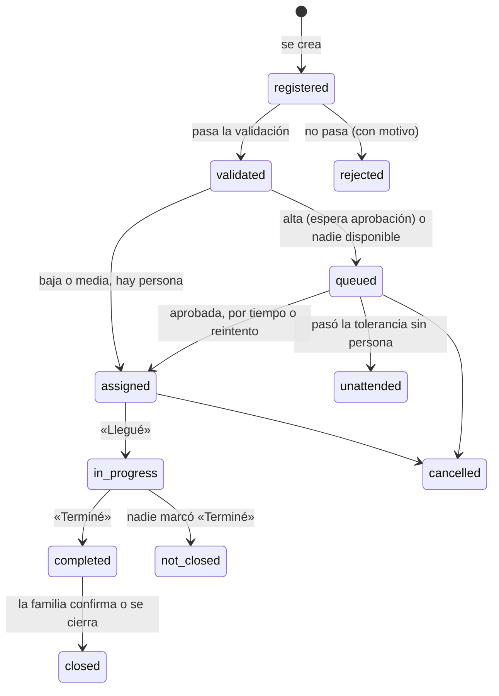
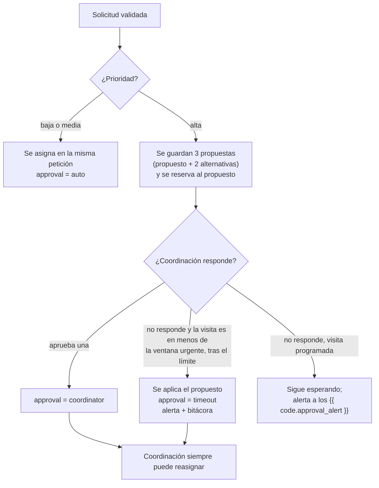
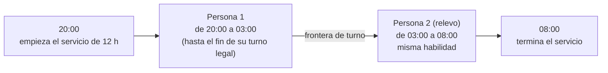

# Operación: de la solicitud a la visita {#cap-operacion}

## En una frase

!!! frase "En una frase"
    **Cada solicitud se valida, el despachador elige sola a la persona que puede ir y llega antes con el tráfico de esa
    hora, lo rutinario se asigna al instante y lo de prioridad alta lo aprueba una persona (con un límite de tiempo
    solo para lo urgente), todo respetando turnos, descansos y jornada legal, hasta que la visita se cierra.**

## Explicado sin tecnicismos

Imagina una central de taxis, pero de enfermeras y cuidadores:

- Llega un pedido: «una enfermera para curar a doña Rosa, mañana a las 11».
- La central revisa que el pedido sea válido (¿doña Rosa es clienta? ¿firmó la autorización? ¿no lo pidieron ya?).
- Busca entre las enfermeras **en turno**, **libres a esa hora** y que **lleguen a tiempo** con el tráfico de las 11.
  Elige a la que tarda menos en llegar.
- Si el pedido es rutinario, lo asigna directo. Si es delicado (prioridad alta), le muestra a la coordinadora la mejor
  opción y dos alternativas para que ella decida. Mientras decide, **aparta** a la enfermera propuesta para que nadie
  se la gane.
- Si nadie puede ir, el pedido queda en cola y la central vuelve a intentar cada minuto.
- La enfermera marca «Llegué» y «Terminé»; la familia confirma.

Y la central respeta la ley: nadie trabaja su día de descanso, ningún turno de día pasa de las horas permitidas, y un
servicio de 12 horas se cubre con dos personas en relevo si una sola no puede.

## Por qué lo hicimos así

| Decidimos | En lugar de | Por qué |
|---|---|---|
| **Asignación automática** con [[despachador]] | Que la coordinadora asigne todo a mano (así era en el Avance 2) | A mano es lento y depende de quién esté de turno. La simulación mostró que el despacho humano espera más. Lo rutinario no necesita a una persona. |
| **Aprobación humana para prioridad alta** | Automatizar todo | Regla 3 del proyecto y principio de IA responsable: lo delicado lo decide una persona y queda su nombre. |
| **Límite de tiempo solo para lo urgente** ({{ cfg.auto_apply_after }}, visita en menos de {{ cfg.urgent_within }}) | Esperar siempre a la coordinadora | SIRAG-D mostró que una aprobación lenta empeoraba la respuesta a lo urgente. Lo programado con tiempo sigue esperando a una persona (Parte IV). |
| **Reserva del candidato** ({{ cfg.hold_minutes }}) | Dejar libre a la persona propuesta | Sin reserva, una solicitud rutinaria podía ganarle la persona a una urgente mientras la coordinadora decidía. |
| Elegir por **tiempo de viaje con el tráfico de la hora** | Elegir por distancia | En la CDMX 5 km a las 18 h tardan mucho más que a las 11 h. La política de Enlaza usa el perfil de TomTom hora por hora. |
| **Restricción `EXCLUDE` en la base** | Revisar traslapes solo en el código | Si dos solicitudes se asignan en el mismo instante, el código de las dos ve a la persona libre. La base de datos rechaza la segunda. |
| **Relevos** para servicios de 12 h | Dejar sin atender lo que no cabe en un turno legal | La Ley Federal del Trabajo limita la jornada; dos personas consecutivas cubren el servicio sin violarla. |
| **Marcar «No cerrada»** | Dejar la visita abierta para siempre | Una visita en curso que nadie terminó (pasó con REQ-08939) bloqueaba indicadores. Ahora se marca y se avisa. |

## Cómo funciona por dentro

### 1. Los estados de una solicitud



Cada cambio de estado tiene hora y responsable, y los importantes van a la bitácora.

### 2. Validación

Antes de buscar a nadie, `operations.validate` revisa:

1. el paciente está activo;
2. hay **consentimiento de atención a domicilio** vigente (regla 5);
3. el servicio está activo en esa institución;
4. la fecha es futura y no más de {{ code.max_days_ahead }} adelante;
5. no hay otra solicitud igual (mismo paciente y servicio) {{ code.duplicate_window_h }} antes o después; si la hay, se
   rechaza como duplicada y se anota de cuál (`duplicate_of`).

### 3. El despachador: quién puede ir y quién conviene

El despachador (`backend/app/services/dispatcher.py`) **no usa la base de datos**: recibe la solicitud, el personal y
el perfil de tráfico como datos y devuelve opciones ordenadas. Por eso SIRAG-D lo importa tal cual y prueba **el mismo
código** que la operación.

**Paso A · ¿Quién puede ir? (igual para cualquier política).** Para cada persona:

- tiene la **habilidad** que pide el servicio (enfermería, cuidados, terapia, medicina);
- la visita completa cabe **dentro de su turno** (incluidos turnos que cruzan la medianoche) y **no es su día de
  descanso**;
- calcula el **viaje**: distancia en línea recta × {{ cfg.circuity }} (para convertirla en distancia por calle,
  supuesto) ÷ la velocidad de esa hora del perfil de TomTom. Usa la velocidad más lenta entre la hora de salida y la de
  llegada: mejor llegar antes que tarde;
- la ventana «salida → fin de la visita» **no se cruza** con otra que ya tenga.

**Paso B · ¿A quién conviene? (depende de la política).**

| Política | Orden de la cola | A quién elige |
|---|---|---|
| `nearest` (más cercano) | por orden de llegada | al más cercano en kilómetros |
| `risk_priority` (prioridad por riesgo) | prioridad → riesgo del paciente → espera | al más cercano en kilómetros |
| **`risk_plus_live_traffic`** (Enlaza, por omisión) | prioridad → riesgo → espera | a quien **tarda menos en llegar con el tráfico de esa hora** |
| `human_dispatcher` (como hoy) | por orden de llegada | al más cercano (la simulación le agrega {{ cfg.human_delay }} para decidir) |

El **riesgo del paciente** es el producto de multiplicadores de `config/simulation.yaml` (pulmonar
{{ cfg.mult_chronic_lung_disease }}, corazón {{ cfg.mult_heart_disease }}, embolia {{ cfg.mult_stroke }}, diabetes
{{ cfg.mult_diabetes }}, dependencia severa {{ cfg.mult_dependency_severe }}, 80+ {{ cfg.mult_age_80_plus }}…), los mismos
de la simulación. **Sin consentimiento de datos de salud** el riesgo vale 1: la solicitud compite solo con su prioridad.
En caso de empate decide la carga del día (a quien tiene menos minutos asignados).

!!! ejemplo "Un caso con números"
    Una visita de enfermería a las 18:00 en Iztapalapa. La enfermera A está a 4 km, la B a 6 km. Con la política «más
    cercano» gana A. Pero si la ruta de A cruza una zona más lenta y la de B no, con «riesgo + tráfico» puede ganar B. Con
    el perfil de TomTom, a las 18 h la ciudad va a {{ ref.traffic_peak_speed }} en promedio, contra
    {{ ref.traffic_free_speed }} sin tráfico: la hora importa tanto como los kilómetros.

**Paso C · Cuándo.** `dispatcher.earliest_options` busca la llegada más temprana desde la hora pedida hasta la
tolerancia ({{ cfg.late_tolerance }} tarde como máximo, `dispatch.late_tolerance_minutes`), y nadie puede salir en el
pasado. Es la misma función en el worker y en SIRAG-D.

**Paso D · Guardar sin traslapes.** La asignación guarda su ventana planeada (`planned_start` = salida,
`planned_end` = fin). La base la protege con una restricción:

```sql
EXCLUDE USING gist (caregiver_id WITH =, tstzrange(planned_start, planned_end) WITH &&)
WHERE (planned_start IS NOT NULL AND status = 'active')
```

Se lee: «no pueden existir dos asignaciones activas del **mismo** cuidador cuyas ventanas **se crucen** (`&&`)». Si
dos peticiones llegan al mismo tiempo y las dos creen que la persona está libre, la segunda inserción falla y la API
recalcula y elige a otra (`save_assignment`). Es una restricción **parcial**: las filas de la semilla no tienen ventana
(si no, sus {{ gen.planned_overlaps }} traslapes «planeados» la romperían) y las asignaciones canceladas o reasignadas
ya no ocupan el horario.

### 4. Aplicar o proponer



- **Baja o media:** se asigna dentro de la misma petición (`approval='auto'`).
- **Alta:** se guardan tres propuestas en `assignment_proposals` y la solicitud queda «en cola» con motivo «esperando
  aprobación». Coordinación aprueba cualquiera de las tres. Al aprobar se **recalcula**: si esa persona ya no está
  libre, la pantalla muestra opciones nuevas («Esa persona ya no estaba libre») en lugar de fallar.
- **Límite de tiempo** (`queue.auto_apply_urgent`): solo si la visita es en menos de {{ cfg.urgent_within }} y las
  propuestas llevan {{ cfg.auto_apply_after }} sin respuesta. Se aplica el candidato propuesto con `approval='timeout'`,
  se crea una alerta para coordinación y queda en la bitácora (`assignment_approved_by_timeout`).
- **Reserva** (`dispatcher.Hold` y `apply_holds`): mientras la alta espera, la ventana de su candidato propuesto no se
  la puede ganar una baja o media; vence a los {{ cfg.hold_minutes }}.
- **Alertas:** una alta sin aprobar a los {{ code.approval_alert }}; una solicitud sin personal a los
  {{ code.queue_alert }}. Cada alerta se crea una sola vez.

{.media}

### 5. La cola y lo que no se pudo atender

Cada minuto el worker reintenta la cola en el orden de la política (`queue.process_queue`). Una solicitud cuya hora más
la tolerancia ya pasó se marca **«sin atender»** (`unattended`). Ese es el indicador que la simulación intenta bajar.

### 6. Las visitas del plan de cuidado

El worker convierte los planes de cuidado en solicitudes reales (`services/care_plans.py`):

- cada plan tiene visita en un día con probabilidad «veces por semana ÷ 7», sorteada con un **hash** de (plan, fecha):
  el resultado es el mismo aunque el worker se reinicie, y en un mes coincide con la frecuencia del plan;
- la hora sale de `services/visit_rules.py`, **compartida con la simulación**: los turnos largos empiezan con el turno
  (8 h a las 08:00, 12 h a las 20:00) y lo demás en bloques de 15 min entre las 8 y las 18 h;
- se publica {{ code.care_plan_release_h }} antes de la visita y pasa por la misma validación y el mismo despachador.

### 7. La visita

- **«Llegué»** y **«Terminé»** registran `clock_timestamp()` (la hora exacta del servidor) y vuelven a revisar el
  consentimiento de atención a domicilio.
- Si el reloj retrocede un instante (pasa en WSL2, ver Parte IV), la hora de término nunca queda antes de la de llegada.
- La familia confirma la visita desde su pantalla.
- **«No cerrada»**: si una visita sigue «en curso» {{ cfg.not_closed_after }} después de su fin planeado, el worker la
  marca `not_closed`, alerta a coordinación («confirma con la persona si se realizó») y lo registra
  (`services/alerts_followup.py`; decisión del equipo, 23 nov 2026).

### 8. Descanso semanal y jornada legal

La Ley Federal del Trabajo (LFT) se aplica con las **mismas funciones** en la operación y en SIRAG-D
(`backend/app/services/labor.py`):

| Regla | Artículo | Cómo la aplica Enlaza |
|---|---|---|
| Un día de descanso por cada seis de trabajo | 69 | Cada persona tiene un día fijo (`caregivers.rest_day`), repartido en rotación para que no descansen todas las del mismo turno el mismo día. El despachador nunca le asigna un turno que empiece ese día. Se cambia en `/personal`; las visitas ya asignadas ese día se reasignan solas. |
| Tipo de jornada según las horas | 60 | Diurna (6 a 20 h), nocturna (20 a 6 h) o mixta; una mixta con {{ code.mixed_night_limit }} o más de noche cuenta como nocturna. El tipo sale de las horas, no de la etiqueta del dato. |
| Jornada máxima | 61 | Diurna {{ code.max_day }}, mixta {{ code.max_mixed }}, nocturna {{ code.max_night }}. Los turnos de día que se pasaban se recortaron (el vespertino 14:00–22:00, mixto, quedó en 14:00–21:30). |

Los {{ seed.night_12h }} turnos nocturnos de 12 h (20:00–08:00) **exceden** el máximo nocturno. Enlaza **no cambia la
plantilla por su cuenta** (es decisión de cada institución): `/personal` los marca «Excede la jornada legal (art. 61)» y
el worker crea una alerta para coordinación. La simulación midió qué pasaría si se cumpliera (@ref(cap-sirag)).

La capacidad semanal que muestra `/personal` es horas de turno × {{ cfg.workdays }} días laborables
(`staffing.workdays_per_week`, supuesto basado en el art. 69).

### 9. Relevos

Un servicio más largo que cualquier turno legal (los de 12 h) que nadie puede cubrir solo se cubre con **dos personas
consecutivas de la misma habilidad** (`dispatcher.relay_options`):



- Siempre se prefiere a **una sola** persona (continuidad del cuidado); el relevo es solo si nadie puede sola.
- Las dos asignaciones se guardan juntas o ninguna (`assignments.leg` = 1 o 2) y la restricción de traslapes protege a
  cada persona.
- En `/mis-visitas` cada quien ve su parte («Te releva…» / «Relevas a…») y el relevo no puede marcar su llegada antes
  que la primera persona.
- Si alguien del relevo queda fuera de servicio **antes** de empezar, se liberan las dos y se vuelve a despachar. Si la
  primera ya está en el domicilio y el relevo no puede, se cancela solo el relevo y coordinación recibe una alerta.
- Con la plantilla actual nadie necesita relevo (los nocturnos de 12 h cubren solos esos servicios). Aparecen al
  simular la jornada nocturna legal: {{ sens.extra_staff.night_legal.vela_timeout.relays }} relevos por semana.

### 10. Cobertura de la semana

`services/coverage.py` (función pura, la misma regla «en turno» del despachador) revisa los próximos 7 días, por día y
franja, qué habilidades se quedan **sin nadie en turno** por descanso o fuera de servicio («martes 8:00–10:00: sin
enfermería»). Solo marca huecos en horas en que la propia plantilla de esa institución sí tiene a alguien con esa
habilidad: no juzga si la institución necesita médico de noche. El worker crea una alerta por franja y la resuelve sola
cuando el hueco desaparece.

{.media}

### 11. Fuera de servicio y reasignación

«Marcar fuera de servicio» (en `/personal` o en el panel de demostración) usa la misma función
(`operations.caregiver_out_of_service`): las visitas pendientes de esa persona se liberan y se vuelven a despachar con
la lógica de siempre (las de prioridad alta pasan por aprobación o por el límite de tiempo) y se alerta a coordinación.
Reasignar conserva la fila anterior como `reassigned` (historial) y crea una nueva.

## Dónde está en el código

| Qué | Dónde |
|---|---|
| Validar, despachar, guardar, aprobar, reasignar, visitas | `backend/app/services/operations.py` |
| Despachador (puro, compartido con SIRAG-D) | `backend/app/services/dispatcher.py` |
| Cola, alertas de espera, sin atender, límite de tiempo | `backend/app/services/queue.py` |
| Visitas del plan de cuidado | `backend/app/services/care_plans.py`, `visit_rules.py` |
| Reglas laborales | `backend/app/services/labor.py` |
| Cobertura de la semana | `backend/app/services/coverage.py` |
| Visitas no cerradas y revisión de voz | `backend/app/services/alerts_followup.py` |
| Rutas | `backend/app/routers/requests.py`, `approvals.py`, `visits.py`, `staff.py`, `board.py` |
| Migraciones de la operación | `0002_operations`, `0003_care_plan_requests`, `0005_timeout_approval`, `0010_rest_day_and_legal_hours`, `0011_relays`, `0012_emergency_review_and_not_closed` |
| Parámetros | `config/simulation.yaml` (`approval`, `dispatch`, `staffing`, `traffic`) |
| Pruebas | `backend/tests/test_operations.py`, `test_dispatcher.py`, `test_labor.py`, `test_relays.py`, `test_alerts_followup.py` |
| Decisiones | `docs/dev/decisiones_paso_3.md`, `docs/dev/decisiones_pantallas_faltantes.md` |

## Números clave

{{ tabla cfg.auto_apply_after cfg.urgent_within cfg.hold_minutes cfg.late_tolerance cfg.not_closed_after code.approval_alert code.queue_alert code.duplicate_window_h cfg.circuity cfg.workdays code.max_day code.max_mixed code.max_night seed.night_12h repo.tests_operations repo.tests_dispatcher repo.tests_labor repo.tests_relays }}

## Limitaciones honestas

- **El viaje se calcula en línea recta × un factor**, no con rutas reales por calle; y se mide desde la base de cada
  persona, no desde su visita anterior.
- **El tráfico es un perfil promedio por hora** (TomTom), no tráfico en vivo. «Live traffic» en el nombre de la
  política significa «el de esa hora», no el de este minuto.
- **El límite de tiempo es una excepción a la aprobación humana.** Está acotado (solo urgente, con alerta, auditable y
  reversible), pero es una decisión ética que hay que poder defender (@ref(cap-etica)).
- **No hay gestión de turnos ni de plantilla**: los turnos vienen de la semilla y solo se cambian el día de descanso y
  «fuera de servicio».
- **Los relevos no se han usado con la plantilla actual**; están probados con pruebas automáticas y en simulación.
- **Los nocturnos de 12 h siguen excediendo la ley** en la semilla: el sistema lo señala, no lo corrige.

## Preguntas que te pueden hacer

!!! pregunta "¿Cómo decide el sistema a quién mandar?"
    Primero filtra a quien puede: habilidad, turno, no es su día de descanso y no tiene otra visita que se cruce contando
    el viaje. Luego, con la política de Enlaza, ordena la cola por prioridad, riesgo y espera, y elige a quien tarda
    menos en llegar con el tráfico de esa hora. Es una función pura en `dispatcher.py` que también usa la simulación.

!!! pregunta "¿Entonces la máquina decide todo?"
    No. Lo rutinario (prioridad baja y media) se asigna solo. Lo de prioridad alta lo aprueba una persona, con el
    candidato propuesto y dos alternativas. La única excepción es lo **urgente** (visita en menos de
    {{ cfg.urgent_within }}) sin respuesta en {{ cfg.auto_apply_after }}: se aplica el propuesto, se avisa y coordinación
    puede cambiarlo. Salió de la simulación: esperar a una aprobación lenta empeoraba la respuesta a lo urgente.

!!! pregunta "¿Qué pasa si dos solicitudes quieren a la misma enfermera al mismo tiempo?"
    La base de datos lo impide con una restricción `EXCLUDE`: no puede haber dos asignaciones activas de la misma persona
    con horarios que se cruzan. La segunda inserción falla y la API elige a otra persona. Hay una prueba que lo fuerza.

!!! pregunta "¿Por qué la familia no puede pedir con prioridad alta?"
    Porque la prioridad la define el estado del paciente (prioridad base), no quien pide. Si no, todo sería urgente. Lo
    urgente de verdad entra por la voz o por coordinación.

!!! pregunta "¿Cómo cumplen la Ley Federal del Trabajo?"
    Cada persona descansa un día fijo por semana (art. 69) y el despachador nunca le asigna un turno ese día; el tipo de
    jornada sale de las horas (art. 60) y los turnos de día no pasan del máximo (art. 61). Los nocturnos de 12 h de la
    semilla exceden el máximo: no los cambiamos solos, los marcamos y avisamos, porque la plantilla la decide la
    institución.

!!! pregunta "¿Qué es un relevo y cuándo se usa?"
    Un servicio de 12 h no cabe en ningún turno legal. Si nadie puede cubrirlo solo, se asignan dos personas de la misma
    habilidad: la primera hasta que termina su turno y la segunda desde ese momento. Siempre se prefiere a una sola
    persona. Hoy no hace falta con la plantilla actual; aparece si se cumple la jornada nocturna legal.

!!! pregunta "¿Qué pasa si nadie está disponible?"
    La solicitud queda en cola con motivo, el worker reintenta cada minuto y coordinación recibe una alerta a los
    {{ code.queue_alert }}. La visita puede empezar hasta {{ cfg.late_tolerance }} tarde; pasada la tolerancia se marca «sin
    atender».

!!! pregunta "¿Qué pasa si la enfermera olvida tocar «Terminé»?"
    A las {{ cfg.not_closed_after }} del fin planeado, el worker marca la visita «No cerrada», avisa a coordinación para que
    confirme si se realizó y lo registra. Así no queda abierta para siempre.

!!! pregunta "¿En qué cambió respecto al Avance 2?"
    En el Avance 2 la coordinadora asignaba todo y el sistema solo sugería; los duplicados se medían en 24 h y se unían
    sin preguntar. Hoy la asignación es automática con aprobación humana en lo de prioridad alta, los duplicados se
    rechazan con motivo en una ventana de {{ code.duplicate_window_h }} y se agregaron relevos, jornada legal y cobertura.
    La tabla completa está en la Parte IV.
