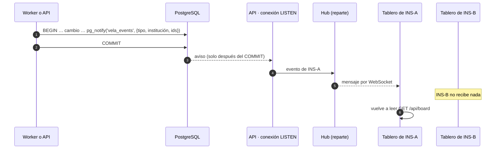
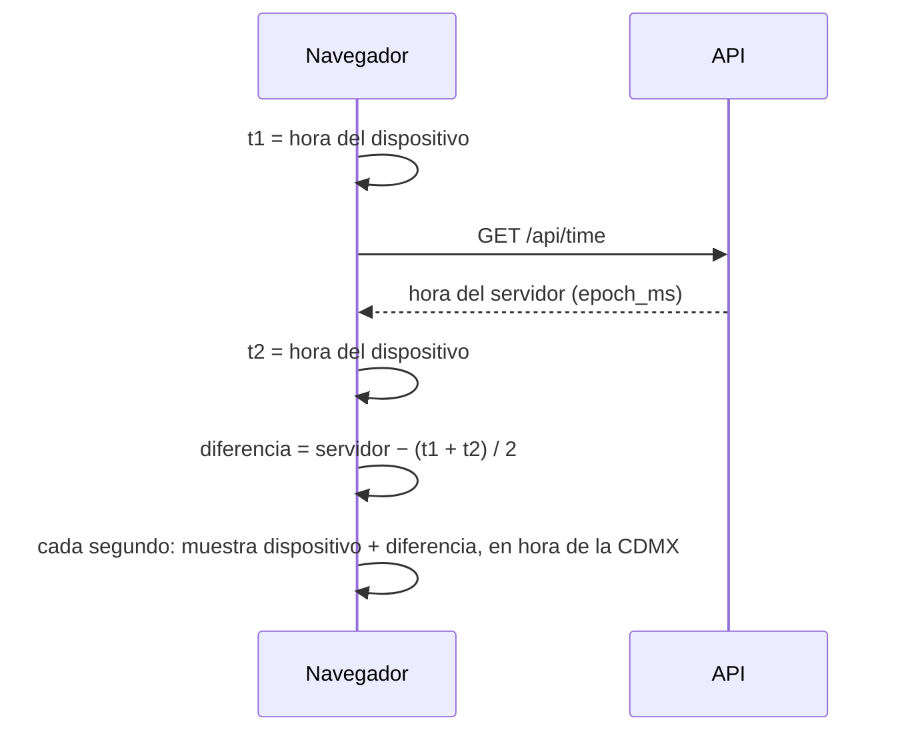

# Tiempo real: el tablero que se mueve solo {#cap-tiempo-real}

## En una frase

!!! frase "En una frase"
    **Cuando algo cambia en la base de datos (una solicitud, una asignación, una llegada, una alerta), PostgreSQL avisa
    a la API al confirmarse el cambio, la API lo reenvía por WebSocket a los tableros de esa institución, y cada tablero
    vuelve a leer sus datos: todo a la hora real de la Ciudad de México.**

## Explicado sin tecnicismos

Piensa en el tablero de llegadas de un aeropuerto. Nadie se acerca a preguntarle a la aerolínea cada minuto si el vuelo
ya llegó: el tablero cambia solo cuando hay una novedad. Eso hace el tablero en vivo de Enlaza.

La analogía tiene dos detalles importantes:

1. **El aviso dice «hubo un cambio en el vuelo 123», no los datos de los pasajeros.** En Enlaza el aviso solo lleva el
   tipo de evento y unos identificadores; el tablero vuelve a pedir la información con todos los permisos de siempre.
2. **El reloj de la pantalla es el del aeropuerto, no el de tu celular.** Aunque tu teléfono tenga la hora mal, Enlaza
   muestra la hora del servidor en la Ciudad de México.

## Por qué lo hicimos así

| Decidimos | En lugar de | Por qué |
|---|---|---|
| [[WebSocket]] | Server-Sent Events (SSE) | Los túneles rápidos de Cloudflare no soportan SSE (regla 7 del proyecto). |
| WebSocket | Que la página pregunte cada pocos segundos («polling») | El polling llega tarde y multiplica peticiones por cada persona conectada. |
| PostgreSQL `LISTEN/NOTIFY` | Un sistema de mensajería aparte (Redis, RabbitMQ) | Ya tenemos PostgreSQL; `NOTIFY` dentro de la transacción solo se entrega al hacer [[COMMIT]], así nunca avisa de algo que no se guardó. Un servicio menos que mantener. |
| Eventos **sin datos personales** | Mandar los datos completos por el WebSocket | El WebSocket no debe ser una segunda puerta a los datos: la seguridad sigue siendo la de la API (seguridad por fila + rol). |
| **Reloj real** | Reloj simulado acelerado | Regla 2 del proyecto: la demostración ocurre de verdad, a la hora real. Lo acelerado solo existe en la simulación, fuera de línea. |

## Cómo funciona por dentro

### Cómo viaja un evento

**Los eventos** que existen hoy (`backend/app/core/events.py`):

| Evento | Cuándo |
|---|---|
| `request.created` | nace una solicitud |
| `request.updated` | se rechaza, se cierra, queda sin atender o «No cerrada» |
| `assignment.proposed` | una prioridad alta espera aprobación |
| `assignment.approved` | se asignó (automática, aprobada o por tiempo) |
| `visit.arrived`, `visit.finished` | «Llegué» y «Terminé» |
| `alert.created`, `alert.updated` | nueva alerta o cambio de una alerta |
| `contingency.changed` | empieza, cambia o termina una contingencia |
| `consent.changed` | se registra o revoca un consentimiento |
| `voice.report_ready` | el modelo de lenguaje terminó un reporte de voz |
| `board.resync` | la API se reconectó y pide a todos recargar |

### Seguridad del WebSocket

- Se autentica con **la misma cookie de sesión** (`httpOnly`), revisada en la base **al conectar** y cada
  {{ code.ws_recheck }}. Solo entran coordinación y Dirección.
- Cierres con código: `4401` sin sesión; `4403` rol sin tablero u origen ajeno.
- **Revisión de `Origin`**: evita que otra página web use la cookie de la persona para abrir el socket. Se compara solo
  el *host* porque dentro de Docker todo llega como http.
- **Filtro por institución en el Hub**: un coordinador solo recibe eventos de su institución; Dirección, todos. Hay una
  prueba que publica un evento de INS-B y luego uno de INS-A y comprueba que INS-A recibe solo el suyo.

### Que no se caiga

- `ping` cada {{ code.ws_ping }}, porque Cloudflare cierra las conexiones sin tráfico.
- La conexión `LISTEN` de la API hace una consulta de prueba cada pocos segundos; si muere (por ejemplo, al reiniciar
  PostgreSQL), reintenta y al volver manda `board.resync` para que cada tablero recargue lo que pudo perder.
  `GET /api/health` dice `"realtime": "ok"` o `"reconnecting"`. Medido a mano: vuelve en {{ man.reconexion_listen_s }}.
- En el navegador, si el socket se cae, aparece «Reconectando…» y se reintenta cada {{ code.ws_retry_s }}.

### El reloj real

- Supone que la respuesta se generó a la mitad del viaje de ida y vuelta, y resincroniza cada
  {{ code.clock_resync_min }} (`frontend/src/lib/clock.ts`).
- Siempre muestra la hora de la Ciudad de México (`Intl`, `America/Mexico_City`), aunque el dispositivo esté en otra
  zona.
- Las horas que se **guardan** (llegadas, términos) las pone PostgreSQL con `clock_timestamp()`: nunca el teléfono.
- El reloj de WSL2 (Linux dentro de Windows) a veces retrocede unos segundos al sincronizarse; por eso la sesión acepta
  {{ code.clock_leeway }} de diferencia (historia completa en la Parte IV).

### Movimiento real para la demostración

Para que el tablero tenga vida sin que nadie haga nada, el worker publica cada minuto las visitas de los planes de
cuidado que tocan (@ref(cap-operacion)). Son deterministas: la misma fecha siempre produce las mismas visitas, aunque el
worker se reinicie. Y el historial de la semilla se mueve con `scripts/rebase_dates.py` para que siempre termine «la
semana pasada».

{.media}

## Dónde está en el código

| Qué | Dónde |
|---|---|
| Publicar un evento (`pg_notify`), escuchar (`listen_forever`), reconectar y repartir (Hub) | `backend/app/core/events.py` (se arranca en `backend/app/main.py`) |
| Ruta del WebSocket | `/ws/board` (`backend/app/ws/board.py`) |
| Hora del servidor | `GET /api/time` (`backend/app/routers/board.py`) |
| Conexión del tablero y reintento | `frontend/src/lib/useBoardSocket.ts` |
| Reloj de la página | `frontend/src/lib/clock.ts` |
| Paso del WebSocket por Caddy | `infra/Caddyfile` (`/ws/*`, `flush_interval -1`) |
| Pruebas | `backend/tests/test_realtime.py` |
| Decisiones | `docs/dev/decisiones_paso_4.md` |

## Números clave

{{ tabla man.evento_tunel_s man.reconexion_listen_s code.ws_ping code.ws_recheck code.ws_retry_s code.clock_resync_min code.clock_leeway code.worker_tick repo.tests_realtime }}

## Limitaciones honestas

- **Una sola API**: el Hub vive en memoria de un proceso. Con varias copias de la API habría que repartir eventos entre
  ellas (por ejemplo, que cada una escuche `LISTEN`).
- **Un evento perdido durante una desconexión** no se reenvía: por eso, al reconectar, el tablero recarga todo.
- **El tiempo por el túnel se midió a mano** en una ocasión.
- **Solo coordinación y Dirección** tienen tablero en vivo; la familia y el personal ven sus pantallas actualizadas al
  recargar o al hacer una acción.

## Preguntas que te pueden hacer

!!! pregunta "¿Cómo se actualiza el tablero sin recargar la página?"
    Con un WebSocket: una conexión que queda abierta. Cuando algo se guarda en la base, PostgreSQL avisa a la API
    (`LISTEN/NOTIFY`), la API reenvía el aviso a los tableros de esa institución, y cada tablero vuelve a pedir sus
    datos. Medimos {{ man.evento_tunel_s }} del guardado al mensaje, por Cloudflare.

!!! pregunta "¿Por qué el aviso no lleva los datos?"
    Para que el WebSocket no sea otra puerta a la información. El aviso solo dice qué cambió; los datos se piden por la
    API, que aplica la seguridad por fila y el rol de siempre.

!!! pregunta "¿Y si se cae la conexión?"
    La página muestra «Reconectando…» y reintenta cada {{ code.ws_retry_s }}; al volver, recarga todo. Si la que se cae es
    la conexión de la API con PostgreSQL, la API se reconecta sola y pide a todos los tableros que recarguen.

!!! pregunta "¿Qué hora usa el sistema?"
    La del servidor, en zona `America/Mexico_City`. La página calcula la diferencia con el reloj del dispositivo y avanza
    cada segundo; las horas que se guardan las pone PostgreSQL. No hay reloj simulado en la operación.

!!! pregunta "¿Por qué no usaron SSE, que es más simple?"
    Porque los túneles rápidos de Cloudflare, que usamos para que el público entre desde su celular, no lo soportan. Lo
    comprobamos al elegir la arquitectura y quedó como regla del proyecto.

!!! pregunta "¿Puede una institución recibir eventos de otra?"
    No. El Hub filtra cada evento por institución antes de enviarlo, y aunque llegara uno, no trae datos: el tablero
    tendría que pedirlos a la API, que solo entrega los de su institución. Hay pruebas automáticas de ambas cosas.
