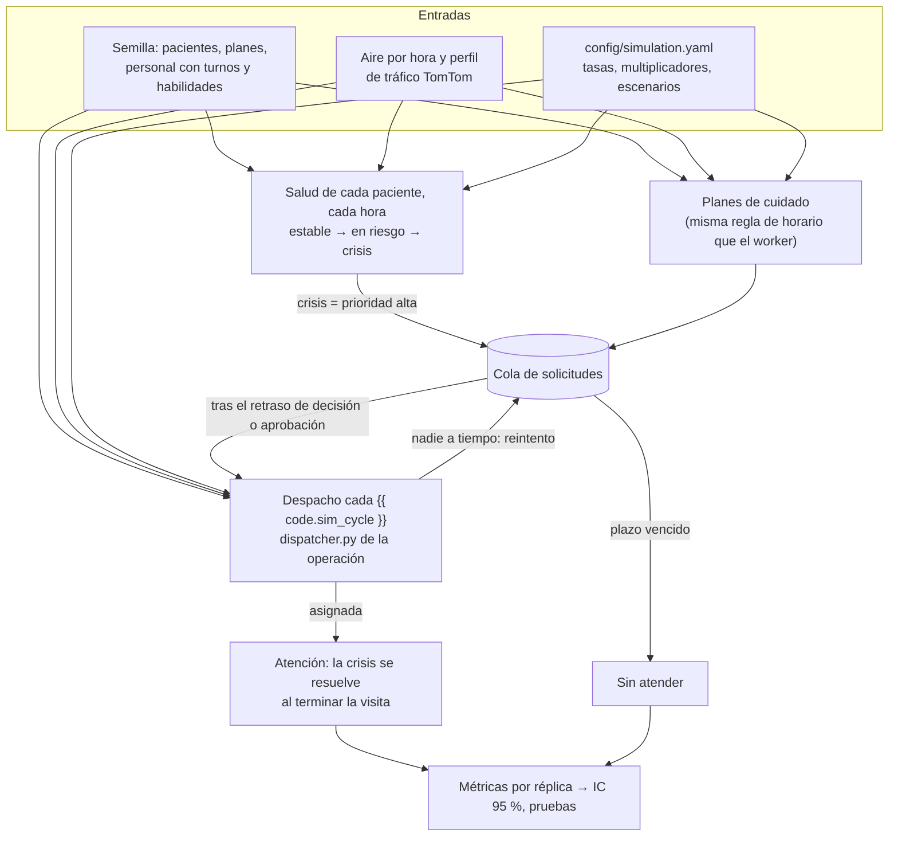
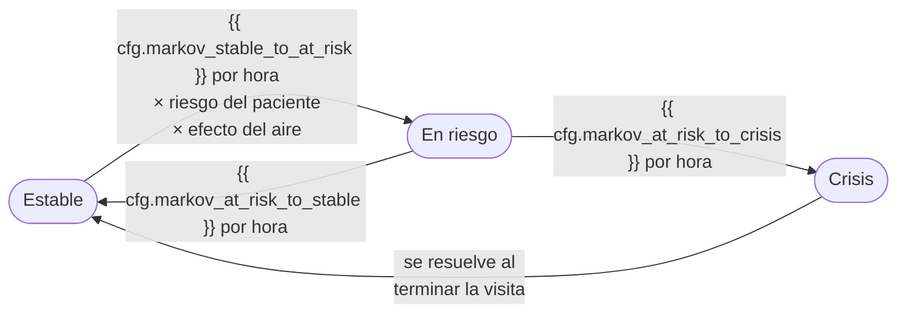

# SIRAG-D: simular semanas de operación para decidir {#cap-sirag}

## En una frase

!!! frase "En una frase"
    **SIRAG-D (Simulación de Riesgo Ambiental y Gestión de Despacho) recrea en la computadora semanas completas de las
    cinco instituciones, con pacientes que pueden entrar en crisis, tráfico por hora y contingencias ambientales, para
    comparar formas de asignar visitas con el mismo código de la operación y decidir con intervalos de confianza y
    pruebas estadísticas.**

## Explicado sin tecnicismos

Antes de cambiar la forma de trabajar de una clínica real, conviene probarla en un **simulador**, como los pilotos
practican en un simulador de vuelo. SIRAG-D es eso para la coordinación de visitas:

- Cada paciente sintético tiene un estado de salud que cambia hora por hora: **estable**, **en riesgo** o **en crisis**.
  Quien tiene más enfermedades o más edad pasa con más facilidad a «en riesgo», y el aire contaminado lo empeora un poco.
- Las visitas de los planes de cuidado aparecen como en la vida real; las crisis generan solicitudes urgentes.
- El personal tiene sus turnos reales, su día de descanso y el tráfico de cada hora.
- Y probamos **cinco formas de asignar** sobre **exactamente las mismas semanas**: la de un despachador humano, la del
  más cercano, la de prioridad por riesgo y dos versiones de Enlaza.

Como el azar puede engañar, cada combinación se repite {{ cfg.replications }} veces (réplicas) y los resultados se dan con
**intervalos de confianza** y **pruebas estadísticas**, no con una sola corrida.

## Por qué lo hicimos así

| Decidimos | En lugar de | Por qué |
|---|---|---|
| [[Simulación de eventos discretos]] con **SimPy** | Una hoja de cálculo con promedios | Las colas, los turnos y las crisis interactúan en el tiempo; los promedios no muestran esperas ni cuellos de botella. SimPy es Python, el lenguaje del equipo. |
| [[Cadena de Markov]] para la salud | Crisis a tasa fija para todos | Permite que el riesgo dependa de cada paciente (enfermedades, dependencia, edad) y del aire. |
| **El mismo despachador** que la operación | Reprogramar la lógica dentro de la simulación | Si la simulación usara otra lógica, sus conclusiones no valdrían para el sistema real. Una prueba comprueba que no hay copia. |
| [[Números aleatorios comunes]] | Sorteos independientes por política | Las cinco políticas enfrentan las mismas visitas y las mismas crisis en cada réplica: la diferencia se debe a la política, no al azar. Hace las comparaciones **pareadas** y más finas. |
| **Friedman + Wilcoxon con Holm** | ANOVA de una vía o Kruskal-Wallis | Esas suponen grupos independientes; con números aleatorios comunes las muestras están pareadas. Y las diferencias no siempre son normales. |
| **Validar** contra el historial | Confiar en el modelo | Antes de comparar, el modelo debe reproducir algo parecido a lo observado con las reglas de antes. |
| **Sensibilidad aparte** | Mezclarla con los resultados principales | Los supuestos dudosos (rapidez de aprobación, riesgo de crisis, plantilla) se mueven uno a uno para ver si las conclusiones aguantan. |
| Correr **fuera de línea y acelerado** | Correr en la app en vivo | Regla 2: la operación usa el reloj real; la simulación corre tan rápido como puede y solo escribe en `simulation/results/`. |

## Cómo funciona por dentro

### El modelo

### La salud: una cadena de Markov por hora

Una [[cadena de Markov]] es un modelo en el que el estado de mañana depende **solo** del estado de hoy (no de cómo se
llegó a él). Cada hora, cada paciente puede cambiar de estado con estas probabilidades base (supuestos calibrados en
`config/simulation.yaml`):

- La probabilidad de pasar de estable a en riesgo se multiplica por el **riesgo del paciente** (los mismos
  multiplicadores del despachador: pulmonar {{ cfg.mult_chronic_lung_disease }}, corazón {{ cfg.mult_heart_disease }},
  dependencia severa {{ cfg.mult_dependency_severe }}, 80+ {{ cfg.mult_age_80_plus }}, sin enfermedad crónica
  {{ cfg.mult_no_chronic_disease }}…).
- Y por el **efecto del aire**: por cada +10 µg/m³ de PM2.5 sobre la línea base de la estación más cercana, sube
  {{ cfg.pm_respiratory }} (respiratorio, a quien tiene enfermedad pulmonar), {{ cfg.pm_cardiovascular }}
  (cardiovascular, corazón o embolia) o {{ cfg.pm_natural_causes }} (causas naturales, el resto). Esos coeficientes
  vienen de estudios publicados (Bell et al. 2014; BMJ 2024), citados en el YAML; **aplicarlos a una probabilidad por
  hora es un supuesto del modelo**, porque los estudios miden ingresos hospitalarios diarios.
- Una crisis genera una solicitud de prioridad alta (una visita de enfermería). Si nadie llega a tiempo, la familia
  acude a urgencias y cuenta como no atendida.

### Lo que se compara: 5 políticas × 3 escenarios × {{ cfg.replications }} réplicas

| Política | Qué hace |
|---|---|
| `human_dispatcher` (despacho humano) | por orden de llegada, al más cercano, con {{ cfg.human_delay }} para decidir cada caso |
| `nearest` (más cercano) | por orden de llegada, al más cercano, sin retraso |
| `risk_priority` (prioridad por riesgo) | primero lo de mayor prioridad y riesgo, al más cercano |
| `risk_plus_live_traffic` (Enlaza sin límite de tiempo) | prioridad y riesgo, a quien llega antes con el tráfico de la hora; las altas esperan aprobación |
| `vela_timeout` (**Enlaza como opera hoy**) | lo anterior + aprobación con límite de tiempo para lo urgente + reserva del candidato |

| Escenario | Qué cambia |
|---|---|
| `normal` | aire y tráfico habituales |
| `contingency_east` | PM2.5 alto en el oriente durante {{ cfg.scenario_hours }} (SAC {{ cfg.sac_target }}…), referencia real de enero de 2024 |
| `contingency_east_roadblocks` | lo anterior + bloqueo en Iztapalapa: tráfico × {{ cfg.roadblock_factor }} y +{{ cfg.blockade_minutes }} por viaje que entra o sale de la alcaldía |

Cada réplica simula {{ cfg.horizon_days }} días de las cinco instituciones. En total: {{ sim.runs_main }} corridas
principales, {{ sim.runs_sensitivity }} de sensibilidad y {{ sim.runs_validation }} de validación, en
{{ sim.elapsed_s }} segundos con {{ sim.workers }} procesos en paralelo (`simulation/results/run_info.json`). Todas
aplican el descanso semanal y la jornada legal, con las mismas funciones de la operación.

### Paso 1. Validación: ¿el modelo se parece al historial?

Con el escenario normal, el despacho humano y la plantilla **como estaba en la semilla** (sin día de descanso, porque
así ocurrió el historial), contando solo «sin atender por falta de personal»:

| | Historial (semilla) | Simulación (IC 95 %) |
|---|---|---|
| Todas las solicitudes | {{ sim.val_real_pct }} | {{ sim.val_sim_short_ci }} sin turnos largos; más alto con ellos |
| Sin turnos largos (8 h y 12 h) | {{ sim.val_real_short_pct }} | {{ sim.val_sim_short_pct }} ({{ sim.val_sim_short_ci }}) |

**Por qué no coinciden del todo.** El generador de la semilla asignaba los turnos largos de 8 h también a personal que
entraba dos horas tarde; la simulación aplica la tolerancia acordada de {{ cfg.late_tolerance }} y esos servicios quedan sin
atender más seguido. Sin turnos largos, la simulación queda cerca del historial. Lo decimos así: la validación es
**aproximada** y explicamos la diferencia.

### Paso 2. Resultados principales

Enlaza como opera hoy frente al despacho humano. Media de {{ cfg.replications }} réplicas, [intervalo de confianza del
{{ cfg.confidence }}], prueba pareada de Wilcoxon con corrección de Holm:

| Métrica | Escenario | Enlaza (hoy) | Despacho humano | ¿Diferencia? |
|---|---|---|---|---|
| Espera de prioridad alta, p90 (min) | normal | {{ sim.normal.vela_timeout.high_wait_p90_min }} [{{ sim.normal.vela_timeout.high_wait_p90_min.ci }}] | {{ sim.normal.human_dispatcher.high_wait_p90_min }} [{{ sim.normal.human_dispatcher.high_wait_p90_min.ci }}] | mejor, {{ test.normal.high_wait_p90_min.vela_timeout.p }} |
| Espera de prioridad alta, p90 (min) | contingencia + bloqueo | {{ sim.contingency_east_roadblocks.vela_timeout.high_wait_p90_min }} [{{ sim.contingency_east_roadblocks.vela_timeout.high_wait_p90_min.ci }}] | {{ sim.contingency_east_roadblocks.human_dispatcher.high_wait_p90_min }} | mejor, {{ test.contingency_east_roadblocks.high_wait_p90_min.vela_timeout.p }} |
| Respuesta a crisis, p90 (min) | normal | {{ sim.normal.vela_timeout.crisis_response_p90_min }} [{{ sim.normal.vela_timeout.crisis_response_p90_min.ci }}] | {{ sim.normal.human_dispatcher.crisis_response_p90_min }} | mejor, {{ test.normal.crisis_response_p90_min.vela_timeout.p }} |
| Crisis atendidas en < 60 min | normal | {{ sim.normal.vela_timeout.crisis_under_60_pct }} | {{ sim.normal.human_dispatcher.crisis_under_60_pct }} | sin diferencia, {{ test.normal.crisis_under_60_pct.vela_timeout.p }} |
| Crisis nocturnas en < 60 min | normal | {{ sim.normal.vela_timeout.night_crisis_under_60_pct }} | {{ sim.normal.human_dispatcher.night_crisis_under_60_pct }} | sin diferencia |
| Sin atender | normal | {{ sim.normal.vela_timeout.unattended_pct }} | {{ sim.normal.human_dispatcher.unattended_pct }} | sin diferencia |
| Utilización del personal | normal | {{ sim.normal.vela_timeout.utilization_pct }} | {{ sim.normal.human_dispatcher.utilization_pct }} | sin diferencia |
| Horas extra en la semana | normal | {{ sim.normal.vela_timeout.overtime_hours }} | {{ sim.normal.human_dispatcher.overtime_hours }} | mejor, {{ test.normal.overtime_hours.vela_timeout.p }} |
| Horas extra en la semana | contingencia + bloqueo | {{ sim.contingency_east_roadblocks.vela_timeout.overtime_hours }} | {{ sim.contingency_east_roadblocks.human_dispatcher.overtime_hours }} | {{ test.contingency_east_roadblocks.overtime_hours.vela_timeout.p }} |

Y las cinco políticas en el escenario normal (espera p90 de prioridad alta, en minutos):

| Despacho humano | Más cercano | Prioridad por riesgo | Enlaza sin límite | Enlaza (hoy) |
|---|---|---|---|---|
| {{ sim.normal.human_dispatcher.high_wait_p90_min }} | {{ sim.normal.nearest.high_wait_p90_min }} | {{ sim.normal.risk_priority.high_wait_p90_min }} | {{ sim.normal.risk_plus_live_traffic.high_wait_p90_min }} | {{ sim.normal.vela_timeout.high_wait_p90_min }} |

Prueba global de Friedman en esa métrica: {{ test.normal.high_wait_p90_min.omnibus }}.

**Cómo leerlo, con honestidad:**

1. **Lo que más mejora la espera de lo urgente es ordenar la cola por prioridad y riesgo**: «prioridad por riesgo» ya
   logra casi lo mismo que Enlaza. Elegir por tráfico en lugar de distancia aporta poco en promedio (los kilómetros
   recorridos casi no cambian: {{ sim.normal.vela_timeout.travel_km }} contra {{ sim.normal.human_dispatcher.travel_km }}
   a la semana).
2. **El «sin atender» no lo arregla ninguna política**: lo limita la capacidad del personal, no quién asigna. Para bajarlo
   hay que contratar donde está el cuello de botella (sensibilidad, abajo).
3. **Las crisis de noche** en instituciones de día no tienen personal en turno: ninguna política lo cambia.
4. **El aire influye poco en las crisis con los coeficientes publicados**; el bloqueo vial pesa más (horas extra).

### Paso 3. Las pruebas estadísticas, paso a paso

Para cada métrica y escenario (`simulation/sirag/stats.py`):

1. Se calcula la **diferencia pareada** de cada política contra el despacho humano, réplica por réplica.
2. **Shapiro-Wilk** revisa si esas diferencias parecen normales.
3. Si todas lo son: ANOVA de medidas repetidas + *t* pareada. Si no (lo más común): **[[Friedman]]** (comparación global
   pareada) + **[[Wilcoxon]] de rangos con signo** (cada política contra el humano).
4. **Corrección de [[Holm]]** sobre las comparaciones contra el humano, para no «encontrar» diferencias por hacer muchas
   pruebas.

### Paso 4. Sensibilidad: ¿las conclusiones aguantan si cambian los supuestos?

Escenario normal, {{ cfg.replications }} réplicas por nivel. Espera p90 de prioridad alta (min):

| Supuesto | Nivel | Enlaza (hoy) | Enlaza sin límite | Despacho humano |
|---|---|---|---|---|
| Retraso de la aprobación | inmediata | {{ sens.approval_delay.0-0.vela_timeout.high_wait_p90_min }} | {{ sens.approval_delay.0-0.risk_plus_live_traffic.high_wait_p90_min }} | {{ sens.approval_delay.0-0.human_dispatcher.high_wait_p90_min }} |
| | 1–5 min | {{ sens.approval_delay.1-5.vela_timeout.high_wait_p90_min }} | {{ sens.approval_delay.1-5.risk_plus_live_traffic.high_wait_p90_min }} | {{ sens.approval_delay.1-5.human_dispatcher.high_wait_p90_min }} |
| | 5–15 min | {{ sens.approval_delay.5-15.vela_timeout.high_wait_p90_min }} | {{ sens.approval_delay.5-15.risk_plus_live_traffic.high_wait_p90_min }} | {{ sens.approval_delay.5-15.human_dispatcher.high_wait_p90_min }} |
| Riesgo de crisis | ×1 | {{ sens.risk_multiplier.1.vela_timeout.high_wait_p90_min }} | {{ sens.risk_multiplier.1.risk_plus_live_traffic.high_wait_p90_min }} | {{ sens.risk_multiplier.1.human_dispatcher.high_wait_p90_min }} |
| | ×2 | {{ sens.risk_multiplier.2.vela_timeout.high_wait_p90_min }} | {{ sens.risk_multiplier.2.risk_plus_live_traffic.high_wait_p90_min }} | {{ sens.risk_multiplier.2.human_dispatcher.high_wait_p90_min }} |
| | ×3 | {{ sens.risk_multiplier.3.vela_timeout.high_wait_p90_min }} | {{ sens.risk_multiplier.3.risk_plus_live_traffic.high_wait_p90_min }} | {{ sens.risk_multiplier.3.human_dispatcher.high_wait_p90_min }} |

Con el límite de tiempo y la reserva, la espera casi no depende de qué tan rápido apruebe coordinación; con más crisis,
la ventaja frente al despacho humano crece.

**¿Y si contratamos?** (Enlaza como opera hoy):

| Plantilla | Personas | Sin atender | Crisis en < 60 min | Crisis nocturnas en < 60 min |
|---|---|---|---|---|
| Actual | {{ sens.extra_staff.current.vela_timeout.staff }} | {{ sens.extra_staff.current.vela_timeout.unattended_pct }} | {{ sens.extra_staff.current.vela_timeout.crisis_under_60_pct }} | {{ sens.extra_staff.current.vela_timeout.night_crisis_under_60_pct }} |
| + enfermería de noche en las de 24 h y un cuidador de día | {{ sens.extra_staff.requested.vela_timeout.staff }} | {{ sens.extra_staff.requested.vela_timeout.unattended_pct }} | {{ sens.extra_staff.requested.vela_timeout.crisis_under_60_pct }} | {{ sens.extra_staff.requested.vela_timeout.night_crisis_under_60_pct }} |
| + un cuidador de día donde está el cuello de botella | {{ sens.extra_staff.targeted.vela_timeout.staff }} | {{ sens.extra_staff.targeted.vela_timeout.unattended_pct }} | {{ sens.extra_staff.targeted.vela_timeout.crisis_under_60_pct }} | {{ sens.extra_staff.targeted.vela_timeout.night_crisis_under_60_pct }} |
| Cumplir la jornada nocturna (dos turnos de 7 h, con relevos) | {{ sens.extra_staff.night_legal.vela_timeout.staff }} | {{ sens.extra_staff.night_legal.vela_timeout.unattended_pct }} | {{ sens.extra_staff.night_legal.vela_timeout.crisis_under_60_pct }} | {{ sens.extra_staff.night_legal.vela_timeout.night_crisis_under_60_pct }} |

Contratar donde está el cuello de botella sí baja el «sin atender»; reforzar la noche sube las crisis atendidas a tiempo.
Cumplir la jornada nocturna cuesta plazas y, con relevos, deja el servicio prácticamente igual: es un costo de
cumplimiento legal que decide cada institución.

**¿La reserva perjudica a lo rutinario?** No: con y sin reserva, el «sin atender» es {{ holds.unattended_pct.with }} y
{{ holds.unattended_pct.without }} ({{ holds.unattended_pct.p }}), y la espera p90 de prioridad media
{{ holds.medium_wait_p90_min.with }} contra {{ holds.medium_wait_p90_min.without }} min (`results/holds_check.csv`).

**Efecto de la contingencia donde ocurre** (alcaldías del oriente, {{ cfg.scenario_hours }}, total de {{ cfg.replications }} semanas): entradas a
«en riesgo» {{ ceff.normal.win_at_risk_entries }} → {{ ceff.contingency_east.win_at_risk_entries }}; crisis
{{ ceff.normal.win_crises }} → {{ ceff.contingency_east.win_crises }}.

### El hallazgo que cambió el producto

En una corrida anterior (21 nov 2026, con la plantilla sin día de descanso), la sensibilidad mostró algo incómodo: con
una coordinación lenta (5–15 min para aprobar), **Enlaza quedaba peor que el despacho humano** en la espera de lo urgente
({{ hist.sens_antes_espera }}, histórico). Lo urgente esperaba a una persona.

El equipo decidió dos cambios, iguales en la operación y en la simulación:

1. **Aprobación con límite de tiempo, solo para lo urgente** (visita en menos de {{ cfg.urgent_within }}, sin respuesta en
   {{ cfg.auto_apply_after }}).
2. **Reserva del candidato** mientras se espera la aprobación ({{ cfg.hold_minutes }}).

| En esa corrida (histórico) | Espera p90 alta vs. humano | Respuesta a crisis p90 vs. humano |
|---|---|---|
| Enlaza sin límite ni reserva | {{ hist.sens_antes_espera }} | {{ hist.sens_antes_crisis }} |
| Con límite, sin reserva | {{ hist.sens_limite_sin_reserva_espera }} | — |
| **Con límite y reserva** | **{{ hist.sens_limite_y_reserva_espera }}** | **{{ hist.sens_limite_y_reserva_crisis }}** |

Con la plantilla legal (corrida vigente), Enlaza sin límite ya no queda peor, pero el límite de tiempo sigue siendo la
mejor opción: con aprobación de 5–15 min, la espera p90 de Enlaza (hoy) es {{ sens.approval_delay.5-15.vela_timeout.high_wait_p90_min }}
contra {{ sens.approval_delay.5-15.human_dispatcher.high_wait_p90_min }} del humano
({{ senstest.approval_delay.5-15.high_wait_p90_min.vela_timeout.p }}). Lo contamos completo en @ref(cap-bitacora).

## Dónde está en el código

| Qué | Dónde |
|---|---|
| Modelo SimPy | `simulation/sirag/model.py` |
| Lectura de datos (sin base de datos) | `simulation/sirag/data.py` |
| Métricas | `simulation/sirag/metrics.py` |
| Réplicas en paralelo | `simulation/sirag/runner.py` |
| Pruebas estadísticas | `simulation/sirag/stats.py` |
| Experimentos | `simulation/experiments/run.py`, `holds_check.py` |
| Resultados | `simulation/results/*.csv`, `run_info.json` |
| Despachador compartido | `backend/app/services/dispatcher.py`, `visit_rules.py`, `labor.py` |
| Parámetros | `config/simulation.yaml` |
| Pantalla | `/simulacion` (`frontend/src/pages/SimulationPage.tsx`) |
| Cómo correrla | `docker compose run --rm sim`; pruebas: `docker compose run --rm sim pytest -q simulation/tests` |
| Documentación completa | `docs/dev/sirag_d_modelo.md` |

## Números clave

{{ tabla sim.runs_main sim.runs_sensitivity sim.runs_validation sim.elapsed_s cfg.replications cfg.horizon_days cfg.confidence sim.normal.vela_timeout.high_wait_p90_min sim.normal.human_dispatcher.high_wait_p90_min sim.normal.vela_timeout.crisis_response_p90_min sim.normal.vela_timeout.unattended_pct sens.extra_staff.targeted.vela_timeout.unattended_pct sim.val_real_short_pct sim.val_sim_short_pct }}

## Limitaciones honestas

- **Las probabilidades de salud son supuestos** calibrados a mano; no salen de un estudio de crisis en personas mayores
  atendidas a domicilio.
- **El efecto del aire se aplica por hora** aunque los estudios midan días: es una aproximación.
- **La validación es aproximada** y explicamos la diferencia con los turnos largos.
- **Cada réplica es una semana**: efectos de largo plazo (cansancio, rotación de personal) no se modelan.
- **El despacho humano es un modelo simplificado** (orden de llegada, al más cercano, con retraso al azar); una
  coordinadora real puede ser mejor o peor.
- **El beneficio principal viene de priorizar**, no del tráfico: lo decimos tal cual.
- **No se simula la voz** ni las falsas alarmas: solo las crisis del modelo de salud.

## Preguntas que te pueden hacer

!!! pregunta "¿Qué es una simulación de eventos discretos?"
    Un modelo en el que el tiempo salta de un evento al siguiente (llega una solicitud, alguien sale, termina una
    visita, un paciente entra en crisis) en lugar de avanzar segundo a segundo. Con SimPy cada proceso (la salud, los
    planes, el despacho) se escribe como una función de Python que espera eventos. Así simulamos una semana en segundos.

!!! pregunta "¿Por qué una cadena de Markov para la salud?"
    Porque el estado de cada hora depende solo del estado anterior (estable, en riesgo, crisis), y así podemos hacer que
    el riesgo dependa de cada paciente y del aire. Las probabilidades base son supuestos documentados en
    `config/simulation.yaml`, calibrados para que las crisis sean poco frecuentes.

!!! pregunta "¿Cuántas réplicas y por qué?"
    {{ cfg.replications }} réplicas de {{ cfg.horizon_days }} días por combinación. Con ese número los intervalos de confianza del
    {{ cfg.confidence }} ya son lo bastante angostos para separar las políticas en las métricas que importan, y el tiempo de
    cómputo es razonable ({{ sim.elapsed_s }} s para todo).

!!! pregunta "¿Por qué Friedman y no ANOVA?"
    Porque las muestras están pareadas: con números aleatorios comunes, la réplica 7 de cada política enfrenta las
    mismas visitas y crisis. ANOVA de una vía y Kruskal-Wallis suponen grupos independientes. Primero revisamos
    normalidad con Shapiro-Wilk; como las diferencias casi nunca son normales, usamos Friedman (la versión pareada de
    Kruskal-Wallis) y Wilcoxon por pares, con corrección de Holm.

!!! pregunta "¿Cómo validaron el modelo?"
    Con las reglas de antes (despacho humano, plantilla de la semilla) la simulación debe reproducir el «sin atender» del
    historial. Sin turnos largos da {{ sim.val_sim_short_pct }} contra {{ sim.val_real_short_pct }} del historial. Con turnos
    largos difiere, y explicamos por qué: el generador de la semilla los asignaba con dos horas de retraso y la simulación
    aplica la tolerancia acordada.

!!! pregunta "Entonces, ¿Enlaza es mejor?"
    En lo que importa para lo urgente, sí y con significancia: la espera p90 de prioridad alta baja de
    {{ sim.normal.human_dispatcher.high_wait_p90_min }} a {{ sim.normal.vela_timeout.high_wait_p90_min }} min
    ({{ test.normal.high_wait_p90_min.vela_timeout.p }}). En el «sin atender» no: eso depende del personal disponible. Y la
    mayor parte de la mejora viene de priorizar por riesgo, no del tráfico.

!!! pregunta "¿Qué cambió en el producto por la simulación?"
    El límite de tiempo para lo urgente y la reserva del candidato. La simulación mostró que, si coordinación tarda en
    aprobar, lo urgente espera más que con un despachador humano. Con los dos cambios, la espera ya casi no depende de
    qué tan rápido apruebe coordinación.

!!! pregunta "¿La simulación usa el mismo código que el sistema?"
    Sí: `simulation/sirag/model.py` importa `backend/app/services/dispatcher.py`, `visit_rules.py` y `labor.py`, las
    mismas funciones del worker. Lo único propio de la simulación son los retrasos de decisión y el reloj acelerado. Una
    prueba automática comprueba que no hay copia de la lógica.

!!! pregunta "¿Qué tanto afecta la contaminación?"
    Poco, con los coeficientes publicados: en las alcaldías afectadas, las entradas a «en riesgo» pasan de
    {{ ceff.normal.win_at_risk_entries }} a {{ ceff.contingency_east.win_at_risk_entries }} en {{ cfg.replications }} semanas y las crisis no
    cambian. El bloqueo vial pesa más que el aire.
