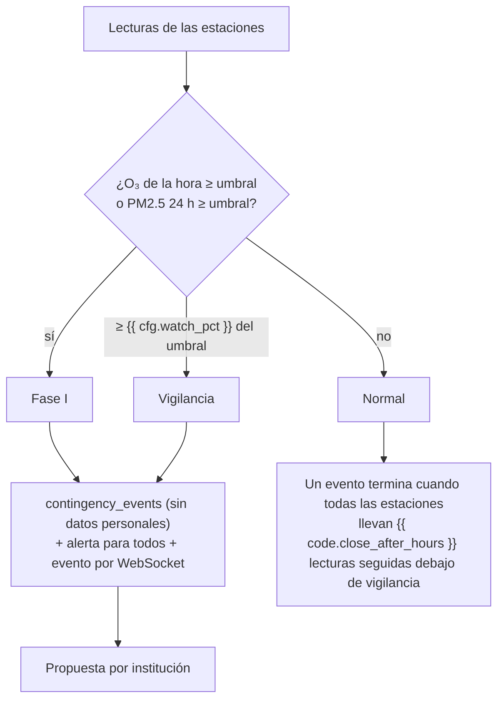

# Contingencia ambiental y panel de demostración {#cap-contingencia}

## En una frase

!!! frase "En una frase"
    **Cada minuto el worker revisa el aire de las estaciones; si se rebasa el umbral de una contingencia, Enlaza lo
    detecta solo, le propone a cada institución ajustes concretos (subir prioridad a pacientes sensibles, adelantar
    oxigenoterapia, recalcular rutas, avisar a familias) y nada cambia hasta que una persona lo aprueba. El panel de
    demostración solo cambia los datos de entrada para que eso se pueda ver en vivo.**

## Explicado sin tecnicismos

Cuando en la Ciudad de México se declara contingencia ambiental, las personas mayores con enfermedades del pulmón o del
corazón son las más afectadas. Una coordinadora atenta pensaría: «Doña Rosa tiene EPOC y vive en Iztapalapa; hoy
conviene subirle la prioridad y adelantar su oxigenoterapia; y avisarle a su hija».

Enlaza hace ese razonamiento por ella, **pero no decide por ella**: le presenta la lista de cambios con su motivo y ella
aprueba todo, una parte o nada.

Para la defensa no podemos esperar a que haya una contingencia real. Por eso existe el **panel de demostración**: es
como un simulador de clima que sube las lecturas de PM2.5 en el oriente. Todo lo que pasa después (detectar, proponer,
aprobar) es el mismo proceso que en un día real.

## Por qué lo hicimos así

| Decidimos | En lugar de | Por qué |
|---|---|---|
| **Detectar solo, proponer, aprobar** | Aplicar los cambios automáticamente | Subir prioridades y avisar a familias afecta a personas; lo decide coordinación (IA responsable). |
| Propuesta **por institución** | Una propuesta global | Cada institución decide sobre sus pacientes; con seguridad por fila, otra institución no la ve. |
| **Excepciones de prioridad** aparte (`priority_overrides`) | Cambiar la prioridad base del paciente | Al terminar el evento todo vuelve a la normalidad sin perder el dato original. |
| Panel que cambia **solo datos de entrada** | Botones que «fingen» el resultado | Así la demostración prueba el sistema real; nada está preparado. |
| Lecturas de demostración en **otra tabla** | Sobrescribir el historial | Lo real y lo de demostración nunca se mezclan; «Volver a normal» deja todo como estaba. |
| Umbrales del **programa oficial** (PCAA) | Umbrales inventados | O₃ {{ cfg.o3_phase1 }} en 1 h, PM2.5 {{ cfg.pm25_phase1 }} en promedio de 24 h, con fuente en `config/simulation.yaml`. |
| Respetar el **consentimiento** | Usar los datos de salud de todos | Sin consentimiento de datos de salud no se propone subirle la prioridad ni avisar «por sensible a la contaminación». |

## Cómo funciona por dentro

### 1. Las lecturas de «ahora»

El aire de cada hora lo genera `app/services/air_model.py` con el mismo modelo calibrado que produjo la serie de
referencia (nivel diario de la ciudad, forma por hora, factor por estación, ruido). La misma hora siempre da el mismo
valor. Cada minuto el worker agrega las horas que falten.

### 2. Detección

La regla de cierre evita el «parpadeo» (que un evento se abra y se cierre cada vez que una lectura sube y baja).

### 3. La propuesta

Para cada institución con pacientes en las alcaldías afectadas, en este orden (`services/contingency.py`):

1. **Subir prioridad** de pacientes sensibles (enfermedad pulmonar, cardiaca o embolia) de esas alcaldías;
2. **Adelantar oxigenoterapia** programada en las próximas {{ code.oxygen_window_h }};
3. **Recalcular rutas** de las visitas de hoy si hay tráfico degradado (bloqueo);
4. **Avisar a las familias** de pacientes sensibles.

Cada cambio dice su motivo. Si una categoría no tiene cambios, la pantalla explica por qué («no hay visitas de
oxigenoterapia en las próximas horas»): así se ve que se revisó.

{.media}

### 4. Aprobación

- Coordinación aprueba **todo, una parte o nada** (`contingency_decisions`). Dirección ve todas las instituciones, pero
  **no decide** por ellas. Otra institución que intente decidir recibe 403 y queda en la bitácora.
- Subir prioridad crea excepciones en `priority_overrides`; la prioridad base no se toca. **Al terminar el evento** se
  desactivan y las solicitudes en cola vuelven a su prioridad original.
- Todo el ciclo queda en la bitácora: `contingency_detected`, `contingency_proposed`, `contingency_decided`,
  `contingency_applied`, `contingency_reverted`, `contingency_ended`.

{.media}

{.media}

### 5. Real y demostración nunca se mezclan

- Las lecturas de un escenario de demostración se guardan en `air_quality_scenario`; la vista `v_air_quality_live` las
  pone por delante **solo mientras el escenario está activo**. El historial calibrado nunca se sobrescribe.
- La detección real usa solo lecturas reales; la de demostración, la vista en vivo. Cada una tiene su propio evento y su
  propia propuesta.
- PM2.5 se evalúa con promedio de 24 h, así que el escenario escribe las últimas 24 horas («episodio ya formado»); si no,
  la Fase I tardaría un día en aparecer. Medido a mano: detección en {{ man.deteccion_contingencia_demo }}.
- «Volver a normal» desactiva el escenario y cierra **solo** el evento de demostración.

### 6. El panel de demostración (`/demo`, solo Dirección)

| Botón | Qué cambia (dato de entrada) | Qué hace el sistema solo |
|---|---|---|
| Contingencia en el oriente | PM2.5 alto en estaciones del oriente (SAC {{ cfg.sac_target }}…) | detecta, propone, espera aprobación |
| Contingencia + bloqueo en Iztapalapa | lo anterior + tráfico × {{ cfg.roadblock_factor }} y +{{ cfg.blockade_minutes }} por viaje que cruza Iztapalapa | además propone recalcular rutas |
| Volver a normal | quita el escenario | cierra el evento de demostración y revierte prioridades |
| Crear solicitud urgente | una visita de prioridad alta en {{ code.demo_urgent_min }} para un paciente sensible | la manda a Aprobaciones; si nadie responde, la aplica por tiempo |
| Dejar fuera de servicio | una persona deja de estar disponible | reasigna sus visitas pendientes con el despachador |
| Frase de ejemplo escrita | manda una frase del conjunto de prueba como texto (sin micrófono) | reglas, clasificador, pantalla y reporte, como una nota real |

Todo lo que crea el panel queda marcado `origin='demo_scenario'` y `scripts/reset_demo.py` lo borra.

{.media}

### 7. Contingencia y simulación

SIRAG-D usa los mismos umbrales y escenarios (`config/simulation.yaml`) para medir qué pasa con una contingencia durante
toda una semana (@ref(cap-sirag)). Conclusión: con los coeficientes publicados, el aire cambia poco las crisis; el
bloqueo vial pesa más.

## Dónde está en el código

| Qué | Dónde |
|---|---|
| Lecturas de «ahora» | `backend/app/services/air_model.py` |
| Detección, propuesta, aplicación y reversión | `backend/app/services/contingency.py` |
| Rutas | `backend/app/routers/contingency.py` (incluye el panel demo, `/api/demo/...`), `backend/app/routers/voice.py` (frase de ejemplo) |
| Migración | `backend/migrations/versions/0006_live_contingency.py` |
| Umbrales y escenarios | `config/simulation.yaml` (`contingency`, `scenarios`) |
| Pantallas | `frontend/src/pages/ContingencyPage.tsx`, `DemoPage.tsx` |
| Pruebas | `backend/tests/test_contingency.py` |
| Decisiones | `docs/dev/decisiones_contingencia.md` |

## Números clave

{{ tabla cfg.o3_phase1 cfg.pm25_phase1 cfg.watch_pct code.close_after_hours cfg.sac_target cfg.ramp cfg.scenario_hours cfg.roadblock_factor cfg.blockade_minutes man.deteccion_contingencia_demo repo.tests_contingency }}

## Limitaciones honestas

- **Las lecturas son sintéticas** (modelo calibrado), no los datos en vivo de SIMAT; el script para descargar los oficiales
  existe, pero la operación usa el modelo.
- **Las coordenadas de las estaciones son aproximadas**; cada paciente usa la estación más cercana.
- **Los umbrales se tomaron de activaciones registradas** y hay que verificarlos contra el programa oficial vigente (así
  lo dice el YAML).
- **«Avisar a familias» registra el aviso en Enlaza**: no manda SMS ni WhatsApp reales.
- **Recalcular rutas** usa el mismo modelo de viaje (línea recta × factor y tráfico por hora), no un navegador real.

## Preguntas que te pueden hacer

!!! pregunta "¿Cómo detecta el sistema una contingencia?"
    Cada minuto el worker revisa las estaciones: ozono de la hora contra {{ cfg.o3_phase1 }} y PM2.5 promedio de 24 h
    contra {{ cfg.pm25_phase1 }}. Al {{ cfg.watch_pct }} del umbral marca vigilancia; al umbral, Fase I. Crea el evento, una
    alerta y un aviso por WebSocket, y prepara una propuesta para cada institución.

!!! pregunta "¿El sistema cambia prioridades solo?"
    No. Propone cambios con su motivo y coordinación aprueba todo, una parte o nada. Las prioridades se suben con
    excepciones que se revierten solas al terminar el evento; la prioridad base del paciente nunca se toca.

!!! pregunta "¿El panel de demostración no es trampa?"
    No, porque solo cambia datos de entrada (lecturas, tráfico, disponibilidad). Lo que sigue lo hace el sistema real. Y
    nunca se mezcla con lo real: las lecturas de demostración van en otra tabla, todo queda marcado como demostración y
    «Volver a normal» lo deshace.

!!! pregunta "¿Por qué la propuesta es por institución?"
    Porque cada institución decide sobre sus pacientes y, con la seguridad por fila, ni siquiera puede ver los de otra.
    Dirección ve todo, pero no aprueba por ellas.

!!! pregunta "¿Qué pasa con un paciente sin consentimiento de datos de salud?"
    No se usa su información de salud: no se le propone subir la prioridad ni se avisa a su familia «por ser sensible a la
    contaminación». Fue una decisión del equipo del 22 nov 2026.

!!! pregunta "¿Cuánto tarda en detectarse en la demostración?"
    Lo medimos a mano: {{ man.deteccion_contingencia_demo }} después de activar el escenario, porque el worker revisa una
    vez por minuto y el escenario escribe de golpe las últimas 24 horas.
