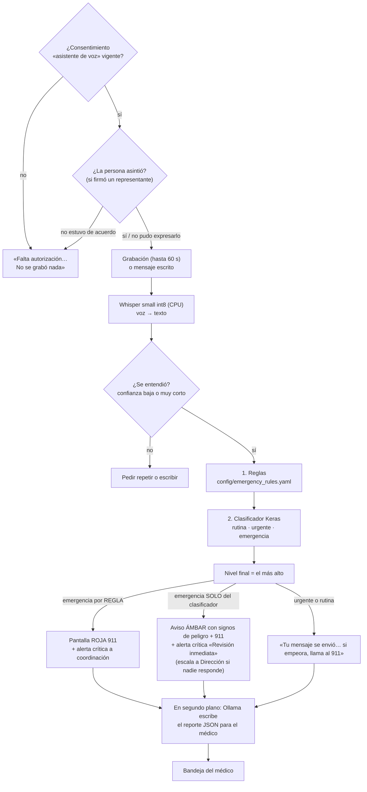

# Enlaza Voz: escuchar, detectar emergencias y resumir para el médico {#cap-voz}

## En una frase

!!! frase "En una frase"
    **Enlaza Voz (antes ORACLE-Voz) convierte una nota de voz en texto con Whisper, busca señales de emergencia primero
    con reglas y después con un clasificador, muestra de inmediato la pantalla del 911 (roja si fue una regla, ámbar si
    fue solo el clasificador) y después un modelo de lenguaje local, **{{ mod.llm_nombre }}**, escribe un resumen para el
    médico que nunca diagnostica.**

## Explicado sin tecnicismos

Imagina a una recepcionista de un consultorio que contesta un recado telefónico:

1. **Lo escribe** tal como lo oyó (eso es Whisper).
2. **Busca palabras de alarma** en una lista pegada en la pared: «no puede respirar», «dolor en el pecho», «no
   responde», «se quiere quitar la vida»… Si aparece una, no lo piensa: «¡llame al 911!» (eso son las **reglas**).
3. Si no aparece ninguna palabra de la lista pero **el tono le suena a algo grave**, igual le dice que llame si ve ciertos
   signos y avisa a la coordinadora para que llame a la familia (eso es el **clasificador** y el aviso ámbar).
4. Después, con calma, **escribe un resumen** para el médico: qué síntomas se mencionaron, desde cuándo, qué medicamentos.
   Nunca dice qué enfermedad es (eso es el **modelo de lenguaje**).

La regla de oro: **la recepcionista nunca le dice a nadie «tranquilo, no es una emergencia»**. Puede equivocarse hacia el
lado de alarmar, nunca hacia el lado de tranquilizar.

## Por qué lo hicimos así

| Decidimos | En lugar de | Por qué |
|---|---|---|
| **Reglas primero**, que el clasificador nunca puede bajar | Solo un clasificador | Las reglas son explicables y predecibles: si alguien dice «no puede respirar», siempre es emergencia. El clasificador puede subir el nivel, nunca bajar una regla (regla 6 del proyecto). |
| **Clasificador además de reglas** | Solo reglas | En el holdout las reglas solas detectaron {{ voz.holdout.sens_rules }} de las emergencias; con el clasificador, {{ voz.holdout.sens }}. Las emergencias se describen de muchas formas que una lista no prevé. |
| **Dos niveles de aviso** (rojo y ámbar) | Una sola pantalla roja para todo | Con una sola pantalla, {{ vozb.holdout.false_alarms }} de las {{ vozb.holdout.all_emergency_screens }} pantallas rojas del holdout serían falsas y la gente aprendería a ignorarla. Con dos niveles, la roja queda en {{ vozb.holdout.red_false }} falsas de {{ vozb.holdout.red }} (decisión del equipo, 23 nov 2026). |
| **El 911 antes que el reporte** | Esperar al modelo de lenguaje | El reporte tarda de {{ voz.t_llm_short }} a {{ voz.t_llm_long }}; una emergencia no puede esperar eso. |
| **IA local** (Whisper y Ollama en la laptop) | Servicios en la nube | La voz de un paciente es un dato sensible: no sale de la computadora. Y cuesta cero. |
| **Holdout escrito a ciegas** y evaluado una sola vez | Evaluar con las mismas frases con que se entrenó | Medir con frases conocidas da resultados inflados ({{ voz.internal_test.sens }} y F1 {{ voz.internal_test.f1 }} en la prueba interna). El holdout es la medida honesta. |
| **No guardar el audio**, solo la transcripción | Guardar las grabaciones | Minimización de datos: se guarda lo necesario. |

## Cómo funciona por dentro

### El flujo completo

### Los tres modelos de Enlaza Voz

Enlaza Voz usa **tres modelos distintos**, cada uno para una sola cosa. Ninguno decide solo: el nivel de emergencia lo ponen
las reglas y el clasificador, y lo que se le dice a la familia está escrito de antemano.

| Modelo | Qué hace | Tamaño | Dónde corre | Tiempo medido |
|---|---|---|---|---|
| **Whisper {{ mod.whisper_modelo }}** (OpenAI, Radford et al., 2023) | Voz → texto | {{ ctx.whisper_small_params }} parámetros; {{ mod.whisper_archivo }} descargado; corre en {{ mod.whisper_tipo }} | contenedor `voice`, CPU | nota de ~10 s: {{ voz.t_transcribe_10 }}; de ~60 s: {{ voz.t_transcribe_60 }} |
| **Clasificador de Keras** (nuestro) | Texto → rutina, urgente o emergencia | {{ mod.clasificador_parametros }} parámetros; {{ mod.clasificador_archivo }} | contenedor `voice`, CPU | {{ mod.clasificador_ms }} por nota |
| **{{ mod.llm_nombre }}** (Qwen, Alibaba Cloud; Yang et al., 2025) | Texto → reporte para el médico, en JSON | {{ mod.llm_parametros }} parámetros; {{ mod.llm_archivo }} en {{ mod.llm_cuantizacion }} | Ollama en Windows, GPU integrada | {{ mod.llm_gpu_reporte }} por reporte (ya cargado) |

Tiempos y tamaños medidos en la laptop del equipo ({{ mod.laptop_cpu }}, {{ mod.laptop_ram }} de RAM) con
`docs/biblia/build/measure_models.sh`.

### 1. Whisper: de voz a texto

[[ASR]] (reconocimiento automático del habla) con **faster-whisper**, modelo `small` cuantizado a enteros de 8 bits
(`int8`) para correr en la CPU de la laptop. Tiempos medidos (`voice/eval/results/timings.csv`): nota de ~10 s
{{ voz.t_transcribe_10 }}, de ~30 s {{ voz.t_transcribe_30 }}, de ~60 s {{ voz.t_transcribe_60 }}. Si la transcripción sale
con poca confianza o demasiado corta, se marca para revisión humana y se pide repetir.

### 2. Las reglas

`config/emergency_rules.yaml` tiene {{ cfg.emergency_categories }} categorías de signos de alarma (dificultad grave para
respirar, dolor de pecho, pérdida de conciencia, signos de embolia, convulsión, sangrado grave, caída grave, confusión
súbita y autolesión) con {{ cfg.emergency_patterns }} patrones de texto. El texto se normaliza (minúsculas, sin acentos)
antes de buscar.

- **No se manejan negaciones a propósito**: «ya no puede respirar» o «ya no quiere vivir» deben seguir siendo
  emergencia. Se prefiere una falsa alarma a una emergencia perdida.
- Si la regla que se activa es **autolesión**, la pantalla roja muestra además la **Línea de la Vida** (gratuita, las 24
  horas), con su número y su fuente en el YAML.

### 3. El clasificador

Una red neuronal pequeña de Keras/TensorFlow que lee el texto de dos formas a la vez:

- **por palabras** (palabras sueltas y pares de palabras),
- **por pedazos de letras** (grupos de 3 y 4 caracteres): un error de dedo cambia una palabra completa, pero solo unos
  pocos pedazos, así que el clasificador lo resiste;

y termina en tres salidas: rutina, urgente, emergencia. Al entrenar, equivocarse con una emergencia «cuesta»
{{ code.class_weight_emergency }} veces más que con una rutina (pesos de clase, supuesto). Se entrenó con las frases internas y
externas, más **aumento de datos** (errores de dedo, muletillas, paráfrasis, mensajes que mezclan dos frases).

### 4. Los dos niveles

El nivel que se guarda es `emergency` en los dos casos: nada se descarta, el reporte sube primero en la bandeja del
médico. Solo cambia **cómo se muestra**:

- **Se activó una regla → pantalla roja** completa: «Esto puede ser una emergencia. Llama al 911 ahora.», botón grande y
  «Ya avisamos a la coordinación de tu institución».
- **Solo el clasificador → aviso ámbar** completo: «Tu mensaje podría indicar algo urgente», la lista de signos concretos
  («Llama al 911 ahora si la persona: no puede respirar…»), el mismo botón del 911 y «Coordinación te contactará en los
  próximos minutos». Coordinación recibe una alerta **crítica** con un contador y dos botones: «Contactada: era
  emergencia» (escala a Dirección) y «Contactada: no era emergencia». Si nadie responde en {{ cfg.escalate_after }}, el worker
  la escala a Dirección. Todo queda en la bitácora.

### 5. El reporte para el médico: {{ mod.llm_nombre }}

#### Qué es un modelo de lenguaje

Un [[modelo de lenguaje]] es un programa que aprendió, leyendo muchísimo texto, a **adivinar la siguiente palabra**. Es
como el teclado del celular que sugiere «mañana» cuando escribes «nos vemos», pero tan grande que, palabra tras palabra,
puede escribir párrafos completos, resumir o llenar un formato. No «sabe» medicina ni entiende como una persona: produce
el texto más probable. Por eso **se usa para resumir lo que ya se dijo, nunca para decidir**.

#### Qué es {{ mod.llm_nombre }}

- **Quién lo hizo:** el equipo Qwen de Alibaba Cloud; es de la familia Qwen3, publicada en 2025 (Yang et al., 2025).
- **Tamaño:** {{ mod.llm_parametros }} de [[parámetros]] (los «números» que el modelo ajustó al aprender).
- **Cuantización:** Ollama lo descarga en {{ mod.llm_cuantizacion }}: cada parámetro se guarda con unos 4 bits en lugar de
  16 ([[cuantización]]). Así pesa {{ mod.llm_archivo }} y cabe en la memoria de una laptop, a cambio de un poco de precisión.
- **Licencia:** Apache 2.0 (se puede usar, también comercialmente, citando la fuente).
- **Dónde corre:** en **Ollama**, un programa que corre modelos de lenguaje en la propia computadora. En esta laptop Ollama usa
  la GPU integrada ({{ mod.laptop_gpu }}), que comparte la memoria RAM.

#### Por qué ese y no uno más grande

Medido en esta laptop con la misma petición que hace Enlaza:

| | GPU integrada (lo que usamos) | Solo CPU |
|---|---|---|
| Memoria que ocupa cargado | {{ mod.llm_gpu_memoria }} | {{ mod.llm_cpu_memoria }} |
| Cargarlo en memoria | {{ mod.llm_gpu_carga }} | {{ mod.llm_cpu_carga }} |
| Escribir un reporte (ya cargado) | {{ mod.llm_gpu_reporte }} | {{ mod.llm_cpu_reporte }} |
| Primer reporte (sin cargar) | {{ mod.llm_gpu_frio }} | {{ mod.llm_cpu_frio }} |
| Velocidad al escribir | {{ mod.llm_gpu_velocidad }} | {{ mod.llm_cpu_velocidad }} |

La laptop tiene {{ mod.laptop_ram }} de RAM que comparten Windows, Docker (base de datos, API, Whisper, clasificador) y el
modelo. {{ mod.llm_nombre }} ya ocupa {{ mod.llm_gpu_memoria }} y tarda {{ mod.llm_gpu_reporte }} por reporte. Un modelo más
grande (por ejemplo, uno de 14 mil millones de parámetros) ocupa y tarda aproximadamente en proporción a su tamaño: no
cabría con holgura junto con todo lo demás y cada reporte tardaría bastante más. **No lo medimos**; es una estimación por
tamaño. Uno más chico sería más rápido, pero escribe peor en español y respeta peor el formato; tampoco lo comparamos
formalmente. {{ mod.llm_nombre }} es el más grande que cabe y responde en un tiempo razonable, y como la pantalla del 911
**no espera al reporte**, ese tiempo no pone en riesgo a nadie.

#### Cómo lo usa Enlaza

La API le pide el reporte a Ollama (`backend/app/services/llm_report.py`) así:

- **Razonamiento («thinking») {{ mod.llm_think }}:** {{ mod.llm_nombre }} puede «pensar en voz alta» antes de contestar; eso
  alarga la respuesta y no ayuda a resumir lo que ya se dijo, así que se apaga (`"think": false`).
- **Temperatura {{ mod.llm_temperatura }}:** la temperatura controla qué tan «creativo» es; baja = respuestas parecidas cada vez,
  sin inventar.
- **Salida JSON con esquema fijo** (`format` = el esquema de Pydantic): resumen, síntomas mencionados, inicio, signos de alarma,
  medicamentos mencionados, frases textuales y limitaciones. **No hay campo de diagnóstico.**
- **Se valida** con Pydantic; si la respuesta no cumple el esquema o tarda más de {{ mod.llm_timeout }}, se guarda solo la
  transcripción y el nivel.

#### Qué NO hace

- **No diagnostica** ni recomienda tratamientos: la instrucción lo prohíbe, el esquema no tiene dónde, y un filtro busca frases
  prohibidas.
- **No decide el nivel de emergencia**: lo ponen las reglas y el clasificador antes de que el modelo escriba una sola palabra;
  el sistema sobrescribe el nivel en el reporte.
- **No habla con la familia**: lo que ve la familia (pantalla roja, aviso ámbar, «tu mensaje se envió») está escrito de antemano.

#### Las defensas, en orden

Ollama corre {{ mod.llm_nombre }} con temperatura baja y un **esquema JSON fijo**: resumen, síntomas
mencionados, inicio, signos de alarma, medicamentos mencionados, frases textuales y limitaciones. La instrucción le pide
resumir lo dicho, **no inferir enfermedades, no recomendar tratamientos** y marcar lo que no se entendió. Defensas:

1. el esquema JSON se valida con Pydantic; si no valida, se guarda solo la transcripción y el nivel;
2. un **filtro** busca frases prohibidas («probablemente tiene», «le recomiendo», «no es una emergencia»);
3. **el nivel siempre lo pone el sistema**, nunca el modelo de lenguaje.

**Confianza del clasificador** (decisión del equipo, 25 nov 2026): la bandeja del médico y las alertas de voz de coordinación
muestran las probabilidades del clasificador («83 % emergencia · 16 % rutina · 1 % urgente») con una nota: es qué tan seguro
estaba el modelo de texto, no la probabilidad de que sea una emergencia real. **Nunca se muestra a la familia**, y al médico solo
con consentimiento de datos de salud.

En la revisión del criterio A8, los {{ voz.reports_reviewed }} reportes generados fueron válidos y
{{ voz.reports_clean }} pasaron el filtro sin frases prohibidas. **Falta la revisión humana** del equipo (casillas en
`voice/eval/results/reports_review.md`).

{.media}

{.media}

### 6. La evaluación: cuatro conjuntos, de menos a más honesto

Las [[métricas de clasificación]] que usamos:

- **Sensibilidad de emergencia** (*recall*): de las emergencias reales, cuántas terminaron en pantalla de 911. Es la
  métrica principal: una emergencia perdida es el peor error.
- **Falsas alarmas por cada 100 notas**: cuántos mensajes que no eran emergencia terminaron en una pantalla de 911.
- **F1 macro**: promedio del equilibrio entre precisión y sensibilidad de las tres clases.
- **[[Matriz de confusión]]**: tabla de «lo que era» contra «lo que dijo el sistema».

| Conjunto | Frases | ¿Se usó para entrenar o escribir reglas? | Sensibilidad (sistema) | Solo reglas | F1 macro | Falsas alarmas / 100 |
|---|---|---|---|---|---|---|
| Prueba interna | {{ voz.internal_test.n }} | sí | {{ voz.internal_test.sens }} | {{ voz.internal_test.sens_rules }} | {{ voz.internal_test.f1 }} | {{ voz.internal_test.fa100 }} |
| Externo | {{ voz.external.n }} | sí | {{ voz.external.sens }} | {{ voz.external.sens_rules }} | {{ voz.external.f1 }} | {{ voz.external.fa100 }} |
| **Holdout a ciegas** | {{ voz.holdout.n }} | **no** | **{{ voz.holdout.sens }}** | **{{ voz.holdout.sens_rules }}** | **{{ voz.holdout.f1 }}** | **{{ voz.holdout.fa100 }}** |
| Frases del equipo | — | no | **pendiente** | pendiente | pendiente | pendiente |

**El holdout** lo escribió un agente que no vio las reglas ni los otros conjuntos, con {{ voz.holdout.emergencies }} frases por nivel y las nueve
categorías, y se guardó en Git **antes** de evaluarlo. Nunca se usó para ajustar nada. Es el resultado que defendemos.

Matriz de confusión del holdout (filas = lo que era; columnas = lo que dijo el sistema):

| Real \\ Sistema | Rutina | Urgente | Emergencia |
|---|---|---|---|
| **Rutina** | {{ vozcm.holdout.routine.routine }} | {{ vozcm.holdout.routine.urgent }} | {{ vozcm.holdout.routine.emergency }} |
| **Urgente** | {{ vozcm.holdout.urgent.routine }} | {{ vozcm.holdout.urgent.urgent }} | {{ vozcm.holdout.urgent.emergency }} |
| **Emergencia** | {{ vozcm.holdout.emergency.routine }} | {{ vozcm.holdout.emergency.urgent }} | {{ vozcm.holdout.emergency.emergency }} |

Qué dice el holdout, en concreto (calculado de `predictions_holdout.csv`):

- De las emergencias, {{ vozb.holdout.emerg_by_rules }} las detectan las reglas y {{ vozb.holdout.emerg_only_classifier }} solo el
  clasificador. Se escapó {{ voz.holdout.missed }}: una autolesión descrita sin palabras obvias («encontré vacías las cajas de
  sus pastillas para dormir… me había dicho que ya no quería ser una carga»).
- Las {{ vozb.holdout.false_alarms }} falsas alarmas (de {{ vozb.holdout.non_emergencies }} frases que no eran emergencia):
  {{ vozb.holdout.false_by_rules }} vienen de reglas (negaciones y sentido figurado: «no se desmayó», «de broma», «la boca chueca
  desde hace años») y {{ vozb.holdout.false_by_classifier }} del clasificador.
- **Metas:** sensibilidad ≥ 98 % → **se cumple**. Menos de 10 falsas alarmas por 100 notas → **no se cumple**.
- Las reglas nuevas que se escribieron viendo el conjunto externo subieron el holdout «solo reglas» de
  {{ vozr.holdout.antes.sens }} a {{ vozr.holdout.despues.sens }}: ayudan, pero lejos del {{ vozr.externo.despues.sens }} del externo,
  porque se escribieron viéndolo.

### 7. El clasificador v2 (rama pendiente) y la evaluación del equipo

Para bajar las falsas alarmas, el equipo probó en la rama `feature/voz-clasificador-v2` (sin fusionar) un clasificador
con un **codificador de frases preentrenado** (un modelo que ya «entiende» español). Se eligió con validación y la regla
para adoptarlo se escribió **antes** de abrir el holdout: adoptarlo solo si mantiene la sensibilidad ≥ 98 % **y** baja las
falsas alarmas.

| Holdout, una sola vez | Sensibilidad | Falsas alarmas / 100 | F1 macro | Tiempo por nota |
|---|---|---|---|---|
| v1 (activo) | {{ vozv2.v1.sens }} | {{ vozv2.v1.fa100 }} | {{ vozv2.v1.f1 }} | {{ vozv2.v1.ms }} |
| v2 (codificador preentrenado) | {{ vozv2.v2.sens }} | {{ vozv2.v2.fa100 }} | {{ vozv2.v2.f1 }} | {{ vozv2.v2.ms }} |

v2 baja mucho las falsas alarmas pero deja pasar más emergencias ({{ vozv2.v2.missed }} contra {{ vozv2.v1.missed }}), así que
**no se adoptó**: el modelo activo sigue siendo v1. Como el holdout ya se usó para comparar, cualquier versión nueva se
tiene que juzgar con un **cuarto conjunto: las frases del equipo** (`data/voice/team_phrases_template.csv` e instructivo
`data/voice/INSTRUCTIVO_frases_equipo.md`), que está **pendiente**.

### 8. Sesgo de reconocimiento de voz

Whisper no reconoce bien náhuatl, mixteco u otomí, y puede equivocarse más con ciertos acentos o con voces de personas
mayores. El prototipo trabaja en español y lo declara; en pantalla hay «No hablo español / Pedir que alguien me llame»,
que crea una solicitud a coordinación con la lengua registrada. El procedimiento para medir la tasa de error por palabra
(WER) por grupo está listo (`voice/eval/bias_wer.py`); con voz sintética dio {{ man.whisper_wer_sintetico }}. Las grabaciones
del equipo con consentimiento y las de Common Voice están **pendientes**.

### 9. Lo que vimos en las pruebas del equipo

Cuando el equipo probó la voz a mano, con sus propias frases, hubo **falsos positivos** (frases tranquilas que salieron como
emergencia, por ejemplo «Hoy mi mamá comió bien y durmió su siesta», aviso ámbar) y **falsos negativos** (frases de alarma,
dichas con palabras distintas a las de entrenamiento, que no subieron de nivel cuando no las atrapó una regla). No fue una
evaluación formal: no tiene conteo y no sustituye al cuarto conjunto pendiente.

**Por qué pasa:** el clasificador se entrenó con **frases sintéticas muy parecidas entre sí** (mismas plantillas, mismas
personas —«mi mamá», «mi papá»—, mismo vocabulario). Aprende palabras de superficie más que el sentido: si una frase rutinaria
se parece a las de emergencia, sube; si una emergencia usa palabras que nunca vio, se le escapa. Por eso el holdout a ciegas da
{{ voz.holdout.fa100 }} falsas alarmas por 100 notas aunque la prueba interna salga casi perfecta.

**Qué sigue:**

1. Las **frases del equipo**, dichas con sus propias palabras, como cuarto conjunto de evaluación (instructivo en
   `data/voice/INSTRUCTIVO_frases_equipo.md`).
2. Una **segunda opinión con {{ mod.llm_nombre }}** para los casos que solo marca el clasificador: preguntarle al modelo de
   lenguaje si el texto describe signos de alarma, como apoyo a la revisión de coordinación. **Pendiente de evaluar**: no se
   adoptará sin medirla antes con la regla escrita de antemano, y nunca podrá bajar una regla.
3. Mientras tanto, las reglas siguen primero, el aviso ámbar lo revisa una persona y el botón del 911 siempre está.

## Dónde está en el código

| Qué | Dónde |
|---|---|
| Orquestación (consentimiento → transcripción → reglas → clasificador → aviso → reporte) | `backend/app/services/oracle.py`, `backend/app/routers/voice.py` |
| Reglas | `config/emergency_rules.yaml`, `backend/app/services/triage_rules.py` |
| Reporte con el modelo de lenguaje ({{ mod.llm_nombre }}) | `backend/app/services/llm_report.py` (petición a Ollama, esquema, filtro) |
| Medición de los tres modelos | `docs/biblia/build/measure_models.sh` → `docs/biblia/datos/modelos_medidos.yaml` |
| Revisión del aviso ámbar y escalamiento | `backend/app/services/alerts_followup.py` |
| Servicio de voz (Whisper + clasificador) | `voice/triage/service.py`, `classifier.py`, `augment.py`, `text.py` |
| Evaluación | `voice/eval/evaluate.py`, `compare_rules.py`, `review_reports.py`, `timings.py`, `bias_wer.py` |
| Resultados | `voice/eval/results/` |
| Frases | `data/voice/` |
| Pantallas | `frontend/src/pages/VoicePage.tsx`, `VoiceReportsPage.tsx` |
| Pruebas | `backend/tests/test_voice.py`, `test_alerts_followup.py` |
| Decisiones | `docs/spec/05_oracle_voz.md`, `docs/dev/decisiones_oracle_voz.md` |

## Números clave

{{ tabla voz.holdout.n voz.holdout.sens voz.holdout.sens_rules voz.holdout.fa100 voz.holdout.f1 voz.holdout.missed vozb.holdout.red vozb.holdout.red_false vozb.holdout.amber vozb.holdout.amber_false cfg.emergency_categories cfg.emergency_patterns cfg.escalate_after voz.t_transcribe_10 mod.llm_nombre mod.llm_parametros mod.llm_cuantizacion mod.llm_gpu_memoria mod.llm_gpu_reporte mod.llm_cpu_reporte mod.clasificador_parametros mod.clasificador_ms voz.reports_reviewed }}

## Limitaciones honestas

- **Muchas falsas alarmas**: {{ voz.holdout.fa100 }} por cada 100 notas en el holdout. Es la meta que no se cumple. Se mitiga
  con el aviso ámbar y la revisión humana, no se resuelve.
- **Las frases son sintéticas.** Personas reales hablan distinto; por eso la evaluación del equipo es importante y está
  pendiente.
- **Se escapó una emergencia** del holdout (autolesión sin palabras obvias). Ningún sistema de este tipo es perfecto: la
  pantalla siempre muestra el botón del 911.
- **Whisper se probó con voz sintética** para medir tiempo, no exactitud con personas mayores reales.
- **No reconoce lenguas indígenas.**
- **En las pruebas del equipo hubo falsos positivos y falsos negativos**: el clasificador aprendió de frases sintéticas muy
  parecidas entre sí. La segunda opinión con {{ mod.llm_nombre }} está pendiente de evaluar.
- **La revisión humana de los {{ voz.reports_reviewed }} reportes** (criterio A8) está pendiente.

## Preguntas que te pueden hacer

!!! pregunta "¿Qué tan bueno es detectando emergencias?"
    En el conjunto que nunca se usó para entrenar ni para escribir reglas (holdout, {{ voz.holdout.n }} frases), detectó
    {{ voz.holdout.sens }} de las emergencias. Se escapó {{ voz.holdout.missed }}. El costo son las falsas alarmas:
    {{ voz.holdout.fa100 }} por cada 100 notas. Elegimos equivocarnos hacia el lado seguro.

!!! pregunta "¿Por qué no presumen el 100 % de la prueba interna?"
    Porque esas frases se usaron para entrenar el clasificador y escribir las reglas: medir con ellas es como calificar un
    examen con las respuestas que el alumno ya vio. El holdout se escribió a ciegas y se evaluó una sola vez. Es el número
    honesto.

!!! pregunta "¿Por qué dos niveles de aviso?"
    Porque con una sola pantalla roja, en el holdout {{ vozb.holdout.false_alarms }} de {{ vozb.holdout.all_emergency_screens }}
    pantallas serían falsas y la gente dejaría de hacerle caso. Las reglas son mucho más confiables: con dos niveles, la roja
    tiene {{ vozb.holdout.red_false }} falsas de {{ vozb.holdout.red }}. Lo que detecta solo el clasificador sale en ámbar, con el
    mismo botón del 911, y una persona de coordinación llama a la familia. Quitarle el aviso al clasificador perdería
    {{ vozb.holdout.emerg_only_classifier }} emergencias reales.

!!! pregunta "¿Qué modelo de lenguaje usan y por qué ese?"
    {{ mod.llm_nombre }}, del equipo Qwen de Alibaba Cloud: {{ mod.llm_parametros }} de parámetros, cuantizado a
    {{ mod.llm_cuantizacion }} por Ollama, licencia Apache 2.0. Corre en la laptop, en la GPU integrada: ocupa
    {{ mod.llm_gpu_memoria }} y escribe un reporte en {{ mod.llm_gpu_reporte }} (en CPU, {{ mod.llm_cpu_reporte }}). Es el más
    grande que cabe junto con todo lo demás y responde a tiempo; como el 911 no lo espera, su lentitud no pone a nadie en riesgo.

!!! pregunta "¿El modelo de lenguaje diagnostica?"
    No. La instrucción lo prohíbe, la salida tiene un esquema fijo sin campo de diagnóstico, se valida con Pydantic y un
    filtro busca frases prohibidas. Además el nivel de urgencia nunca lo decide el modelo de lenguaje: lo deciden las reglas y
    el clasificador. Y la pantalla dice «No es un diagnóstico».

!!! pregunta "¿Por qué la pantalla del 911 no espera al reporte?"
    Porque el reporte tarda entre {{ voz.t_llm_short }} y {{ voz.t_llm_long }} en la laptop. El nivel sale en una fracción de
    segundo (reglas y clasificador); la pantalla se muestra en ese momento y el reporte se hace después, en segundo plano.

!!! pregunta "¿Qué pasa con alguien que no habla español?"
    Whisper no reconoce lenguas indígenas de forma confiable; lo declaramos. Hay un botón «No hablo español / Pedir que
    alguien me llame» que crea una solicitud a coordinación con la lengua registrada.

!!! pregunta "¿Probaron un modelo mejor?"
    Sí, un codificador de frases preentrenado (rama `feature/voz-clasificador-v2`). Bajó las falsas alarmas a
    {{ vozv2.v2.fa100 }} por 100, pero la sensibilidad cayó a {{ vozv2.v2.sens }}. Habíamos escrito antes la regla de adopción
    (sensibilidad ≥ 98 % y menos falsas alarmas) y no la cumplió, así que no se adoptó. Así se evita elegir el modelo
    después de ver los resultados.

!!! pregunta "¿Se guarda la grabación?"
    No. Solo la transcripción y el nivel. Y sin consentimiento de «asistente de voz» vigente no se graba nada. Si firmó un
    representante pero la persona **no estuvo de acuerdo** (asentimiento «no»), tampoco.

!!! pregunta "¿Por qué la familia no ve qué tan seguro estaba el modelo?"
    Porque un porcentaje puede tranquilizar de más («solo 40 % emergencia») o asustar de más. A la familia le damos una acción
    clara: llamar al 911 si ve ciertos signos. La confianza es una herramienta para quien revisa (médico y coordinación), con una
    nota que explica que no es la probabilidad de una emergencia real.
