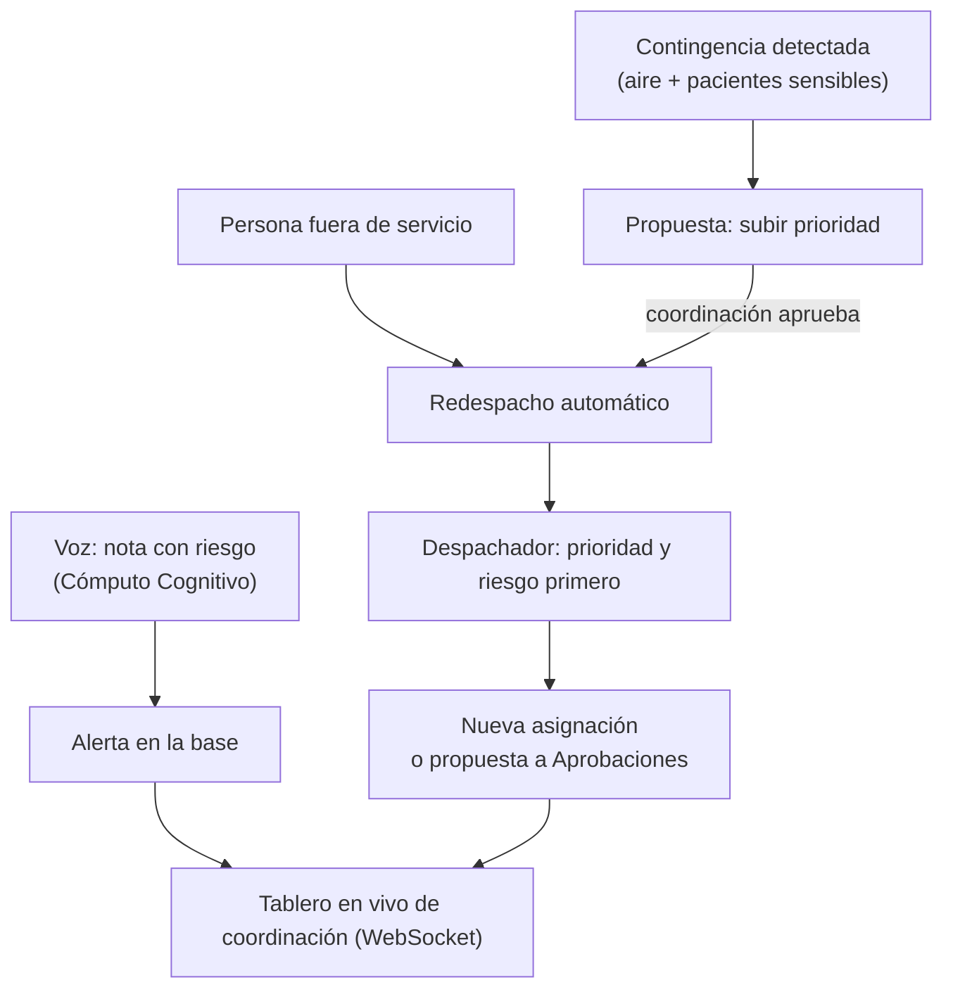

# Sistemas de Información Empresarial {#cap-m-sie}

Responsable: {{ equipo.materias.sie }}

## En una frase

!!! frase "Lo que aporta esta materia"
    **Enlaza es, ante todo, un sistema de información: registra cada transacción de la coordinación de visitas (TPS),
    conoce a pacientes y familias (CRM), administra al personal y los servicios (ERP), resume para decidir (MIS) y ayuda
    a elegir entre alternativas (DSS), todo en una sola base de datos compartida por cinco instituciones que nunca se ven
    entre sí.**

## Qué evalúa el profesor

Lo que dicen los documentos (citados en @ref(cap-m-pp-doc)):

| Pide | Documento y sección | Dónde se responde |
|---|---|---|
| Entregable: «Arquitectura del Sistema de Información Institucional (CRM/ERP/Nube)» | PP, «Evidencia integradora», p. 2 | conceptos TPS/CRM/ERP/MIS/DSS (abajo); arquitectura @ref(cap-arquitectura); nube: «Arquitectura en la nube» (abajo) |
| Resolver la fragmentación: articular procesos, actores, tecnologías y flujos de información | PP, «Incidente crítico de la UCA: SIE», p. 11 | «Respuesta al incidente crítico» (abajo) |
| Que una alerta de alto riesgo reasigne personal de inmediato | PP, p. 11 | «Respuesta al incidente crítico» |
| Registros duplicados o identificadores distintos para una misma persona | PP, p. 11; «Problemas suscitados», p. 7 | «Calidad de datos» (abajo) |
| Qué información requiere cada área, cuál se comparte, quién accede y con qué finalidad | PP, p. 11 | «Información por área» (abajo) |
| Apoyar decisiones operativas, tácticas y estratégicas | PP, p. 11 | «Información por área» |
| Base central, qué datos produce y usa cada área, usuarios y permisos, separación entre instituciones, **calidad de datos** y **plan de respaldo** | Plan SIE, sección 2 | «Información por área», «Calidad de datos», «Plan de respaldo» (abajo); seguridad @ref(cap-seguridad) |
| Mismo glosario y diccionario de datos; demostración de un día normal y una contingencia que pase por las seis materias | Plan SIE, sección 3 | glosario (anexo), diccionario (abajo), guion (Parte V) |
| Transacción central, mapa de sistemas, diccionario, matriz de permisos, bocetos, escenarios | Avance 2 (lo que entregó el equipo) | este capítulo y @ref(cap-operacion) |
| Pesos y criterios de calificación propios de SIE | **no lo dicen los documentos: confirmar con el profesor** | — |

## Los conceptos, desde cero

### Sistema de información

**Qué es.** Un conjunto de personas, procesos, datos y tecnología que recoge, guarda, procesa y entrega información
para operar y decidir. No es «el programa»: incluye quién captura, qué reglas se siguen y quién usa el resultado.

**Ejemplo cotidiano.** La cafetería de la escuela: la cajera (persona) cobra (proceso), anota en la caja registradora
(tecnología) lo que se vendió (datos), y al final del día la dueña ve qué se acabó (información para decidir qué comprar).

**En Enlaza.** Personas (coordinación, personal, familias, médicos, Dirección), procesos (solicitud → visita),
datos (PostgreSQL) y tecnología (la app web, el worker, la voz). Ver @ref(cap-que-es).

### Transacción y TPS (sistema de procesamiento de transacciones)

**Qué es.** Una transacción es un evento del negocio que hay que registrar completo o no registrar: una venta, un
depósito, una solicitud de visita. Un [[TPS]] registra esas transacciones con fecha, responsable y estado, y garantiza
que no queden a medias.

**Ejemplo.** Un retiro en el cajero: o se descuenta el dinero **y** sale el efectivo, o no pasa nada. Nunca solo una de
las dos.

**En Enlaza.** La transacción central es la **solicitud de servicio**, desde que se registra hasta que se cierra:
`registered → validated → queued/assigned → in_progress → completed → closed`, con salidas `rejected`, `cancelled`,
`unattended` y `not_closed` (@ref(cap-operacion)). Cada paso se guarda dentro de una **transacción de base de datos**
([[COMMIT]]): una asignación de relevo guarda a las dos personas juntas o a ninguna.

### CRM (gestión de la relación con clientes)

**Qué es.** El sistema que conoce al cliente: quién es, qué ha pedido, qué autorizó, su historial.

**Ejemplo.** La tarjeta de puntos del supermercado: saben qué compras y te mandan ofertas de eso.

**En Enlaza.** [[CRM]] = pacientes, familiares (quién puede pedir por quién), **consentimientos** e historial de
atención. Sin el CRM no se podría validar que quien pide está autorizado ni que hay consentimiento.

### ERP (planeación de recursos de la empresa)

**Qué es.** El sistema que administra los recursos internos: personal, turnos, inventario, catálogo, nómina.

**Ejemplo.** En una tienda, saber cuántos empleados hay por turno y qué productos hay en bodega.

**En Enlaza.** Un [[ERP]] **acotado**: personal, habilidades, turnos, día de descanso, jornada legal, «fuera de
servicio» y catálogo de servicios con duración, habilidad requerida y precio de referencia. Nómina, inventario y
contabilidad quedan fuera de alcance (como ya decía el Avance 2).

### MIS (sistema de información gerencial)

**Qué es.** Convierte la operación en indicadores periódicos para quien dirige: no muestra cada transacción, muestra
cómo va el negocio.

**Ejemplo.** El reporte semanal de ventas por sucursal.

**En Enlaza.** [[MIS]] = Panorama-AM, vista Operación: contadores en vivo, puntualidad, «sin atender», carga del
personal (@ref(cap-panorama)).

### DSS (sistema de apoyo a la decisión)

**Qué es.** Ayuda a **elegir entre alternativas** con modelos y datos; la decisión la toma una persona.

**Ejemplo.** Una app de mapas que te propone tres rutas con su tiempo estimado; tú eliges.

**En Enlaza.** [[DSS]] en tres lugares: (1) **Aprobaciones** propone un candidato y dos alternativas con su tiempo de
viaje; (2) **SIRAG-D** compara políticas de asignación con intervalos de confianza; (3) la **contingencia** propone
ajustes que coordinación aprueba.

### EIS (sistema de información para ejecutivos)

**Qué es.** Vista resumida para la alta dirección, de toda la organización. **En Enlaza** no hay un EIS separado (el
Avance 2 lo dejó «para el futuro»); Dirección usa Panorama con todas las instituciones y `/negocio`.

### SaaS y multi-institución (multi-inquilino)

**Qué es.** [[SaaS]]: software que se usa por internet y se paga por suscripción. **Multi-inquilino**: una sola
instalación sirve a varios clientes, cada uno con sus datos separados.

**Ejemplo.** Un edificio de departamentos: una sola construcción, pero cada familia con su llave.

**En Enlaza.** Una base de datos para cinco instituciones con **seguridad por fila** ([[RLS]]): sin institución en la
sesión, cero filas (@ref(cap-seguridad)).

### Base de datos relacional, integridad y restricciones

**Qué es.** Datos en tablas relacionadas por claves. La **integridad** son reglas que la base garantiza aunque el
programa se equivoque: claves únicas, referencias válidas, valores permitidos.

**En Enlaza.** {{ db.tables_total }} tablas y {{ db.views_total }} vistas. Ejemplos de integridad que garantiza PostgreSQL:
una asignación **activa** por solicitud (y por tramo de relevo); la restricción **`EXCLUDE`** que impide que una misma
persona tenga dos visitas que se crucen; la bitácora de solo agregar.

### Diccionario de datos

**Qué es.** La lista de cada dato: qué significa, quién lo genera, dónde se usa y qué controles tiene.

**En Enlaza.** El Avance 2 definió nueve datos (`institucion_id`, `paciente_id`, consentimiento, solicitud, servicio,
cuidador y turno, asignación, estado, cierre). Hoy viven en `database/sql/001_schema.sql`, las migraciones y
`docs/spec/03_base_de_datos.md`, con nombres en inglés (`institution_id`, `patient_id`…).

### Matriz de permisos (control de acceso por rol)

**Qué es.** Qué puede hacer cada rol con cada dato. **En Enlaza:** cinco roles, mapa en `backend/app/core/roles.py`,
revisado en cada ruta (`require_role`) y con **alcance** (el médico solo sus pacientes, la familia solo el suyo). Tabla
completa en @ref(cap-recorrido).

### Auditoría (bitácora)

**Qué es.** El registro de quién hizo qué y cuándo, que no se puede borrar. **En Enlaza:** `audit_log`, de solo agregar,
con lecturas de expedientes, asignaciones, aprobaciones, contingencias e intentos bloqueados.

### Proceso de negocio y escenarios

**Qué es.** La secuencia de pasos, actores, decisiones y excepciones de una actividad. **En Enlaza:** el diagrama de
estados de la solicitud; escenario normal (solicitud rutinaria asignada sola) y excepcionales (duplicada → rechazada con
motivo; nadie libre → cola, reintento y alerta; urgente sin aprobar → aplicada por tiempo).

## Respuesta al incidente crítico de SIE

**El incidente** (PP, p. 11): cada área digitalizó por su cuenta; los componentes funcionan por separado, pero la
información no fluye. Si un paciente se clasifica de alto riesgo y la alerta no llega sola al área que reasigna personal,
el tiempo se pierde. Además hay identificadores duplicados. La dirección no quiere seguir sumando sistemas ni sustituirlos de
golpe.

**La respuesta de Enlaza: un solo sistema con una sola base, en lugar de integrar sistemas sueltos.**

- **La alerta llega sola**: una nota de voz de emergencia crea una alerta crítica que el tablero recibe al instante; una
  contingencia propone subir la prioridad de los pacientes sensibles; «fuera de servicio» redespacha las visitas de esa persona
  sin que nadie las copie de un sistema a otro (@ref(cap-operacion), @ref(cap-contingencia)).
- **Sin sustituir de golpe**: en una institución real, la propuesta sería un **piloto** por etapas: primero la agenda y el
  tablero, luego la voz y los tableros de decisión (ver la ruta de implementación en @ref(cap-m-emp)).

### Información por área: qué produce, qué usa, quién accede y para qué

| Área | Produce | Usa | Accede | Finalidad | Decisión |
|---|---|---|---|---|---|
| Familia | solicitudes, notas de voz, confirmaciones | próximas visitas de su paciente | solo su paciente | pedir y seguir la atención | operativa |
| Personal | llegada, término, notas | su agenda, el domicilio | solo sus visitas | prestar el servicio | operativa |
| Medicina | ajustes del plan de cuidado | reportes de voz, fichas de sus pacientes (con consentimiento) | sus pacientes | atención clínica | operativa/táctica |
| Coordinación | aprobaciones, reasignaciones, consentimientos, decisiones de contingencia | toda su institución | su institución | operar y responder | operativa/táctica |
| Dirección | — | todas las instituciones (agregado), negocio, simulación, bitácora | todo, con `*` | dirigir la plataforma | estratégica |
| Worker (proceso) | visitas del plan, alertas, «sin atender», contingencias | todo, con `*` | — | operación automática | operativa |

### Calidad de datos

- **Un solo identificador por entidad**: cada persona tiene un `person_id`, cada paciente un `patient_id` que apunta a ella;
  no hay copias por área, así que no hay identificadores distintos para la misma persona.
- **Reglas en la base**: claves únicas, referencias válidas, una asignación activa por solicitud, restricción `EXCLUDE` contra
  traslapes, bitácora de solo agregar.
- **Validación en la entrada**: paciente activo, consentimiento, servicio activo, fecha válida, duplicados en
  {{ code.duplicate_window_h }} rechazados con motivo.
- **Comprobación**: `scripts/verify_db.py` revisa conteos exactos de la semilla, 0 traslapes reales, aislamiento y
  contraseñas.

### Plan de respaldo

!!! cuidado "Lo que hay y lo que no"
    **Hoy no hay respaldos automáticos de la base de datos.** Lo que sí hay: la semilla y las migraciones están en Git, así que la
    base se puede **reconstruir desde cero** en minutos (Parte V). Lo que se perdería si se borrara el volumen de Docker es la
    **operación en vivo** (visitas, notas, bitácora de los ensayos).

Propuesta (para una institución real, no implementada): respaldo diario con `pg_dump` cifrado, copia fuera de la laptop o
del servidor, retención de 30 días, prueba mensual de restauración, y respaldo antes de cada migración. Para la defensa basta
un respaldo manual antes de empezar (comando en la Parte V).

### Arquitectura en la nube

El prototipo corre en una laptop y se publica con un túnel (@ref(cap-arquitectura)). El modelo de negocio ya presupuesta la
nube desde el año {{ neg.hosting_start_year }}: un servidor de {{ neg.hosting_server_usd }} USD al mes y una base PostgreSQL
administrada de {{ neg.hosting_database_usd }} USD al mes por cada {{ neg.institutions_per_server }} instituciones
(DigitalOcean). Como todo está en Docker Compose, el mismo conjunto de servicios se puede llevar a un servidor: lo que cambia
es el túnel por un dominio propio y la base por una administrada con respaldos.

## Por qué lo hicimos así

| Decisión | Alternativa descartada | Razón |
|---|---|---|
| Una base de datos con RLS | Una base por institución (pregunta del Avance 2) | Más simple de operar y de demostrar; el aislamiento lo garantiza la base y se prueba |
| Asignación automática (DSS que decide lo rutinario) | DSS que solo sugiere (Avance 2) | La simulación mostró que esperar a una persona en todo empeora la respuesta |
| 403 y bitácora entre instituciones | 404 «no encontrado» (Avance 2) | La institución prefiere saber que alguien lo intentó |
| Duplicado = mismo paciente y servicio a {{ code.duplicate_window_h }}, se rechaza con motivo | 24 h y unir sin preguntar (Avance 2) | Un paciente puede necesitar dos visitas el mismo día; unir sin avisar esconde errores |

## Dónde se ve en el sistema

| Concepto | Pantalla | Código | Capítulo |
|---|---|---|---|
| TPS: la solicitud | `/familia`, `/tablero` (nueva solicitud), `/mis-visitas` | `services/operations.py` | @ref(cap-operacion) |
| DSS: propuestas | `/aprobaciones` | `services/dispatcher.py` | @ref(cap-operacion) |
| CRM | `/pacientes`, `/pacientes/:id`, consentimientos en `/privacidad` | `routers/patients.py`, `services/privacy.py` | @ref(cap-seguridad) |
| ERP | `/personal` | `services/labor.py`, `coverage.py` | @ref(cap-operacion) |
| MIS | `/panorama` | `routers/panorama.py` | @ref(cap-panorama) |
| DSS: simulación | `/simulacion` | `simulation/` | @ref(cap-sirag) |
| Multi-institución | todas (intenta `/pacientes/PAC-0151` con INS-A) | `database/sql/004_row_level_security.sql` | @ref(cap-seguridad) |
| Auditoría | `/privacidad` (Dirección) | `core/audit.py` | @ref(cap-seguridad) |

## Números clave

{{ tabla seed.institutions seed.patients seed.caregivers seed.service_requests seed.assign_auto seed.assign_coordinator db.tables_total db.tables_with_rls db.rls_patients_none db.rls_patients_insa db.rls_patients_all repo.tests_operations repo.tests_tenant_isolation }}

## Limitaciones honestas

- **Sin EIS**, sin nómina, sin facturación (CFDI), sin inventario: el ERP es acotado a propósito.
- **No hay alta de usuarios ni de personal desde la app**: vienen de la semilla.
- **No se probó con una institución real** ni con procesos reales de una coordinadora.
- **La evidencia de cierre** es llegada, término y confirmación de la familia; no hay firma ni foto (era una duda abierta
  del Avance 2).

## Qué decir en 2 minutos

!!! frase "Guion de 2 minutos · SIE"
    «La transacción central de Enlaza es la **solicitud de servicio**. Nace de un familiar, de coordinación, del plan de
    cuidado o de una nota de voz; se **valida** (paciente activo, consentimiento vigente, sin duplicado) y el
    **despachador** busca a quien tiene la habilidad, está en turno, no es su día de descanso y llega antes con el tráfico
    de esa hora. Lo rutinario se asigna solo; lo de prioridad alta lo aprueba coordinación, con el candidato y dos
    alternativas.

    En términos de sistemas: el **TPS** registra cada paso con hora y responsable; el **CRM** sabe quién es el paciente,
    quién puede pedir por él y qué autorizó; el **ERP** acotado administra personal, turnos y servicios; Panorama es el
    **MIS**; y las propuestas y la simulación son el **DSS**.

    Las cinco instituciones comparten una sola base de datos, pero **PostgreSQL** separa los datos por fila: sin
    institución en la sesión, la API ve cero pacientes; con la Clínica Oriente ve {{ db.rls_patients_insa }}. Un intento de
    ver a un paciente de otra institución responde 403 y queda en una bitácora que nadie puede borrar.

    Respecto al Avance 2 cambiamos tres cosas, con razones: la asignación pasó a ser automática con aprobación humana en
    lo delicado, el acceso entre instituciones se registra en vez de ocultarse, y los duplicados se rechazan con motivo.»

## 10 preguntas difíciles

!!! pregunta "1. ¿Cuál es exactamente la transacción central y cuándo termina?"
    La solicitud de servicio. Termina cerrada (la visita se hizo y la familia confirmó o se cerró), o en un estado final
    con motivo: rechazada, cancelada, sin atender o «No cerrada». Ninguna solicitud se queda sin estado.

!!! pregunta "2. ¿Por qué una sola base de datos y no una por institución?"
    Porque es un SaaS: una sola instalación es más fácil de mantener, respaldar y actualizar. El riesgo es mezclar datos,
    y lo resolvemos en la base misma con seguridad por fila, que falla cerrada. Lo comprueban pruebas automáticas y
    `verify_db.py`.

!!! pregunta "3. ¿Qué pasa si un programador olvida filtrar por institución en una consulta?"
    Nada: la política de seguridad por fila filtra en PostgreSQL aunque la consulta no lo haga, porque la API se conecta
    con un usuario que no es dueño de las tablas. Encontramos un caso real (las vistas) y lo corregimos.

!!! pregunta "4. ¿Dónde está el CRM y dónde el ERP? ¿No son solo tablas?"
    Son funciones distintas sobre la misma base. El CRM (pacientes, familias, consentimientos, historial) responde
    «¿quién es y qué autorizó?». El ERP (personal, turnos, habilidades, descanso, servicios) responde «¿quién puede atender
    y cuándo?». En el prototipo comparten base porque es un solo sistema integrado, que es justo la ventaja.

!!! pregunta "5. ¿Por qué el DSS ahora decide lo rutinario? ¿No debería solo sugerir?"
    En el Avance 2 solo sugería. La simulación mostró que esperar una decisión humana en todo hace esperar más a lo
    urgente. Por eso lo rutinario se asigna solo y lo de prioridad alta lo aprueba una persona; la única excepción es lo
    urgente sin respuesta en {{ cfg.auto_apply_after }}, que se aplica con aviso y se puede cambiar.

!!! pregunta "6. ¿Cómo garantizan que una enfermera no tenga dos visitas al mismo tiempo?"
    Con una restricción `EXCLUDE` en PostgreSQL: no pueden existir dos asignaciones activas de la misma persona cuyas
    ventanas (salida → fin de la visita) se crucen. Si dos peticiones llegan a la vez, la segunda falla y la API elige a
    otra persona.

!!! pregunta "7. ¿Cómo manejan los duplicados?"
    Antes de buscar personal, la validación revisa si hay otra solicitud del mismo paciente y servicio
    {{ code.duplicate_window_h }} antes o después; si la hay, se rechaza con motivo y se guarda de cuál es duplicada. En el
    Avance 2 proponíamos 24 h y unir sin preguntar; lo cambiamos porque un paciente puede necesitar dos visitas el mismo día.

!!! pregunta "8. ¿Qué evidencia demuestra que el servicio se dio?"
    La hora de llegada y de término (las pone el servidor, no el teléfono), la confirmación de la familia y el cierre. Si
    nadie marca «Terminé», el sistema marca la visita «No cerrada» y avisa. No hay firma ni foto: es una limitación.

!!! pregunta "9. ¿Qué indicadores tiene el MIS y qué decisión habilita cada uno?"
    Puntualidad (¿hay que reforzar turnos o rutas?), «sin atender» (¿falta personal?), carga del personal (¿repartir
    mejor?), cola y espera máxima (¿escalar ya?). Cada tarjeta empieza con su pregunta.

!!! pregunta "10. En el incidente, la información fragmentada retrasa la reasignación. ¿Cómo lo evita Enlaza y no es solo «otro sistema más»?"
    Enlaza no suma un sistema a los que ya hay: reúne en una base la solicitud, el paciente, el consentimiento, el personal y
    las alertas. Por eso una nota de voz de emergencia, una contingencia o alguien fuera de servicio disparan la reasignación sin
    que nadie copie datos. En una institución real se adoptaría por etapas (piloto), para no detener el servicio, y cada área
    seguiría viendo solo lo suyo gracias a los roles y la seguridad por fila. Además, todo queda en la bitácora, que nadie puede
    borrar desde la aplicación.
