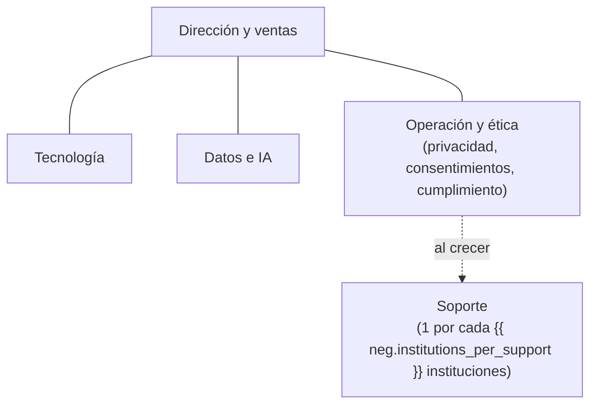

# Emprendimiento {#cap-m-emp}

## En una frase

!!! frase "Lo que aporta esta materia"
    **Enlaza es un negocio SaaS para instituciones de cuidado: un problema real de coordinación, una propuesta de valor
    clara, tres planes de suscripción, un modelo financiero a cinco años con cada supuesto marcado, un mercado medido con
    el DENUE y la honestidad de decir que el plan base no alcanza y qué haría falta.**

## Qué evalúa el profesor

| Pide | Documento y sección | Dónde se responde |
|---|---|---|
| Entregable: «Plan de Negocios Viable y Canvas de la Startup» | PP, «Evidencia integradora», p. 2 | Canvas (abajo); @ref(cap-negocio) |
| 1. Estudio de mercado: segmentación geográfica por zonas vulnerables, estimación de demanda, competidores tradicionales y tecnológicos | PP, «Componentes Clave del Plan de Negocios Formal», p. 15 | «Plan de negocios formal», estudio 1 (abajo) |
| 2. Estudio técnico-operativo: arquitectura en la nube, flujos de datos en tiempo real, simulador de rutas | PP, p. 15 | estudio 2 (abajo) |
| 3. Estudio administrativo y legal: organigrama, código de ética para datos de salud, marco legal de protección de datos | PP, p. 15 | estudio 3 (abajo) |
| 4. Evaluación financiera: ingresos y egresos a {{ doc.emp_anios }}, **VAN y TIR**, análisis de riesgos financieros | PP, p. 15 | estudio 4 (abajo) |
| 5. Estrategia de financiamiento: pitch para inversionistas ángel o capital semilla; *silver economy* en Latinoamérica | PP, p. 15 | estudio 5 (abajo) |
| Propuesta de valor sostenible, análisis financiero realista, costos asequibles y atraer capital semilla (por qué fracasan el {{ doc.emp_fracaso }} de estas iniciativas) | PP, «Incidente crítico de la UCA: Emprendimiento», p. 14 | «Respuesta al incidente crítico» (abajo) |
| Incorporar al plan las limitaciones técnicas y éticas de los otros cinco componentes, no como notas al pie | PP, «Resultado de esta actuación», p. 7 | riesgos del estudio 4 (abajo) |
| Sostener la promesa de escalamiento nacional o reformular hacia una expansión regional más segura | PP, «Incidente crítico», p. 6; «Dilemas», p. 8 | «Respuesta al incidente crítico» |
| Ruta de implementación realista: piloto, mantenimiento, capacitación y costos | PP, «Desarrollo del Problema Prototípico», p. 9 | «Ruta de implementación» (abajo) |
| Rentabilidad financiera y retorno social de inversión | PP, «Planteamiento», enfoque de emprendimiento, p. 3 | estudio 4 (VAN, TIR) y «Retorno social» (abajo) |
| El plan se alimenta de los resultados de la simulación y del tablero | PP, «Rúbrica Analítica», p. 4; Plan SIE, sección 3 | datos de uso en `/negocio`; costo de cumplir la LFT de SIRAG-D (abajo) |
| Rúbrica propia de la materia | **no lo dicen los documentos: confirmar con el profesor** | — |

## Los conceptos, desde cero

### Problema, cliente y usuario

**Qué es.** El **cliente** paga; el **usuario** usa. No siempre son la misma persona.

**En Enlaza.** Cliente: la **institución** (residencia, centro de día, red de cuidado a domicilio). Usuarios: coordinación,
personal, médicos y familias. El problema: coordinar visitas con llamadas, WhatsApp y hojas de cálculo (@ref(cap-que-es)).

### Propuesta de valor

**Qué es.** Por qué un cliente elegiría tu producto: qué dolor quita o qué ganancia da.

**En Enlaza.** «Cada visita, con la persona adecuada y a tiempo»: asignación automática que respeta turnos y ley, tablero en
vivo, familias informadas, alerta de emergencias por voz, indicadores y datos protegidos, sin instalar nada.

### Modelo de negocio y Lienzo (Canvas)

**Qué es.** Cómo una empresa crea, entrega y cobra valor. El **Lienzo de modelo de negocio** lo resume en nueve bloques.

| Bloque | Enlaza |
|---|---|
| Segmentos de clientes | instituciones privadas de cuidado de personas mayores (CDMX, luego Edomex, Jalisco, Nuevo León); centros públicos con plan Gobierno |
| Propuesta de valor | coordinación automática, en vivo, segura y con datos para decidir |
| Canales | venta directa, demostraciones, la página pública |
| Relación con clientes | suscripción, soporte, capacitación |
| Fuentes de ingreso | suscripción mensual por plan |
| Recursos clave | la plataforma, el equipo, los datos de referencia |
| Actividades clave | desarrollo, soporte, ventas |
| Socios clave | nube (hospedaje), instituciones piloto |
| Estructura de costos | sueldos (fijo), soporte y hospedaje (crecen con clientes), adquisición |

### SaaS y suscripción; MRR y ARPA

**Qué es.** [[SaaS]]: software como servicio, pagado por suscripción. **MRR**: ingreso recurrente mensual. **ARPA**: ingreso
promedio por cuenta (institución).

**En Enlaza.** Tres planes (Básico {{ neg.plan_basic_price }}, Profesional {{ neg.plan_professional_price }}, Institucional
{{ neg.plan_institutional_price }} al mes) con una mezcla supuesta: ARPA de {{ bm.arpa1 }}.

### Costos fijos y variables

**Qué es.** **Fijos:** no cambian con el número de clientes (sueldos, renta). **Variables:** crecen con los clientes.

**En Enlaza.** Fijo del año 1: {{ bm.fixed1 }} al mes. Variables: soporte y hospedaje, {{ bm.variable_cost }} por institución al
mes; más {{ bm.cac }} por cada institución nueva (adquisición).

### Punto de equilibrio

**Qué es.** Cuántos clientes (o cuánto tiempo) hacen falta para que los ingresos cubran los costos.

**Ejemplo.** Un puesto de tacos con renta de 10,000 al mes que gana 20 por taco necesita vender 500 tacos para no perder.

**En Enlaza.** Fórmula clásica: {{ bm.fixed1 }} ÷ {{ bm.arpa1 }} ≈ {{ bm.breakeven_static }}. Con el modelo mes a mes, deja de perder
dinero en el mes {{ bm.breakeven_month }}.

### Flujo de caja e inversión necesaria

**Qué es.** El dinero que entra y sale cada mes. La **inversión necesaria** es el punto más bajo de la caja acumulada:
lo que hay que financiar antes de recuperarse.

**En Enlaza.** {{ bm.investment }}, en el mes {{ bm.investment_month }}; recupera lo perdido en el mes {{ bm.payback_month }}.

### Valor del dinero en el tiempo, tasa de descuento y VPN

**Qué es.** Un peso hoy vale más que un peso dentro de cinco años (inflación, riesgo, oportunidad). La **tasa de descuento**
mide cuánto «castigamos» el futuro. El **[[VPN]]** suma los flujos futuros traídos a hoy: positivo = el proyecto crea valor a
esa tasa.

**Ejemplo.** Si te ofrecen 110 pesos dentro de un año o 100 hoy, y tu dinero puede rendir 10 % en otro lado, da igual: el
valor presente de esos 110 es 100.

**En Enlaza.** Tasa base {{ bm.rate_25 }} (tasa libre de riesgo + prima de empresa nueva). VPN: {{ bm.npv_15 }} al
{{ bm.rate_15 }}, **{{ bm.npv_25 }}** al {{ bm.rate_25 }}, {{ bm.npv_35 }} al {{ bm.rate_35 }}.

### TIR (tasa interna de retorno)

**Qué es.** La tasa de descuento con la que el VAN (VPN) de un proyecto vale exactamente cero. Si la TIR es mayor que la tasa que
exigen los inversionistas, el proyecto crea valor.

**Ejemplo.** Si prestas 100 pesos y te devuelven 120 en un año, la TIR es 20 %: si tu dinero te rinde más en otro lado, no te
conviene.

**En Enlaza.** Base {{ bm.sc.base.tir }} (menor que la tasa exigida de {{ bm.rate_25 }}: VAN negativo); recomendado
{{ bm.sc.recommended.tir }} (supone plan Gobierno y fundadores al {{ neg.founder_salary_year1_recommended }} % el año 1; sin ambos, VPN {{ bm.rec_wo_both }}).

### Churn (cancelación)

**Qué es.** El porcentaje de clientes que se va cada mes. **En Enlaza:** {{ neg.monthly_churn }} % al mes (supuesto): vida
esperada de un cliente {{ bm.lifetime }}.

### LTV, CAC, LTV/CAC y recuperación del CAC

**Qué es.** **[[LTV]]**: lo que deja un cliente en toda su vida. **[[CAC]]**: lo que cuesta conseguirlo. **LTV/CAC** mayor que 3
se considera sano. **Recuperación del CAC**: meses de margen para pagar lo que costó conseguirlo.

**En Enlaza.** LTV {{ bm.ltv }}, CAC {{ bm.cac }}, **LTV/CAC {{ bm.ltv_cac }}**, recuperación en {{ bm.cac_payback }}.

### Tamaño de mercado (TAM, SAM, SOM)

**Qué es.** **TAM**: todo el mercado posible. **SAM**: la parte que tu producto puede atender. **SOM**: la parte que
realistamente puedes ganar.

**En Enlaza.** Medido con el [[DENUE]] (mayo de 2026): por ejemplo, {{ neg.denue_residences_private_cdmx }} residencias y
{{ neg.denue_day_centers_private_cdmx }} centros de día privados en la CDMX. Con el plan base, en el año 5 Enlaza tendría el
{{ bm.sc.base.share_cdmx }} de los privados de la CDMX: un SOM irreal. El escenario recomendado limita la participación al
{{ neg.recommended_private_cap }} % por entidad.

### Competencia

**Qué es.** Quién más resuelve el problema, y a qué precio. **En Enlaza:** software de consultorio (HuliPractice,
Doctoralia) cobra por médico; Enlaza cobra por institución e incluye la coordinación del personal (@ref(cap-negocio)).

### Escenarios y sensibilidad

**Qué es.** Probar el plan con supuestos distintos (pesimista, conservador, recomendado) y ver qué palanca mueve más el
resultado.

**En Enlaza.** Base (VPN {{ bm.sc.base.npv25 }}), conservador ({{ bm.sc.conservative.npv25 }}) y recomendado
({{ bm.sc.recommended.npv25 }}; supone plan Gobierno y fundadores al {{ neg.founder_salary_year1_recommended }} % el año 1; sin ambos, VPN {{ bm.rec_wo_both }}). ¿Qué haría el VPN base = 0? Precio Profesional {{ bm.zero_price }}, o {{ bm.zero_year5 }}
instituciones en el año 5, o CAC {{ bm.zero_cac }}.

## El plan de negocios formal, estudio por estudio

### 1. Estudio de mercado

- **Segmentación geográfica:** CDMX primero (la población de 60+ más grande y la contingencia ambiental del problema),
  después Estado de México conurbado, Jalisco y Nuevo León (orden de expansión, supuesto). Dentro de la CDMX, Panorama-AM
  muestra por alcaldía dónde vive la población con más riesgo (multimorbilidad, dependencia, sensibilidad a la contaminación),
  que es donde conviene empezar.
- **Estimación de demanda:** {{ seed.pop60_cdmx }} personas de 60+ en la CDMX (Censo 2020); establecimientos que serían clientes
  según el DENUE: {{ neg.denue_residences_private_cdmx }} residencias, {{ neg.denue_day_centers_private_cdmx }} centros de día y
  {{ neg.denue_home_nursing_cdmx }} servicios de enfermería a domicilio privados en la CDMX, más los públicos para el plan Gobierno.
- **Competidores tradicionales:** la coordinación con llamadas, WhatsApp y hojas de cálculo (gratis, pero sin asignación,
  trazabilidad ni datos). **Tecnológicos:** software de consultorio y agenda médica (HuliPractice, Doctoralia), que cobra por
  médico y no coordina personal a domicilio; software de residencias en otros países.

### 2. Estudio técnico-operativo

Arquitectura actual y en la nube (@ref(cap-arquitectura), @ref(cap-m-sie)), flujos en tiempo real por WebSocket
(@ref(cap-tiempo-real)) y el simulador SIRAG-D, que usa el mismo despachador que la operación (@ref(cap-sirag)). **Sensores:** el
PP menciona flujos de sensores; Enlaza no usa sensores (usa lecturas de aire, tráfico por hora, la app y la voz).

### 3. Estudio administrativo y legal

**Organigrama inicial** (el número de fundadores y sus áreas son supuesto del equipo, `assumptions.csv`):

**Código de ética para datos de salud** y **marco legal**: consentimiento por tipo, minimización, privacidad desde el diseño,
IA supervisada, LFPDPPP 2025, ARCO, LFT (@ref(cap-etica), @ref(cap-m-pp)). La bibliografía del PP recomienda el código de ética
de AMIPCI (2021) y las directrices de la OMS (2021): **confirmar con el profesor** si se espera adoptarlos por escrito.

### 4. Evaluación financiera

Proyecciones mensuales a {{ doc.emp_anios }} con el mismo modelo de `/negocio` (@ref(cap-negocio)):

| Escenario | VAN (VPN) al {{ bm.rate_25 }} | **TIR** | Equilibrio (mes) | Inversión necesaria |
|---|---|---|---|---|
| Base | {{ bm.sc.base.npv25 }} | {{ bm.sc.base.tir }} | {{ bm.sc.base.breakeven }} | {{ bm.sc.base.investment }} |
| Conservador | {{ bm.sc.conservative.npv25 }} | {{ bm.sc.conservative.tir }} | {{ bm.sc.conservative.breakeven }} | {{ bm.sc.conservative.investment }} |
| Recomendado | {{ bm.sc.recommended.npv25 }} | {{ bm.sc.recommended.tir }} | {{ bm.sc.recommended.breakeven }} | {{ bm.sc.recommended.investment }} |

La **TIR** es la tasa de descuento anual con la que el VAN de los cinco años vale cero. La del escenario base queda **debajo**
de la tasa exigida ({{ bm.rate_25 }}), por eso su VAN es negativo; la del recomendado la supera con holgura, pero supone plan Gobierno y fundadores al {{ neg.founder_salary_year1_recommended }} % el año 1; sin ambos, VPN {{ bm.rec_wo_both }}.

**Riesgos financieros, incluidos los que revelaron los otros componentes:**

| Riesgo | Origen | Efecto en el plan | Mitigación |
|---|---|---|---|
| Mercado privado pequeño | DENUE | no caben {{ bm.y5.customers }} clientes en CDMX y Edomex | tope de participación, más entidades, plan Gobierno |
| Churn mayor al supuesto | supuesto | baja el LTV y retrasa el equilibrio | piloto con medición real |
| CAC mayor fuera de la CDMX | supuesto | más inversión necesaria | expansión regional gradual |
| Falsas alarmas de voz ({{ voz.holdout.fa100 }} por 100 notas) | Cómputo Cognitivo | carga para coordinación y riesgo de que el cliente desactive la voz | dos niveles, revisión humana; vender la voz como módulo en evaluación |
| Sesgo con lenguas originarias | Cómputo Cognitivo | no se puede vender la voz en el sur sin evaluar | expansión regional, evaluación por grupo antes de cada región |
| Cumplir la jornada nocturna cuesta plazas | Simulación ({{ sens.extra_staff.night_legal.vela_timeout.staff }} personas en lugar de {{ sens.extra_staff.current.vela_timeout.staff }}) | costo para el cliente, no para Enlaza | Enlaza lo informa; el cliente decide |
| «Sin atender» limitado por el personal del cliente | Simulación | la promesa no puede ser «cero visitas perdidas» | vender priorización de lo urgente, que sí mejora |
| Datos sensibles | Práctica Profesional | multas y pérdida de confianza | seguridad por fila, consentimientos, bitácora |

### 5. Estrategia de financiamiento: guion de pitch

1. **Problema:** {{ seed.pop60_cdmx }} personas de 60+ en la CDMX; instituciones que coordinan visitas por WhatsApp.
2. **Solución:** Enlaza, demostración en vivo.
3. **Evidencia:** la simulación muestra que priorizar por riesgo baja la espera de lo urgente
   ({{ sim.normal.human_dispatcher.high_wait_p90_min }} a {{ sim.normal.risk_priority.high_wait_p90_min }} min de p90).
4. **Mercado:** DENUE por segmento; expansión regional.
5. **Modelo:** suscripción; LTV/CAC {{ bm.ltv_cac }}.
6. **Lo que pedimos:** la inversión necesaria del escenario recomendado, {{ bm.sc.recommended.investment }}, para llegar al equilibrio
   en el mes {{ bm.sc.recommended.breakeven }}. Dicho en voz alta: ese escenario supone plan Gobierno y fundadores al {{ neg.founder_salary_year1_recommended }} % el año 1; sin ambos, VPN {{ bm.rec_wo_both }}.
7. **Riesgos y cómo los atendemos** (la tabla anterior): mostrar los riesgos da credibilidad ante inversionistas.

**Silver economy en Latinoamérica:** el modelo solo cubre México; la expansión latinoamericana **no se modeló** y se presenta
como visión, no como proyección.

## Ruta de implementación

Pide el PP (p. 9): piloto, mantenimiento, capacitación y costos. Propuesta del equipo (las etapas son supuesto, sin fechas):

| Etapa | Qué se hace | Costo que ya está en el modelo |
|---|---|---|
| Piloto | una institución de la CDMX, solo agenda, asignación y tablero; consentimientos firmados; medir puntualidad y «sin atender» reales | CAC de {{ bm.cac }} por institución |
| Capacitación | coordinación, personal y familias (modo sencillo, voz) | dentro del soporte |
| Ampliación | voz y Panorama; después contingencia | — |
| Mantenimiento | soporte (1 por cada {{ neg.institutions_per_support }} instituciones), hospedaje desde el año {{ neg.hosting_start_year }}, respaldos | costos variables del modelo ({{ bm.variable_cost }} por institución al mes) |

## Respuesta al incidente crítico de Emprendimiento

**El incidente** (PP, p. 14): el {{ doc.emp_fracaso }} de las iniciativas de este tipo fracasa en dos años por propuestas de valor
débiles, finanzas poco realistas, precios inasequibles o falta de capital semilla. En el incidente general (p. 6), la dirección
debe decidir si sostiene la promesa de escalamiento nacional.

- **Propuesta de valor sostenible:** se vende a instituciones que ya tienen el problema y el presupuesto; la familia no paga a
  Enlaza.
- **Análisis financiero realista:** VAN, TIR, tres escenarios y el VAN base negativo dicho abiertamente.
- **Costos asequibles:** con el plan lleno, Enlaza cuesta {{ bm.per_patient_basic }} (Básico) o {{ bm.per_patient_professional }}
  (Profesional) al mes por paciente, que paga la institución.
- **Escalamiento nacional:** **no se promete**. El escenario recomendado crece por regiones, con tope de participación, y la
  voz no se lleva a regiones donde no se haya evaluado.

### Retorno social

El PP pide demostrar retorno social de inversión. **No se calculó un SROI** (retorno social en pesos). Lo que sí se mide:
menos espera para lo urgente (simulación), jornada legal del personal, familias informadas y horas de coordinación ahorradas
(`/negocio`, supuesto de {{ neg.minutes_per_manual_assignment }} min por asignación). **Confirmar con el profesor** si se espera un
SROI formal.

## Por qué lo hicimos así

- **Suscripción y no comisión** ({{ neg.commission_alternative }} % evaluada): ingreso predecible y sin conflicto con instituciones
  de asistencia privada.
- **Supuestos en un CSV con fuente**, para que cualquier profesor pueda cambiar uno y ver el efecto en `/negocio`.
- **Mercado por segmento del DENUE**, no el total del sector.
- **Mostrar el VPN negativo** y proponer una alternativa, en lugar de inflar los supuestos.

## Dónde se ve en el sistema

| Concepto | Dónde |
|---|---|
| Planes y precios | página pública `/` (Planes) y `/negocio` |
| Equilibrio, VPN, LTV/CAC, escenarios | `/negocio` (Dirección); `business/model.ipynb` |
| Supuestos con fuente | `data/business/assumptions.csv` |
| Cálculo | `backend/app/services/business_model.py` |
| Uso real del prototipo | `/negocio` (servicios coordinados, horas ahorradas) |

## Números clave

{{ tabla bm.arpa1 bm.fixed1 bm.breakeven_static bm.breakeven_month bm.investment bm.npv_25 bm.ltv bm.cac bm.ltv_cac bm.cac_payback neg.monthly_churn bm.sc.recommended.npv25 neg.denue_residences_private_cdmx }}

## Limitaciones honestas

- Sin **entrevistas a clientes** ni prueba de disposición a pagar.
- Precios, mezcla, churn, CAC y crecimiento son **supuestos**.
- El **plan Gobierno** no tiene un precio de referencia público.
- No se calculó un **retorno social en pesos** (SROI).
- La expansión latinoamericana no se modeló.
- Pesos nominales, antes de impuestos y sin IVA.

## Qué decir en 2 minutos

!!! frase "Guion de 2 minutos · Emprendimiento"
    «Nuestro cliente es la institución que cuida personas mayores: hoy coordina visitas con WhatsApp y hojas de cálculo.
    Enlaza es un **SaaS por suscripción**: tres planes por tamaño, ingreso promedio de {{ bm.arpa1 }} al mes por institución.

    Con un costo fijo de {{ bm.fixed1 }} al mes, el **punto de equilibrio** clásico es de {{ bm.breakeven_static }}; con el modelo
    mes a mes dejamos de perder dinero en el mes {{ bm.breakeven_month }}. Cada cliente es muy rentable: **LTV/CAC de
    {{ bm.ltv_cac }}** y recuperamos su costo de adquisición en {{ bm.cac_payback }}.

    Pero somos honestos: al {{ bm.rate_25 }} de descuento el **VPN del plan base es negativo** ({{ bm.npv_25 }}), y medimos el
    mercado real con el **DENUE**: el plan base pediría quedarnos con el {{ bm.sc.base.share_cdmx }} de los establecimientos privados de la CDMX. Por eso
    proponemos un **escenario recomendado**: tope de participación, expansión a otros estados y un plan para centros públicos;
    su VPN es {{ bm.sc.recommended.npv25 }}, pero supone plan Gobierno y fundadores al {{ neg.founder_salary_year1_recommended }} % el año 1; sin ambos, VPN {{ bm.rec_wo_both }}.»

## 10 preguntas difíciles

!!! pregunta "1. ¿Quién paga y quién usa?"
    Paga la institución; usan coordinación, personal, médicos y familias. La familia no paga a Enlaza.

!!! pregunta "2. ¿Por qué suscripción y no comisión por servicio?"
    La suscripción da ingreso predecible a Enlaza y costo predecible a la institución. Una comisión por servicio cobraría más a
    quien atiende más, lo que choca con instituciones de asistencia privada.

!!! pregunta "3. ¿De dónde salen los precios?"
    Son supuestos, comparados con el software de consultorio (HuliPractice de {{ neg.competitor_hulipractice_min }} a
    {{ neg.competitor_hulipractice_max }} por médico). Enlaza cobra por institución e incluye la coordinación del personal. Falta
    validarlos con entrevistas.

!!! pregunta "4. Si el VPN es negativo, ¿por qué invertir?"
    Al {{ bm.rate_25 }} el plan base no crea valor: las pérdidas de los primeros años pesan más que las utilidades del final.
    Por eso proponemos el escenario recomendado (VPN {{ bm.sc.recommended.npv25 }}), que supone plan Gobierno y fundadores al {{ neg.founder_salary_year1_recommended }} % el año 1; sin ambos, VPN {{ bm.rec_wo_both }}.

!!! pregunta "5. ¿Qué es LTV/CAC y por qué el suyo es tan alto?"
    Lo que deja un cliente en su vida contra lo que cuesta conseguirlo. Es alto ({{ bm.ltv_cac }}) porque el churn supuesto es
    bajo ({{ neg.monthly_churn }} % al mes) y el costo variable por cliente es pequeño. Si el churn fuera mayor, bajaría: es un
    supuesto a validar.

!!! pregunta "6. ¿Qué tan grande es el mercado?"
    Lo medimos con el DENUE por clase de actividad: residencias, centros de día y enfermería a domicilio, privados y públicos.
    Por ejemplo, {{ neg.denue_residences_private_cdmx }} residencias privadas en la CDMX. Es pequeño: por eso hay que crecer a otras
    entidades y a centros públicos.

!!! pregunta "7. ¿Qué tasa de descuento usaron y por qué?"
    {{ bm.rate_25 }} nominal: tasa libre de riesgo (TIIE 28 días {{ neg.tiie_28_days }} %) más una prima por ser empresa nueva.
    Mostramos también {{ bm.rate_15 }} y {{ bm.rate_35 }} para ver la sensibilidad.

!!! pregunta "8. ¿Cuánto dinero necesitan?"
    {{ bm.investment }} en el plan base (el punto más bajo de la caja, en el mes {{ bm.investment_month }}); en el recomendado,
    {{ bm.sc.recommended.investment }} (que supone plan Gobierno y fundadores al {{ neg.founder_salary_year1_recommended }} % el año 1; sin ambos, VPN {{ bm.rec_wo_both }}).

!!! pregunta "9. ¿Qué los diferencia de la competencia?"
    La competencia cobra por médico y se centra en el consultorio. Enlaza es para la institución: asigna personal a domicilio
    respetando turnos y ley, tiene tablero en vivo, avisa a familias, detecta emergencias por voz y separa los datos por
    institución.

!!! pregunta "10. ¿Sostendrían la promesa de escalamiento nacional ante los inversionistas?"
    No. El plan base no cabe en el mercado privado y el asistente de voz no está evaluado con hablantes de lenguas originarias.
    Proponemos crecer por regiones con tope de participación (escenario recomendado, TIR {{ bm.sc.recommended.tir }}; supone plan Gobierno y fundadores al {{ neg.founder_salary_year1_recommended }} % el año 1; sin ambos, VPN {{ bm.rec_wo_both }}) y llevar la
    voz a una región solo después de evaluarla ahí. Presentar los riesgos completos da más credibilidad que una promesa que no se
    puede cumplir. El supuesto más débil es el precio del plan Gobierno, sin referencia pública.
