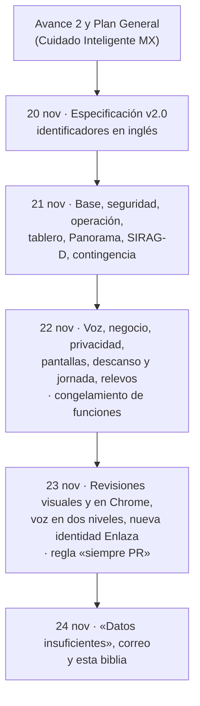

# Bitácora de hallazgos y decisiones {#cap-bitacora}

## En una frase

!!! frase "En una frase"
    **Enlaza no salió como se planeó: cada parte destapó algo (una fuga de privacidad, un hallazgo de la simulación, falsas
    alarmas de voz, la ley laboral, un reloj que retrocede) y en cada caso el equipo decidió qué hacer; esta es la historia
    en orden, con qué pasó, cómo se descubrió y qué se decidió.**

## Explicado sin tecnicismos

Un proyecto real no avanza en línea recta. Este capítulo es el diario del proyecto. Sirve para la defensa porque muchas
preguntas difíciles se contestan mejor con una historia («lo encontramos así y lo resolvimos así») que con una definición.
Las fechas son de 2026, en hora de la Ciudad de México. Los números de PR son los del repositorio en GitHub.

## Por qué lo hicimos así

Llevar el registro de las decisiones (en `docs/dev/`, en `CLAUDE.md` y en cada PR) fue una regla desde el inicio. Así nadie
depende de la memoria de una persona, y cualquier integrante puede explicar por qué algo es como es.

## Cómo funciona por dentro

### Antes del código

**Avance 2 y Plan General (noviembre).** El equipo definió el proyecto como *Cuidado Inteligente MX* para la materia de SIE:
la transacción central, el mapa de sistemas, el diccionario de datos, la matriz de permisos y dos instituciones ficticias
(@ref(cap-avance2)).

**20 nov · Especificación v2.0.** Reemplazó la especificación anterior, que tenía los identificadores en español. Desde ahí
el código, las tablas y las rutas van en inglés y todo lo que lee una persona en español (regla 1 de `CLAUDE.md`).

### 21 de noviembre: los cimientos

**1. Kit inicial.** Especificación, datos sintéticos, SQL y configuración. También se desactivó la atribución automática de
IA en los commits (ver @ref(cap-construccion)).

**2. Base de la API, sesión, aislamiento y bitácora (PR #1).**
- *Qué pasó:* había que decidir qué responder cuando alguien pide un paciente de otra institución.
- *Cómo se descubrió:* con la seguridad por fila, la API no ve ese paciente y solo podría responder 404.
- *Qué se decidió:* responder **403 y registrarlo** usando una función mínima (`entity_institution`). En el Avance 2 la
  propuesta era 404.

**3. La fuga de privacidad en las vistas (PR #2).**
- *Qué pasó:* las vistas de la carga inicial corrían con permisos de su dueño y **se saltaban la seguridad por fila**.
  `vela_api`, sin institución, leía {{ hist.fuga_vistas_pacientes }} fichas por `v_patients` y {{ hist.fuga_vistas_personas }}
  personas por `v_persons`.
- *Cómo se descubrió:* al construir la operación se revisó qué veía la API sin institución en cada objeto, no solo en las
  tablas, y se reprodujo en una transacción que se deshizo.
- *Qué se decidió:* `security_invoker = true` en las vistas, RLS en `persons` y pruebas que lo vigilan. Hoy esas vistas dan
  {{ db.rls_vpatients_none }} filas sin institución (@ref(cap-seguridad)).

**4. Los traslapes «planeados» de la semilla (PR #2).**
- *Qué pasó:* con el horario planeado, el historial tiene {{ gen.planned_overlaps }} pares de visitas que se cruzan.
- *Cómo se descubrió:* al querer imponer «nunca hay traslapes» a todo.
- *Qué se decidió:* no tocar el historial (es realista) y garantizar con una **restricción `EXCLUDE` parcial** que ninguna
  asignación **nueva** se cruce (@ref(cap-operacion)).

**5. Tablero en vivo y Cloudflare (PR #3).**
- *Qué pasó:* detrás del túnel, la API creía que todo era http y no marcaba la cookie como segura.
- *Qué se decidió:* confiar en `Cf-Visitor` y en `X-Forwarded-Proto` solo desde direcciones privadas. Se comprobó con un túnel
  real; la reconexión de `LISTEN` se probó reiniciando PostgreSQL (@ref(cap-tiempo-real)).

**6. Panorama-AM con referencias verificadas (PR #4).** Se verificaron los cuadros de la ENSANUT. La ENASEM correcta era la
**2024**, no la 2021. Se marcó como **supuesto** el factor de ajuste ({{ gen.enasem_factor }}) y como aproximada la comparación de
multimorbilidad (@ref(cap-datos)).

**7. SIRAG-D y el hallazgo que cambió el producto (PR #5).**
- *Qué pasó:* en la sensibilidad, con una coordinación que tarda 5–15 min en aprobar, **Enlaza quedaba peor que el despacho
  humano** en lo urgente ({{ hist.sens_antes_espera }}, histórico).
- *Cómo se descubrió:* el análisis de sensibilidad del retraso de aprobación, que era un supuesto dudoso.
- *Qué se decidió:* **aprobación con límite de tiempo solo para lo urgente** ({{ cfg.auto_apply_after }}, visita en menos de
  {{ cfg.urgent_within }}) y **reserva del candidato** ({{ cfg.hold_minutes }}). Con los dos cambios: {{ hist.sens_limite_y_reserva_espera }}
  frente al humano (@ref(cap-sirag)).
- *También:* el worker publicaba los turnos de 8 h a horas al azar y nunca se podían asignar. Se creó una regla de horario
  compartida con la simulación (`visit_rules.py`) y se alineó la tolerancia de {{ cfg.late_tolerance }}.

**8. Contingencia en vivo y panel de demostración (PR #6).** Se decidió que **lo real y la demostración nunca se mezclen**:
lecturas en otra tabla, eventos separados y «Volver a normal» que solo cierra lo de demostración (@ref(cap-contingencia)).

### 22 de noviembre: voz, negocio, ley y congelamiento

**9. ORACLE-Voz y la evaluación honesta (PR #7).**
- *Qué pasó:* en la prueba interna y en el externo todo salía casi perfecto.
- *Cómo se descubrió que no era cierto:* el equipo decidió medir en un **tercer conjunto a ciegas** (holdout), escrito por un
  agente que no vio nada más y guardado en Git antes de evaluarlo. Ahí: sensibilidad {{ voz.holdout.sens }}, pero
  {{ voz.holdout.fa100 }} falsas alarmas por cada 100 notas.
- *Qué se decidió:* publicar el resultado tal cual, agregar la **Línea de la Vida** a la pantalla de autolesión y dejar abiertas
  las opciones para bajar las falsas alarmas (@ref(cap-voz)).

**10. Negocio, privacidad y consentimientos (PR #8).** Se verificó el plazo ARCO en el texto vigente de la ley y se movieron
las pruebas a una **base aparte** (`vela_test`), para que dejaran de escribir en la bitácora de la demostración
({{ hist.pruebas_pr8 }} pruebas entonces).

**11. Mercado real del DENUE y escenario recomendado (PR #9).**
- *Qué pasó:* con el conteo del DENUE por segmento, el plan base pedía quedarse con el {{ bm.sc.base.share_cdmx }} de los establecimientos
  privados de la CDMX.
- *Qué se decidió:* quitar el total del sector (incluía establecimientos que no son clientes) y crear el **escenario
  recomendado** (tope de participación, expansión regional, plan Gobierno) (@ref(cap-negocio)).

**12. El 401 intermitente y el reloj de WSL2 (PR #9).**
- *Qué pasó:* las pruebas fallaban de vez en cuando ({{ hist.falla_401_frecuencia }}) con «Inicia sesión para continuar» justo
  después de entrar bien.
- *Cómo se descubrió:* primero se buscó en la voz (sin éxito, en muchas corridas); al aparecer en otras pruebas se midió el
  reloj de la laptop: WSL2 **retrocede {{ hist.salto_reloj_wsl2 }}** al sincronizarse con Windows. Un token emitido justo antes
  parecía «del futuro».
- *Qué se decidió:* aceptar {{ code.clock_leeway }} de diferencia al validar la sesión y que «Terminé» nunca quede antes de
  «Llegué». También afectaba a la demostración.

**13. Pantallas faltantes y consentimiento en las decisiones automáticas (PR #10).**
- *Qué pasó:* una auditoría contra la especificación encontró pantallas que decían «Próximamente».
- *Qué se decidió:* construirlas y, además, una decisión ética: **sin consentimiento de datos de salud, el despachador y la
  contingencia no usan esos datos**.
- *Hallazgo legal:* el turno «mixto» de la semilla era en realidad diurno, el vespertino excedía la jornada mixta y los
  nocturnos de 12 h exceden la nocturna (LFT arts. 60 y 61).

**14. Descanso de ley y jornada legal en la operación y en SIRAG-D (PR #11).** Cada persona descansa un día fijo (art. 69).
Los resultados empeoraron para **todas** las políticas: sin atender de {{ hist.sin_atender_7dias }} a
{{ sim.normal.vela_timeout.unattended_pct }} y utilización de {{ hist.utilizacion_7dias }} a {{ sim.normal.vela_timeout.utilization_pct }}.
Se **volvió a correr** toda la simulación y se revisó si el hallazgo del límite de tiempo seguía en pie. Sigue en pie, aunque
el original dependía de la plantilla de 7 días.

**15. Relevos, cobertura y congelamiento de funciones (PR #12).**
- *Qué pasó:* al cumplir la jornada nocturna, los servicios de 12 h ya no cabían en un turno de 7 h y el «sin atender» subía
  ({{ hist.nocturna_sin_relevos }}).
- *Qué se decidió:* **relevos** (dos personas consecutivas de la misma habilidad) y la vista de cobertura de la semana. Con
  relevos, cumplir la jornada ya no empeora el servicio.
- *Decisión del equipo:* **congelar funciones** hasta la defensa. Desde aquí solo correcciones, textos y lo que salga de los
  ensayos.

### 23 de noviembre: revisiones, dos niveles e identidad

**16. Revisión visual de todas las pantallas (PR #13).** Mapa que nunca queda en blanco, horas de 24 h en todo el sistema y la
bitácora en palabras normales ({{ hist.pruebas_pr13 }} pruebas).

**17. Revisión en Chrome en Windows (PR #14).** Los puntos encontrados usando el sistema como lo haría el público. Por
ejemplo:
- las gráficas crecían solas con Windows al 125 % ({{ hist.graficas_crecian }});
- REQ-08939 se contaba como «en visita» todo el día;
- el campo de fecha duplicaba el texto;
- los mensajes del navegador salían en inglés.

Se creó `ui_checks.mjs`, que revisa esos puntos en un navegador real.

**18. Voz en dos niveles y visitas «No cerradas» (PR #15, excepción aprobada al congelamiento).**
- *Qué pasó:* «el paciente comió bien y está tranquilo» salió como emergencia con P = {{ hist.caso_pac0112 }} solo por el
  clasificador.
- *Qué se decidió:* analizar el holdout. Con una sola pantalla roja, {{ vozb.holdout.false_alarms }} de
  {{ vozb.holdout.all_emergency_screens }} serían falsas. Con dos niveles (rojo para reglas, ámbar para el clasificador con revisión
  humana y escalamiento a los {{ cfg.escalate_after }}), la roja queda en {{ vozb.holdout.red_false }} de {{ vozb.holdout.red }}.
- *Además:* REQ-08939 se quedó abierta un día entero; ahora el worker marca «No cerrada» a las {{ cfg.not_closed_after }} y avisa.
  ({{ hist.pruebas_pr15 }} pruebas.)

**19. Diseño de tarjetas y próximas visitas de la familia (PR #16).** Las tarjetas ya no se estiran, la familia ve sus próximos
7 días (con el mismo sorteo del worker), el tablero vacío dice «Todo al día» y las alertas se agrupan
({{ hist.pruebas_pr16 }} pruebas).

**20. Clasificador v2: evaluado una vez y no adoptado (rama sin fusionar).** Un codificador preentrenado bajó las falsas
alarmas a {{ vozv2.v2.fa100 }} por 100 notas, pero la sensibilidad cayó a {{ vozv2.v2.sens }}. La regla de adopción, escrita antes de
abrir el holdout, no se cumplió y se quedó v1. La evaluación con las frases del equipo sigue **pendiente**.

**21. Nueva identidad: de Vela a Enlaza (PR #17).** Logotipo recreado en vectores a partir del original del equipo, paleta
validada, tipografías y página de presentación. ORACLE-Voz pasó a Enlaza Voz con el mismo cambio, lo que además evita
confusión con la marca Oracle. Los nombres internos (`vela`, `vela_api`) no cambiaron para no romper nada.

**22. Revisión final de identidad y regla «siempre PR» (PR #18).** Decisión del equipo: **ningún cambio directo a `main`**.
Todo va en una rama con su PR y se fusiona solo con las pruebas en verde.

### 24 de noviembre: los últimos ajustes

**23. «Datos insuficientes» y correo del aviso de privacidad (PR #20).**
- *Qué pasó:* al escribir esta biblia se vio que Panorama mostraba «100 % puntual» con dos visitas de ensayo, y que el aviso de
  privacidad conservaba un correo con el nombre viejo.
- *Qué se decidió:* con menos de {{ code.min_visits_rate }} se muestra «datos insuficientes (N visitas)», y el correo pasó a
  `privacidad@enlaza.test`.

**24. Hallazgos de la biblia y lo que se decidió (25 nov).**
- *El asentimiento «no» no bloqueaba la voz*, aunque el formato de consentimiento lo decía → **se corrigió** (PR #21,
  excepción al congelamiento): la voz se bloquea igual que sin consentimiento, con su mensaje y su registro.
- *El plan general pedía mostrar la confianza del modelo* → la bandeja del médico y las alertas de coordinación muestran la
  **confianza del clasificador**, nunca a la familia (PR #21).
- *Una prueba de navegador fallaba en `main`* (el campo de fecha no reemplazaba lo escrito si se tecleaba de inmediato) → se
  corrigió en el mismo PR.
- *No había respaldos de la base* → `scripts/backup_db.sh` y `scripts/restore_db.sh`, antes de la defensa y después de cada ensayo.
- *El diagnóstico de campo no estaba documentado* → el equipo lo hace esta semana con el material de `docs/diagnostico/`.
- *Las referencias* → lista completa en APA 7 en los anexos.
- *Sigue abierto:* una frase claramente rutinaria («Hoy mi mamá comió bien y durmió su siesta») dispara el aviso ámbar; se
  mitiga con la revisión humana.

## Dónde está en el código

| Qué | Dónde |
|---|---|
| Decisiones de cada paso | `docs/dev/decisiones_*.md`, `docs/dev/sirag_d_modelo.md` |
| Reglas y decisiones fechadas del equipo | `CLAUDE.md` |
| Historia de cambios | `git log main` y los PR en GitHub |
| Antes y después de las revisiones | `docs/dev/capturas/revision/`, `docs/dev/capturas/diseno/` |

## Números clave

{{ tabla git.commits_main git.prs_main git.first_day git.last_day hist.fuga_vistas_pacientes gen.planned_overlaps hist.sens_antes_espera hist.sens_limite_y_reserva_espera hist.salto_reloj_wsl2 hist.sin_atender_7dias sim.normal.vela_timeout.unattended_pct hist.caso_pac0112 repo.pytest_collected }}

## Limitaciones honestas

- La historia está reconstruida de los documentos y del repositorio. Lo que se habló y no quedó escrito no aparece.
- Varias cifras históricas ya no están en los archivos de resultados (se sobrescribieron). Por eso se citan como «histórico»,
  con su documento de origen.
- Todo el sistema se construyó entre el 21 y el 23 de noviembre, mucho más rápido que el plan día por día de la especificación (`docs/spec/10`).
  @ref(cap-construccion) explica cómo.

## Preguntas que te pueden hacer

!!! pregunta "¿Qué fue lo más difícil del proyecto?"
    Que cada parte cambiaba a las otras. La ley laboral cambió los resultados de la simulación; la simulación cambió la
    operación (límite de tiempo); la evaluación de voz cambió las pantallas (dos niveles). Lo resolvimos manteniendo un solo
    sistema y registrando cada decisión.

!!! pregunta "¿Qué error grave encontraron?"
    La fuga de privacidad en las vistas: la API, sin institución, podía leer todas las fichas por una vista aunque la tabla
    estuviera protegida. La encontramos revisando qué veía la API en cada objeto, la reprodujimos, la corregimos y agregamos
    pruebas.

!!! pregunta "¿Algo que salió de la simulación cambió el sistema real?"
    Sí: el límite de tiempo para lo urgente y la reserva del candidato. La simulación mostró que, si coordinación tarda, lo
    urgente espera más que con un despachador humano.

!!! pregunta "¿Por qué cambiaron el nombre a días de la defensa?"
    El 23 de noviembre el equipo adoptó una identidad completa (logo, colores, tipografía) y unificó los módulos bajo Enlaza;
    además, el nombre del módulo de voz evitaba confusión con una marca registrada. Solo cambió lo que ve una persona; los
    nombres internos se quedaron para no romper nada.

!!! pregunta "¿Por qué dejaron de agregar funciones?"
    El 22 de noviembre el equipo congeló funciones para estabilizar el sistema antes de la defensa. Desde ahí solo entraron
    correcciones, textos y dos excepciones aprobadas (la voz en dos niveles y las visitas no cerradas).
