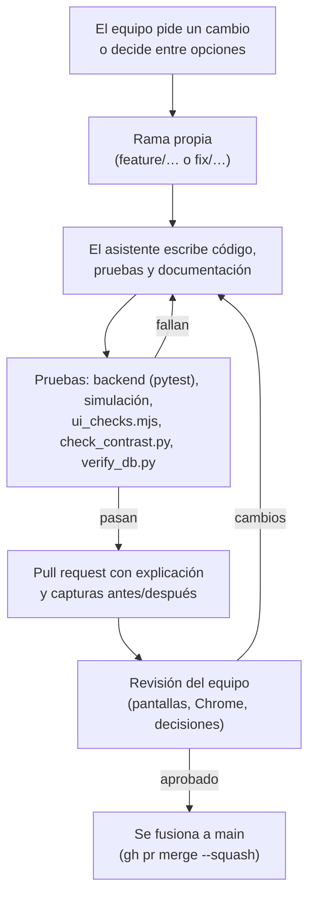

# Cómo se construyó {#cap-construccion}

## En una frase

!!! frase "En una frase"
    **El equipo definió el problema, el diseño y las reglas, tomó las decisiones y revisó el resultado; la mayor parte del
    código, las pruebas y la documentación técnica la escribió un asistente de programación con IA (Claude Code) siguiendo
    esas reglas, un cambio por pull request, con pruebas automáticas y revisiones en el navegador.**

## Explicado sin tecnicismos

Piensa en una obra: el equipo es el arquitecto y el dueño, que deciden qué se construye, con qué reglas, y revisan cada
avance; el asistente de programación es una cuadrilla muy rápida que construye lo que se le pide, propone opciones y avisa
cuando encuentra un problema. La cuadrilla no decide qué casa se hace ni firma la entrega.

Este capítulo existe porque un profesor puede preguntar, con toda razón, **«¿ustedes programaron esto?»**. La respuesta
honesta no es «sí, todo» ni «no, fue la IA»: es la de este capítulo.

## Por qué lo hicimos así

- **Tiempo:** el sistema completo (seis módulos integrados) se construyó entre el {{ git.first_day }} y el {{ git.last_day }}. Sin
  un asistente, un equipo que solo sabe Python no habría llegado a un sistema web en tiempo real con seguridad por fila,
  simulación y voz.
- **Reglas escritas:** para que el asistente no improvisara, el equipo puso las reglas en `CLAUDE.md`: idioma, reloj real,
  asignación, aislamiento, consentimiento, política de emergencias, sin secretos, auditoría, toda cifra con fuente,
  congelamiento de funciones y «siempre PR».
- **Revisión:** ningún cambio entra a `main` sin un PR y sin que pasen las pruebas (decisión del equipo, 23 nov 2026).

## Cómo funciona por dentro

### El flujo de cada cambio

### Qué hizo cada quien

| Lo hizo el equipo | Lo hizo el asistente (Claude Code) |
|---|---|
| Elegir el problema y el enfoque (Avance 2, Plan General, con los nombres de los cuatro integrantes) | Escribir la mayor parte del código: backend, frontend, simulación, voz, SQL, migraciones |
| El logotipo original (`assets/brand/source/logo_enlaza.jpg`) y la identidad | Recrear el logotipo en vectores y aplicar la identidad en la app |
| Las reglas de `CLAUDE.md` | Escribir las pruebas automáticas ({{ repo.tests_summary }} en el backend) |
| Las decisiones fechadas (límite de tiempo, descanso de ley, relevos, consentimiento en decisiones automáticas, escenario de negocio, voz en dos niveles, congelamiento, «siempre PR», «datos insuficientes») | Proponer opciones con sus pros y contras cuando había que decidir |
| Revisar las pantallas y el uso real, y pedir las correcciones (por ejemplo, la revisión en Chrome en Windows del 23 nov; **confirmar quién la hizo**) | Encontrar problemas técnicos: la fuga de las vistas, el reloj de WSL2, las gráficas que crecían, las falsas alarmas |
| Aprobar las excepciones al congelamiento | Documentar las decisiones (`docs/dev/`) y escribir este libro |
| La defensa y la explicación de cada parte | Tomar las capturas y generar las cifras desde los archivos |

!!! nota "Para llenar por el equipo"
    Esta tabla se basa en lo que consta en el repositorio. El equipo debe completar **quién** del equipo hizo cada revisión y
    decisión, y corregir lo que no sea exacto:

    | Tarea | Responsable |
    |---|---|
    | Revisión en Chrome en Windows (23 nov) | ____ |
    | Decisiones de SIRAG-D (límite de tiempo, reserva) | ____ |
    | Decisión de la voz en dos niveles | ____ |
    | Identidad y logotipo | ____ |
    | Modelo de negocio y escenarios | ____ |
    | Frases de voz del equipo (pendiente) | ____ |
    | Diagnóstico de campo (pendiente o realizado) | ____ |

### Cómo se revisó cada cambio

- **Un PR por cambio**: {{ git.prs_main }} pull requests fusionados en `main` ({{ git.commits_main }} commits). Cada PR explica qué
  cambia, por qué y cómo se probó.
- **Pruebas automáticas** en una base de datos aparte (`vela_test`), para no tocar la demostración: backend con pytest, simulación,
  pruebas de navegador (`frontend/scripts/ui_checks.mjs`), contraste (`scripts/check_contrast.py`) y la base (`scripts/verify_db.py`).
  Las pruebas del backend crecieron con cada cambio ({{ hist.pruebas_pr8 }} → {{ hist.pruebas_pr13 }} → {{ hist.pruebas_pr15 }} →
  {{ hist.pruebas_pr16 }} → {{ repo.pytest_collected }}).
- **Capturas antes y después** en el proyector (1280 × 720) y en el celular (390 × 844): `docs/dev/capturas/`.
- **Revisión en un navegador real**: la revisión en Chrome en Windows encontró problemas que las pruebas no veían (gráficas que
  crecían con la pantalla al 125 %, el campo de fecha, mensajes en inglés).
- **Evaluaciones con reglas escritas antes**: el holdout de voz se guardó en Git antes de evaluarlo, y la regla para adoptar el
  clasificador v2 se escribió antes de ver el resultado.

### Lo que no dice el historial de Git

Por decisión del equipo, los commits **no llevan** la marca automática «generado con IA» (`CLAUDE.md`, «No AI attribution», y
`.claude/settings.json`). Por eso el historial de Git, por sí solo, no muestra quién escribió qué: todos los commits aparecen
con la cuenta del equipo. **Este capítulo existe para que eso quede dicho con claridad**, y no se oculte en una defensa.

## Dónde está en el código

| Qué | Dónde |
|---|---|
| Reglas para el asistente | `CLAUDE.md` |
| Configuración (sin atribución automática) | `.claude/settings.json` |
| Decisiones y por qué | `docs/dev/`, `docs/spec/` |
| Historia | `git log main`; los PR en GitHub |
| Pruebas | `backend/tests/`, `simulation/tests/`, `frontend/scripts/ui_checks.mjs`, `scripts/check_contrast.py`, `scripts/verify_db.py` |
| Capturas de revisión | `docs/dev/capturas/` |

## Números clave

{{ tabla git.first_day git.last_day git.prs_main git.commits_main repo.tests_summary hist.pruebas_pr8 hist.pruebas_pr16 repo.pages repo.routers repo.services }}

## Limitaciones honestas

- **Riesgo de no entender el propio sistema.** Es el riesgo real de construir con un asistente. Este libro, los guiones y las
  preguntas de cada capítulo existen para cerrarlo antes de la defensa.
- **La autoría de cada línea no se puede reconstruir** desde Git (no hay atribución automática).
- **La rapidez tiene costo**: hubo hallazgos tardíos (el reloj de WSL2, los dos niveles de voz, el asentimiento que no bloquea
  la voz) que salieron de revisiones, no del diseño inicial.

## Preguntas que te pueden hacer

!!! pregunta "¿Ustedes programaron esto?"
    Respuesta honesta en tres partes:

    1. **Lo que es nuestro:** el problema, el diseño desde el Avance 2, las reglas del proyecto, todas las decisiones (por ejemplo,
       la voz en dos niveles o el límite de tiempo) y la revisión de cada cambio.
    2. **Lo que hizo la herramienta:** la mayor parte del código la escribió un asistente de programación con IA, Claude Code,
       siguiendo nuestras reglas escritas, con un pull request por cambio y pruebas automáticas.
    3. **Lo que podemos demostrar:** que entendemos y podemos defender cada parte. Pregúntenos cualquiera: cómo se aísla a las
       instituciones, por qué Friedman y no ANOVA, por qué dos niveles de aviso o por qué el VPN base es negativo.

!!! pregunta "¿No es trampa usar IA para programar?"
    Lo sería si lo escondiéramos o si no entendiéramos lo que entregamos. Lo decimos abiertamente y la evaluación del proyecto
    pide, además del código, el diseño, las decisiones y la defensa, que son nuestras. Es como usar una calculadora: la usamos,
    pero tenemos que saber qué operación hacer y si el resultado tiene sentido.

!!! pregunta "¿Cómo saben que el código hace lo que dicen?"
    Por las pruebas automáticas ({{ repo.pytest_collected }} en el backend, más simulación, navegador, contraste y base de datos), las
    revisiones en el navegador y porque cada cifra de la app y de este libro sale de un archivo que se puede revisar.

!!! pregunta "¿Por qué los commits no dicen que se usó IA?"
    Fue una decisión del equipo para que el historial quedara limpio. Para no esconderlo, lo explicamos aquí y en la defensa.

!!! pregunta "Si la IA encontró los errores, ¿qué hicieron ustedes?"
    Decidir qué hacer con cada hallazgo. Por ejemplo, la evaluación honesta de la voz la pedimos nosotros (un conjunto a ciegas),
    y la decisión de mostrar dos niveles de aviso en lugar de bajar la sensibilidad fue del equipo, después de ver la matriz de
    errores.
