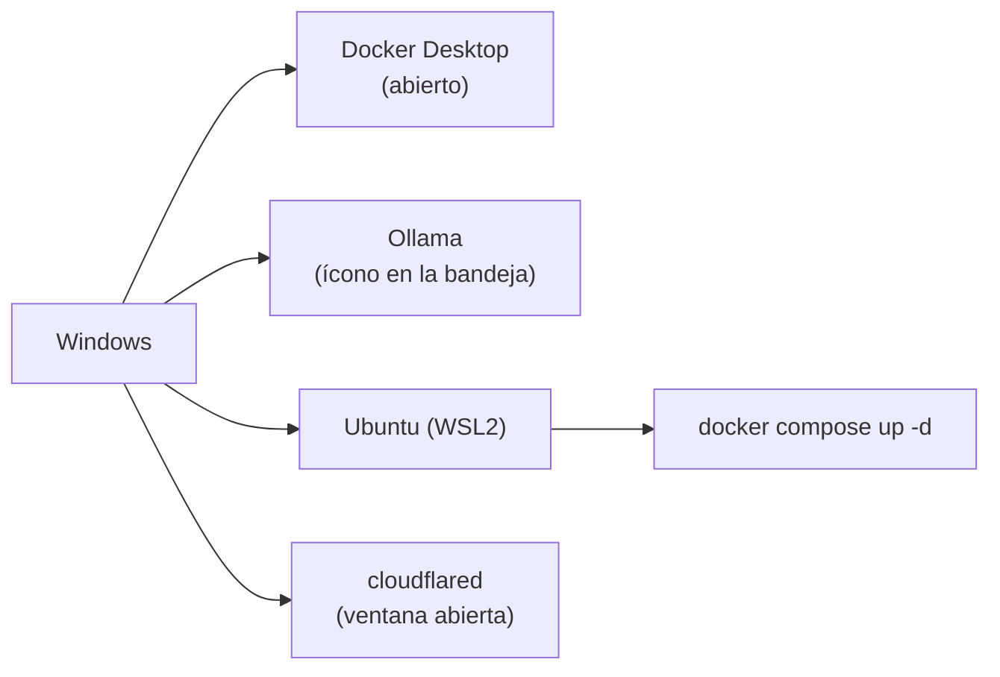

# Preparar la laptop {#cap-laptop}

## En una frase

!!! frase "En una frase"
    **Enlaza corre en una laptop con Windows 11: WSL2 con Ubuntu, Docker Desktop, Ollama con la GPU integrada y
    cloudflared; se instala una vez (una o dos horas) y después se enciende con un solo comando.**

## Explicado sin tecnicismos

Es como preparar una cocina antes de abrir un restaurante: se instalan los aparatos una sola vez (Windows, Ubuntu, Docker,
Ollama) y después cada día solo se encienden. La guía completa, paso a paso, está en `docs/00_preparar_laptop_y_github.md`.
Este capítulo es el resumen para no perderse.

## Por qué lo hicimos así

- **WSL2 + Docker** porque así todo corre igual en cualquier laptop del equipo (@ref(cap-arquitectura)).
- **Ollama en Windows** porque solo ahí usa la GPU integrada Radeon (Vulkan); dentro de WSL2 iría solo en CPU.
- **cloudflared** para dar un enlace público sin tocar el módem de la escuela.

## Cómo funciona por dentro

### Lista de instalación (una sola vez)

| Paso | Dónde | Comando o acción | Cómo comprobarlo |
|---|---|---|---|
| 1. Virtualización activa | BIOS / Administrador de tareas | «Virtualización: Habilitado» (SVM Mode) | Administrador de tareas → Rendimiento → CPU |
| 2. WSL2 con Ubuntu 24.04 | PowerShell (administrador) | `wsl --install -d Ubuntu-24.04` | `wsl -l -v` dice versión 2 |
| 3. Docker Desktop | Windows | motor WSL 2 + integración con Ubuntu-24.04 | `docker ps` en Ubuntu |
| 4. Ollama + GPU integrada | PowerShell | `setx OLLAMA_VULKAN 1` y `setx OLLAMA_IGPU_ENABLE 1`; `ollama pull` del modelo de `OLLAMA_MODEL` | `ollama ps` menciona GPU |
| 5. cloudflared | PowerShell | `winget install --id Cloudflare.cloudflared` | `cloudflared --version` |
| 6. Herramientas en Ubuntu | Ubuntu | git, Node.js 22, Python, GitHub CLI | `gh auth status` |
| 7. Repositorio | Ubuntu | `gh repo clone <usuario>/vela ~/proyectos/vela` | `ls ~/proyectos/vela` |
| 8. Configuración local | Ubuntu | `cp .env.example .env` y cambiar contraseñas y `JWT_SECRET` | `.env` existe y **no** aparece en `git status` |
| 9. Encender todo | Ubuntu | `docker compose up -d` | `curl localhost:8080/api/health` dice `"status":"ok"` |
| 10. Verificar la base | Ubuntu | `python3 scripts/verify_db.py` | «Todo correcto» |
| 11. Base de pruebas | Ubuntu | `python3 scripts/create_test_db.py` | `docker compose exec api pytest -q` pasa |

!!! cuidado "La GPU integrada es soporte no oficial"
    `OLLAMA_IGPU_ENABLE` funcionó en la laptop del equipo (Ryzen con Radeon integrada), pero no está documentado por Ollama.
    Si da problemas, se quita la variable y el modelo corre en CPU: funciona igual, más lento.

### Qué debe estar abierto para que funcione

## Dónde está en el código

| Qué | Dónde |
|---|---|
| Guía completa | `docs/00_preparar_laptop_y_github.md` |
| Variables | `.env.example` (el `.env` real no se sube) |
| Servicios | `docker-compose.yml` |

## Números clave

{{ tabla code.clock_leeway voz.t_whisper_load voz.t_llm_short }}

## Limitaciones honestas

- Solo se probó en la laptop del equipo (Ryzen, Windows 11). En otra computadora los tiempos del modelo de lenguaje cambian.
- La primera vez Whisper y el modelo de lenguaje se descargan (varios GB): hacerlo con buen internet, **no** el día de la defensa.

## Preguntas que te pueden hacer

!!! pregunta "¿Por qué no lo subieron a un servidor?"
    Porque para el prototipo la laptop cuesta cero, mantiene los datos locales y con el túnel de Cloudflare el público entra
    desde su celular. El modelo de negocio ya presupuesta un servidor en la nube para operar con clientes reales.
