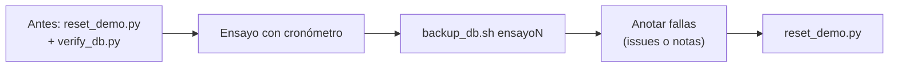

# Arrancar, respaldar, limpiar y recrear {#cap-operar}

## En una frase

!!! frase "En una frase"
    **Cinco comandos cubren todo el mantenimiento: encender (`docker compose up -d`), comprobar (`verify_db.py`), respaldar
    (`backup_db.sh`), limpiar los ensayos (`reset_demo.py`) y, si hace falta, recrear la base desde la semilla.**

## Explicado sin tecnicismos

Después de cada ensayo quedan «platos sucios»: notas de voz de prueba, solicitudes urgentes de demostración, alertas,
contingencias simuladas. `reset_demo.py` los lava sin tocar la semilla. Antes de lavar, conviene **tomar una foto** de cómo
quedó todo (el respaldo), por si algo sale mal.

## Por qué lo hicimos así

- **Respaldo antes de la defensa y después de cada ensayo** (decisión del equipo, 25 nov 2026): si un ensayo deja la base en mal
  estado, se vuelve atrás en minutos.
- **`reset_demo.py` y no borrar todo**: la semilla (el historial) y la bitácora se conservan; solo se quita lo que crearon los
  ensayos.
- **Recrear desde cero, solo si hace falta**: deja la bitácora limpia de las semanas de desarrollo.

## Cómo funciona por dentro

### Encender y comprobar

```bash
cd ~/proyectos/vela
docker compose up -d                 # base, migraciones, API, worker, voz, web y proxy
curl -s localhost:8080/api/health    # {"status":"ok","db":"ok","realtime":"ok",…}
python3 scripts/verify_db.py         # «Todo correcto»
```

### Respaldar y restaurar

```bash
bash scripts/backup_db.sh ensayo1    # -> backups/vela_AAAA-MM-DD_HHMM_ensayo1.dump (Git ignora backups/)
bash scripts/restore_db.sh backups/vela_AAAA-MM-DD_HHMM_ensayo1.dump   # pide confirmación; luego corre verify_db.py
```

El respaldo es un `pg_dump` completo: semilla, operación en vivo y bitácora. La restauración detiene la API y el worker,
restaura, los vuelve a encender y verifica. Se probó restaurando en una base temporal: mismos conteos y mismas políticas de
seguridad por fila.

### Limpiar los ensayos

```bash
python3 scripts/reset_demo.py --dry-run   # cuántas filas borraría, sin guardar
python3 scripts/reset_demo.py             # lo aplica (queda en la bitácora como demo_reset)
python3 scripts/verify_db.py
```

Borra reportes de voz, alertas, avisos a familias, solicitudes ARCO, escenarios de demostración, propuestas abiertas y las
solicitudes en vivo creadas por personas o por el panel; regresa a la semilla los consentimientos, descansos y planes que se
cambiaron en un ensayo. **No toca** la semilla, las visitas del plan que ya empezaron ni la bitácora. Al minuto, el worker vuelve
a crear solas las visitas de hoy.

### Fechas vivas

```bash
python3 scripts/rebase_dates.py --dry-run
python3 scripts/rebase_dates.py           # el historial termina «la semana pasada»
```

### Recrear la base desde cero (opcional, el día anterior)

```bash
bash scripts/backup_db.sh antes_de_recrear
docker compose stop api worker web proxy db
docker compose rm -f db
docker volume rm vela_pgdata              # SOLO la base de la demo
docker compose up -d                      # carga la semilla y las migraciones
python3 scripts/verify_db.py
python3 scripts/create_test_db.py         # la base de pruebas vive en el mismo volumen
python3 scripts/rebase_dates.py
```

### Regenerar esta biblia

```bash
bash scripts/build_biblia.sh              # números y PDF
bash scripts/build_biblia.sh --capturas   # además: reset, capturas nuevas de cada pantalla, reset otra vez
```

### Rutina de cada ensayo



## Dónde está en el código

| Qué | Dónde |
|---|---|
| Respaldo y restauración | `scripts/backup_db.sh`, `scripts/restore_db.sh` |
| Limpiar ensayos | `scripts/reset_demo.py` |
| Fechas vivas | `scripts/rebase_dates.py` |
| Verificar la base | `scripts/verify_db.py` |
| Base de pruebas | `scripts/create_test_db.py` |
| Generar la biblia | `scripts/build_biblia.sh` |

## Números clave

{{ tabla seed.service_requests seed.persons repo.pytest_collected code.worker_tick }}

## Limitaciones honestas

- Los respaldos son **manuales**; si se olvida, no hay.
- `restore_db.sh` reemplaza **toda** la base: usarlo solo con un respaldo bueno.
- Recrear desde cero borra la bitácora de desarrollo (por eso, respaldo antes).

## Preguntas que te pueden hacer

!!! pregunta "¿Qué pasa si se pierde la base de datos?"
    Se restaura el último respaldo con `restore_db.sh`. Si no hubiera respaldo, la base se recrea desde la semilla y las
    migraciones, que están en Git; se perdería solo la operación en vivo de los ensayos.
