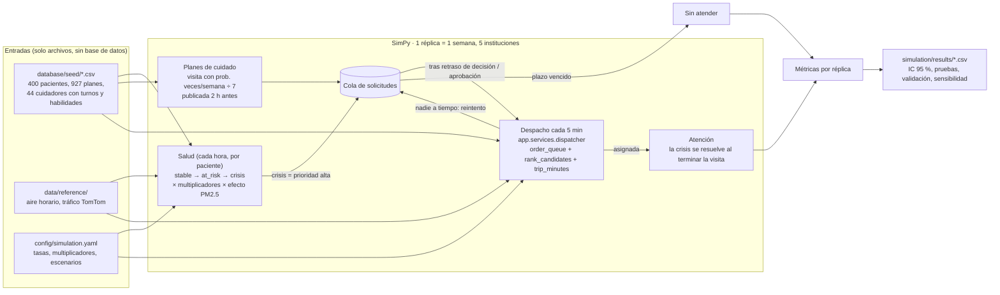

# SIRAG-D · modelo, supuestos y validación

**Pregunta:** ¿qué política de asignación atiende mejor a los pacientes de mayor riesgo cuando hay
contingencia ambiental y tráfico? (`docs/spec/06_sirag_d_y_contingencia.md`)

Código en `simulation/`. Correr: `docker compose run --rm sim` (escribe `simulation/results/`).
Pruebas: `docker compose run --rm sim pytest -q simulation/tests`.

## 1. Diagrama del modelo

**El mismo despachador.** `simulation/sirag/model.py` importa `app/services/dispatcher.py` (el de la
operación) y llama `order_queue`, `rank_candidates`, `trip_minutes` y `patient_risk`. No hay copia de esa
lógica (lo comprueba `simulation/tests/test_sirag.py`). Al despachador solo se le agregó un parámetro opcional
`extra_minutes` para el bloqueo vial; la operación no lo usa. La regla de **a qué hora** ocurre una visita del
plan está en `app/services/visit_rules.py`, compartida por el worker y la simulación.

**Reservas:** mientras una prioridad alta espera aprobación, su candidato propuesto queda reservado
(`dispatcher.apply_holds`), igual que en el worker.

**Cuándo se intenta cada solicitud también es código de la operación:** `dispatcher.earliest_options` busca
la llegada más temprana desde la hora pedida hasta un límite (visitas del plan: tolerancia de 60 min,
`dispatch.late_tolerance_minutes`; crisis: 4 h, después la familia acude a urgencias) y nadie puede salir en
el pasado. El worker real usa la misma función (`operations.dispatch_requests` y `options_for`).
**Lo único propio de la simulación** son los retrasos de decisión (humano 5–20 min, aprobación 1–5 min) y el
reloj acelerado.

**Números aleatorios comunes.** Cada sorteo usa una semilla derivada de (2026, réplica) y de la identidad de
lo que se sortea (paciente-hora, plan-día, solicitud). En la réplica *r* las 4 políticas enfrentan las mismas
visitas y las mismas crisis (las primeras crisis son idénticas; después pueden divergir un poco porque una
crisis se resuelve cuando se atiende). Por eso las comparaciones son **pareadas**.

## 2. Tabla de supuestos

| Parámetro | Valor | De dónde sale |
|---|---|---|
| Pacientes, planes, cuidadores, turnos, habilidades, duración de servicios | semilla | `database/seed/*.csv` |
| Hora de las visitas del plan | turnos de 8 h a las 08:00, de 12 h a las 20:00; resto en bloques de 15 min de 8 a 18 h | regla del generador de la semilla (`hora_deseada`) |
| Transiciones por hora stable→at_risk / at_risk→stable / at_risk→crisis | 0.0006 / 0.05 / 0.01 | **supuesto** calibrado a ~0.9 crisis/año (YAML) |
| Multiplicadores de riesgo (pulmonar 1.5, cardiaca 1.4, EVC 1.3, diabetes 1.15, dependencia severa 1.6 / moderada 1.25, 80+ 1.3, sin crónica 0.5) | YAML | **supuesto** (YAML) |
| Efecto PM2.5 por +10 µg/m³ sobre la línea base de 30 días de la estación | respiratorio 2.2 %, cardiovascular 0.78 %, causas naturales 0.91 % | Kloog et al. 2014 (PLoS One 9:e88578; Medicare 65+, EE. UU.); BMJ 2024 (citados en el YAML) |
| **Aplicar esos coeficientes a un riesgo por hora** | se multiplica la transición stable→at_risk | **supuesto del modelo**: los coeficientes vienen de estudios de mortalidad e ingresos hospitalarios **diarios** |
| A quién se aplica cada coeficiente | pulmonar → respiratorio; corazón/EVC → cardiovascular; resto → causas naturales | YAML (`apply_*`) + **supuesto** para "resto" |
| Estación de cada paciente | la más cercana | **supuesto** (coordenadas de estaciones aproximadas) |
| Serie de aire del escenario normal | semana del 9 al 15 nov 2026 de la serie calibrada | `data/reference/air_quality_hourly.csv` |
| Contingencia en el oriente | PM2.5 objetivo por estación (SAC 105, UIZ 98, …, resto 60) durante 24 h desde el miércoles 08:00 | YAML (referencia real ene 2024); hora de inicio: **supuesto** |
| Bloqueo en Iztapalapa | tráfico × 1.25 y +15 min por viaje que empieza o termina en Iztapalapa | YAML (**supuestos**); "cruza" = origen o destino en la alcaldía: **supuesto** |
| Velocidad por hora y tipo de día | perfil TomTom 2025 | `data/reference/traffic_hourly_profile.csv` |
| Distancia por calle | línea recta × 1.4 | **supuesto** (YAML) |
| km recorridos | ida y vuelta a la base | **supuesto** |
| Crisis → servicio | visita de enfermería de 30 min (SRV-02) | **supuesto** |
| Crisis sin personal | sin atender a las 4 h (urgencias) | **supuesto** |
| Tolerancia de retraso de visitas del plan | 60 min | **supuesto** (acordado) |
| Retraso del despacho humano | U(5, 20) min antes de cada decisión | YAML (**supuesto**) |
| Aprobación de coordinación (Enlaza, prioridad alta) | U(1, 5) min | **supuesto** (ver sensibilidad) |
| Duración real de las visitas | igual a la nominal | semilla (desviación observada = 0) |
| Réplicas, horizonte, semilla, confianza | 30 × 7 días, 2026, 95 % | YAML |

## 2.1 Reglas laborales (desde el 22 nov 2026)

Todas las corridas aplican las reglas de la Ley Federal del Trabajo con las **mismas funciones** que la operación
(`backend/app/services/labor.py`): cada persona descansa un día fijo por semana (art. 69; rotación que reparte los
días dentro de cada turno y habilidad) y el despachador nunca asigna un turno que empiece ese día; el tipo de
jornada sale de las horas (art. 60) y los turnos diurnos y mixtos no pasan del máximo del art. 61 (el vespertino
14:00–22:00 es mixto y queda en 14:00–21:30). Los nocturnos de 12 h (20:00–08:00) se dejan como están (decisión
de la institución) y se miden en la sensibilidad «Cumplir jornada nocturna» (sección 10). La utilización cuenta
solo los días que cada persona trabaja. La semilla no se toca: es la línea base «antes de Enlaza», con personal
asignado los 7 días.

**Relevos (desde el 22 nov 2026).** Un servicio más largo que cualquier turno legal (más de 8 h: SRV-04 y SRV-07,
de 12 h) que nadie puede cubrir solo se puede cubrir con **dos personas consecutivas de la misma habilidad**: la
primera trabaja hasta el final de su turno y la segunda llega en ese momento (la frontera de turno) y se queda
hasta el final. Siempre se prefiere a una sola persona (continuidad del cuidado). Es la misma función en la
operación y en SIRAG-D (`dispatcher.relay_options`, usada por `rank_candidates`). Con la plantilla actual nadie
necesita relevo (los nocturnos de 12 h cubren solos esos servicios): las corridas principales no cambian; los
relevos aparecen en «Cumplir jornada nocturna» (sección 10).

## 3. Validación

Escenario `normal` + `human_dispatcher` **con la plantilla tal como está en la semilla** (7 días, sin descanso:
`Params(labor_rules=False)`, porque así ocurrió el historial) contra la línea base de la semilla, contando **solo** "sin atender
por falta de personal" (`no_staff_available`), sin las cancelaciones de familias:

| | Línea base (semilla) | Simulación |
|---|---|---|
| Todas las solicitudes | 267 / 2,864 = 9.3 % · sin cancelaciones (267 / 2,788) = **9.6 %** | **14.7 %** [14.3, 15.1] |
| Sin turnos largos (8 h y 12 h) | **7.4 %** | **8.7 %** [8.4, 9.1] |

**Por qué difieren.** Casi toda la diferencia está en los turnos largos (cuidador de 8 h a las 08:00). Solo
cabe en un turno de 08:00–16:00; cada persona toma uno al día. El generador de la semilla los asignaba también
a personal de turno mixto (10:00–18:00), es decir, **empezando 2 h tarde**, porque su regla era "cuando el
cuidador quede libre dentro del turno". La simulación aplica la tolerancia acordada de 60 min, así que esos
servicios quedan sin atender más seguido. Sin ellos, la simulación queda 1.3 puntos arriba de la línea base.

Otras diferencias conocidas: la semilla usaba 20 min fijos de traslado y no exigía que el traslado cupiera;
la simulación usa el traslado del despachador (TomTom × circuidad).

## 4. Pruebas estadísticas

Con números aleatorios comunes las muestras están **pareadas** por réplica; un ANOVA de una vía o
Kruskal-Wallis supondrían grupos independientes. Por métrica y escenario:
1. Shapiro-Wilk sobre las diferencias pareadas (política − despacho humano).
2. Si todas son normales: ANOVA de medidas repetidas + *t* pareada; si no: **Friedman** (versión pareada de
   Kruskal-Wallis) + **Wilcoxon** de rangos con signo.
3. Corrección de **Holm** sobre las 3 comparaciones contra `human_dispatcher`.

Resultados en `simulation/results/tests.csv` y en `/simulacion`.

## 5. Lo que dicen los resultados (corrida del 22 nov 2026, con descanso semanal y jornada legal: 450 corridas principales + 1,050 de sensibilidad + 30 de validación en 300 s con 15 procesos)

Cifras de **Enlaza con aprobación con límite de tiempo y reserva** (`vela_timeout`), la política con la que
opera hoy el worker, frente al despacho humano. Media [IC 95 %] de 30 réplicas; pruebas pareadas con Holm.

| Métrica | Escenario | Enlaza (como opera hoy) | Despacho humano | Resultado |
|---|---|---|---|---|
| Espera de prioridad alta, p90 | normal | **20.1 min** [17.7–22.4] | 23.6 [21.2–26.0] | mejor, p < 0.001 |
| Espera de prioridad alta, p90 | contingencia + bloqueo | 24.1 [22.2–26.1] | 27.2 [25.2–29.2] | mejor, p = 0.0003 |
| Respuesta a crisis, p90 | normal | 76.0 min [56.4–95.6] | 80.0 [61.8–98.1] | mejor, p = 0.008 |
| Crisis atendidas en < 60 min | normal | 56.4 % [48.3–64.6] | 53.9 % [45.4–62.5] | sin diferencia (p = 0.81) |
| Crisis nocturnas (20–06 h) en < 60 min | normal | 43.9 % [26.6–61.3] | 43.9 % [26.6–61.3] | sin diferencia |
| Sin atender | normal | 19.1 % [18.5–19.6] | 19.1 % [18.5–19.6] | sin diferencia |
| Utilización del personal | normal | 28.1 % [27.6–28.6] | 28.1 % [27.6–28.6] | sin diferencia |
| Horas extra en la semana | normal | 13.7 h [13.3–14.2] | 14.1 h [13.7–14.5] | mejor, p = 0.008 |
| Horas extra en la semana | contingencia + bloqueo | 23.7 h [22.9–24.4] | 23.9 h [23.2–24.6] | sin diferencia (p = 0.051) |

**Qué cambió frente a la corrida del 21 nov (plantilla de 7 días):** con el descanso de ley hay 1/7 menos
turnos, así que todo empeora para todas las políticas: sin atender 14.7 % → 19.1 %, espera p90 de prioridad
alta 13.3 → 20.1 min (humano 16.4 → 23.6), respuesta a crisis p90 67.0 → 76.0 min, crisis en < 60 min
63.4 % → 56.4 %, utilización 26.2 % → 28.1 %. **La ventaja de Enlaza se mantiene** en espera de prioridad alta y
respuesta a crisis; las horas extra con bloqueo **ya no son significativamente menores** (antes p < 0.001).

- Las crisis de noche en instituciones de día no tienen personal de turno: ninguna política lo arregla, por
  eso el % en < 60 min casi no cambia.
- El "sin atender" lo limita la capacidad del personal, no el despachador (ver sección 9).
- **Contingencia donde ocurre** (24 h; GAM, Iztacalco, V. Carranza, Iztapalapa, Tláhuac; totales de 30
  semanas): entradas a "en riesgo" 136 → 145 (+9), crisis 21 → 21. En toda la semana: 1,429 → 1,439
  entradas, 186 → 186 crisis. **Con los coeficientes publicados el efecto del aire sobre las crisis es
  pequeño**; el bloqueo pesa más (horas extra 13.7 → 23.7 h).

## 6. Análisis de sensibilidad (aparte; no es resultado principal)

Escenario normal, 30 réplicas (`simulation/results/sensitivity.csv`, pruebas en `sensitivity_tests.csv`).
Espera p90 de prioridad alta, en minutos:

| Supuesto | Nivel | Enlaza con límite y reserva (hoy) | Enlaza sin límite (con reserva) | Despacho humano |
|---|---|---|---|---|
| Retraso de aprobación | 0 (inmediata) | 19.8 | 19.8 | 23.6 |
| | 1–5 min | 20.1 | 20.2 | 23.6 |
| | 5–15 min | 20.4 | 21.7 | 23.6 |
| Riesgo de crisis | ×1 | 20.1 | 20.2 | 23.6 |
| | ×2 | 22.7 | 22.9 | 27.3 |
| | ×3 | 25.3 | 25.3 | 30.7 |

Con la reserva y el límite de tiempo, la espera ya no depende de qué tan rápido apruebe coordinación; con más
crisis la ventaja frente al despacho humano crece. La sección 8 cuenta cómo se llegó aquí.

## 7. Operación y simulación, alineadas

- **Tolerancia de 60 min:** el worker reintenta hasta 60 min después de la hora pedida y solo entonces marca
  "sin atender" (antes no asignaba tarde). Prueba: `test_visit_is_assigned_late_within_tolerance…`.
- **Hora de las visitas del plan:** regla compartida `app/services/visit_rules.py` (antes el worker ponía los
  turnos de 8 h a horas al azar y nunca podían asignarse).

## 8. Hallazgo de la simulación que cambió el producto

**En una frase:** se detectó con la plantilla de 7 días (sin día de descanso); con la plantilla legal Enlaza sin
límite de tiempo ya no queda peor que el despacho humano, pero el límite de tiempo sigue siendo la mejor opción.

**Qué encontró la sensibilidad (corrida del 21 nov, plantilla de 7 días).** Con aprobación lenta (5–15 min),
Enlaza quedaba **peor** que el despacho humano: espera p90 de prioridad alta +3.0 min (Wilcoxon-Holm p = 0.006).

**Decisiones del equipo (21 nov 2026).** Dos cambios, iguales en la operación y en la simulación:
1. **Aprobación con límite de tiempo, solo para lo urgente.** Si una solicitud alta con visita en menos de
   60 min lleva 3 min sin aprobación, Enlaza aplica el candidato propuesto (`approval='timeout'`, "aprobada
   por tiempo"), avisa a coordinación (alerta `approved_by_timeout`) y lo registra en la bitácora;
   coordinación puede cambiarlo. Se limitó a lo urgente porque la regla 3 de `CLAUDE.md` y la spec 11 piden
   que una persona apruebe la prioridad alta.
2. **Reserva del candidato.** Mientras una prioridad alta espera aprobación, la ventana de su candidato
   propuesto queda reservada y las de prioridad baja y media no se la pueden ganar. La reserva vence a los
   15 min (`approval.hold_minutes`, supuesto que cubre aprobaciones de hasta 15 min). Función compartida:
   `dispatcher.Hold` / `apply_holds`, usada por `operations.dispatch_requests` y `options_for` y por SIRAG-D.

Valores en `config/simulation.yaml` (`approval.auto_apply_after_minutes`, `approval.urgent_within_minutes`,
`approval.hold_minutes`).

**Resultado** (sensibilidad, escenario normal, 30 réplicas, retraso de aprobación 5–15 min, frente al
despacho humano; corrida del 21 nov con plantilla de 7 días, histórico de cómo se tomó la decisión):

| Métrica | Enlaza sin límite ni reserva (antes) | Enlaza con límite, sin reserva | **Enlaza con límite y reserva (hoy)** |
|---|---|---|---|
| Espera de prioridad alta, p90 | +3.0 min, peor (p = 0.006) | +1.9 min, sin diferencia (p = 0.078) | **−3.0 min, mejor (p = 0.0002)**: 13.3 frente a 16.4 |
| Respuesta a crisis, p90 | −1.4 min, sin diferencia | −5.4 min, mejor (p < 0.001) | **−7.8 min, mejor (p = 0.0001)** |

Con los dos cambios, una coordinación lenta ya no deja a Enlaza en desventaja: la espera de prioridad alta con
5–15 min de retraso (13.3 min) queda igual que con aprobación de 1–5 min (13.3 min).

**Con el descanso de ley (corrida del 22 nov):** Enlaza **sin** límite de tiempo (con reserva) ya no queda peor
con aprobación de 5–15 min: −1.9 min de espera p90 frente al humano (p = 0.010) y respuesta a crisis −3.3 min
sin diferencia significativa (p = 0.39). **Con** el límite de tiempo la ventaja es mayor y significativa en las
dos: −3.2 min (p < 0.001) y −5.4 min (p = 0.010), y la espera con 5–15 min (20.4) casi no se aleja de la de
1–5 min (20.1). El límite de tiempo sigue justificado, pero el hallazgo original («Enlaza peor que el humano»)
dependía de la plantilla de 7 días.

**La reserva no empeora a las demás** (escenario normal, Enlaza como opera hoy, 30 réplicas pareadas con y sin
reserva, `simulation/experiments/holds_check.py` → `results/holds_check.csv`, corrida del 22 nov): sin atender
19.1 % con y sin reserva, espera p90 de prioridad media 23.8 → 23.8 min y baja 25.1 → 25.2 min, sin ninguna
diferencia significativa (Wilcoxon-Holm p = 1.0).

## 9. ¿Y si contratamos? (sensibilidad)

Escenario normal, 30 réplicas, política Enlaza con límite de tiempo:

| Personal | Sin atender | Crisis en < 60 min | Crisis nocturnas en < 60 min |
|---|---|---|---|
| Actual (44 personas) | 19.1 % | 56.4 % | 43.9 % |
| +1 enfermera de noche en cada institución de 24 h y +1 cuidador de día en INS-A (47) | 19.0 % | 59.6 % | 53.1 % |
| +1 cuidador de día en INS-B y en INS-D, dirigido al cuello de botella (46) | **17.5 %** | 56.4 % | 43.9 % |

(Corrida del 21 nov, plantilla de 7 días: 14.7 %, 14.7 % y 12.9 % sin atender.) Las conclusiones no cambian:
la primera opción casi no toca el «sin atender» pero sube las crisis atendidas a tiempo, sobre todo de noche;
la segunda va al cuello de botella (visitas de cuidador diurno de 8 h en INS-B e INS-D) y baja el «sin atender»
1.6 puntos. El personal contratado también descansa un día por semana.

## 10. Cumplir jornada nocturna (sensibilidad)

Los turnos de 20:00 a 08:00 (12 h) exceden las 7 h de la jornada nocturna (LFT art. 61). Escenario: cada uno se
parte en dos turnos legales, 20:00–03:00 y 01:00–08:00, lo que duplica las plazas nocturnas: **+4 personas**
(44 → 48; INS-B e INS-D). Escenario normal, 30 réplicas:

Con **relevos** (corrida del 22 nov, después de agregarlos al despachador; los servicios de 12 h se cubren con
dos personas, la primera de 20:00 a 03:00 y la segunda de 03:00 a 08:00):

| Política | Sin atender | Crisis en < 60 min | Crisis nocturnas en < 60 min | Relevos por semana |
|---|---|---|---|---|
| Enlaza (como opera hoy), turnos de 12 h | 19.07 % [18.55–19.58] | 56.4 % | 43.9 % [26.6–61.3] | 0 |
| Enlaza (como opera hoy), dos turnos de 7 h | 19.15 % [18.64–19.66] | 56.9 % | 45.0 % [27.4–62.6] | 2.7 |
| Despacho humano, turnos de 12 h | 19.08 % | 53.9 % | 43.9 % | 0 |
| Despacho humano, dos turnos de 7 h | 19.16 % | 54.4 % | 45.0 % | 2.7 |

Comparación pareada (mismas 30 réplicas, Enlaza como opera hoy, Wilcoxon): «sin atender» +0.08 puntos (p = 0.001;
unas 0.5 solicitudes por semana de ~645), crisis nocturnas en < 60 min +1.1 puntos (p = 0.69; solo 23 réplicas
tienen crisis de noche y en 1 cambia el resultado), crisis en < 60 min +0.5 puntos (p = 0.73).

**Antes de los relevos** (misma noche, corrida anterior del 22 nov): el «sin atender» subía de 19.1 % a 19.6 %,
porque los servicios de 12 h de noche ya no cabían en un turno de 7 h.

**Qué cambió en la conclusión.** Con relevos, cumplir la jornada nocturna ya **no empeora** la atención de forma
apreciable: el «sin atender» queda prácticamente igual (+0.08 puntos, detectable porque las réplicas son
pareadas, pero de media solicitud por semana). Sigue **sin mejorarla**: las crisis nocturnas atendidas a tiempo no
cambian. Cuesta las mismas 4 plazas. Es un costo de cumplimiento legal, no una mejora del servicio; lo decide la
institución (Enlaza solo lo marca y avisa).
