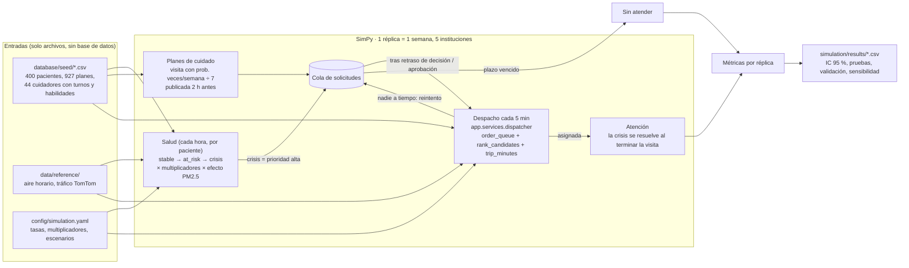

# SIRAG-D · modelo, supuestos y validación

**Pregunta:** ¿qué política de asignación atiende mejor a los pacientes de mayor riesgo cuando hay
contingencia ambiental y tráfico? (`docs/spec/06_sirag_d_y_contingencia.md`)

Código en `simulation/`. Correr: `docker compose run --rm sim` (escribe `simulation/results/`).
Pruebas: `docker compose run --rm sim pytest -q simulation/tests`.

## 1. Diagrama del modelo

**El mismo despachador.** `simulation/sirag/model.py` importa `app/services/dispatcher.py` (el de la
operación) y llama `order_queue`, `rank_candidates`, `trip_minutes` y `patient_risk`. No hay copia de esa
lógica (lo comprueba `simulation/tests/test_sirag.py`). Al despachador solo se le agregó un parámetro opcional
`extra_minutes` para el bloqueo vial; la operación no lo usa. La regla de **a qué hora** ocurre una visita del
plan está en `app/services/visit_rules.py`, compartida por el worker y la simulación.

**Reservas:** mientras una prioridad alta espera aprobación, su candidato propuesto queda reservado
(`dispatcher.apply_holds`), igual que en el worker.

**Cuándo se intenta cada solicitud también es código de la operación:** `dispatcher.earliest_options` busca
la llegada más temprana desde la hora pedida hasta un límite (visitas del plan: tolerancia de 60 min,
`dispatch.late_tolerance_minutes`; crisis: 4 h, después la familia acude a urgencias) y nadie puede salir en
el pasado. El worker real usa la misma función (`operations.dispatch_requests` y `options_for`).
**Lo único propio de la simulación** son los retrasos de decisión (humano 5–20 min, aprobación 1–5 min) y el
reloj acelerado.

**Números aleatorios comunes.** Cada sorteo usa una semilla derivada de (2026, réplica) y de la identidad de
lo que se sortea (paciente-hora, plan-día, solicitud). En la réplica *r* las 4 políticas enfrentan las mismas
visitas y las mismas crisis (las primeras crisis son idénticas; después pueden divergir un poco porque una
crisis se resuelve cuando se atiende). Por eso las comparaciones son **pareadas**.

## 2. Tabla de supuestos

| Parámetro | Valor | De dónde sale |
|---|---|---|
| Pacientes, planes, cuidadores, turnos, habilidades, duración de servicios | semilla | `database/seed/*.csv` |
| Hora de las visitas del plan | turnos de 8 h a las 08:00, de 12 h a las 20:00; resto en bloques de 15 min de 8 a 18 h | regla del generador de la semilla (`hora_deseada`) |
| Transiciones por hora stable→at_risk / at_risk→stable / at_risk→crisis | 0.0006 / 0.05 / 0.01 | **supuesto** calibrado a ~0.9 crisis/año (YAML) |
| Multiplicadores de riesgo (pulmonar 1.5, cardiaca 1.4, EVC 1.3, diabetes 1.15, dependencia severa 1.6 / moderada 1.25, 80+ 1.3, sin crónica 0.5) | YAML | **supuesto** (YAML) |
| Efecto PM2.5 por +10 µg/m³ sobre la línea base de 30 días de la estación | respiratorio 2.2 %, cardiovascular 0.78 %, causas naturales 0.91 % | Bell et al. 2014; BMJ 2024 (citados en el YAML) |
| **Aplicar esos coeficientes a un riesgo por hora** | se multiplica la transición stable→at_risk | **supuesto del modelo**: los coeficientes vienen de estudios de mortalidad e ingresos hospitalarios **diarios** |
| A quién se aplica cada coeficiente | pulmonar → respiratorio; corazón/EVC → cardiovascular; resto → causas naturales | YAML (`apply_*`) + **supuesto** para "resto" |
| Estación de cada paciente | la más cercana | **supuesto** (coordenadas de estaciones aproximadas) |
| Serie de aire del escenario normal | semana del 9 al 15 nov 2026 de la serie calibrada | `data/reference/air_quality_hourly.csv` |
| Contingencia en el oriente | PM2.5 objetivo por estación (SAC 105, UIZ 98, …, resto 60) durante 24 h desde el miércoles 08:00 | YAML (referencia real ene 2024); hora de inicio: **supuesto** |
| Bloqueo en Iztapalapa | tráfico × 1.25 y +15 min por viaje que empieza o termina en Iztapalapa | YAML (**supuestos**); "cruza" = origen o destino en la alcaldía: **supuesto** |
| Velocidad por hora y tipo de día | perfil TomTom 2025 | `data/reference/traffic_hourly_profile.csv` |
| Distancia por calle | línea recta × 1.4 | **supuesto** (YAML) |
| km recorridos | ida y vuelta a la base | **supuesto** |
| Crisis → servicio | visita de enfermería de 30 min (SRV-02) | **supuesto** |
| Crisis sin personal | sin atender a las 4 h (urgencias) | **supuesto** |
| Tolerancia de retraso de visitas del plan | 60 min | **supuesto** (acordado) |
| Retraso del despacho humano | U(5, 20) min antes de cada decisión | YAML (**supuesto**) |
| Aprobación de coordinación (Vela, prioridad alta) | U(1, 5) min | **supuesto** (ver sensibilidad) |
| Duración real de las visitas | igual a la nominal | semilla (desviación observada = 0) |
| Réplicas, horizonte, semilla, confianza | 30 × 7 días, 2026, 95 % | YAML |

## 3. Validación

Escenario `normal` + `human_dispatcher` contra la línea base de la semilla, contando **solo** "sin atender
por falta de personal" (`no_staff_available`), sin las cancelaciones de familias:

| | Línea base (semilla) | Simulación |
|---|---|---|
| Todas las solicitudes | 267 / 2,864 = 9.3 % · sin cancelaciones (267 / 2,788) = **9.6 %** | **14.7 %** [14.3, 15.1] |
| Sin turnos largos (8 h y 12 h) | **7.4 %** | **8.7 %** [8.4, 9.1] |

**Por qué difieren.** Casi toda la diferencia está en los turnos largos (cuidador de 8 h a las 08:00). Solo
cabe en un turno de 08:00–16:00; cada persona toma uno al día. El generador de la semilla los asignaba también
a personal de turno mixto (10:00–18:00), es decir, **empezando 2 h tarde**, porque su regla era "cuando el
cuidador quede libre dentro del turno". La simulación aplica la tolerancia acordada de 60 min, así que esos
servicios quedan sin atender más seguido. Sin ellos, la simulación queda 1.3 puntos arriba de la línea base.

Otras diferencias conocidas: la semilla usaba 20 min fijos de traslado y no exigía que el traslado cupiera;
la simulación usa el traslado del despachador (TomTom × circuidad).

## 4. Pruebas estadísticas

Con números aleatorios comunes las muestras están **pareadas** por réplica; un ANOVA de una vía o
Kruskal-Wallis supondrían grupos independientes. Por métrica y escenario:
1. Shapiro-Wilk sobre las diferencias pareadas (política − despacho humano).
2. Si todas son normales: ANOVA de medidas repetidas + *t* pareada; si no: **Friedman** (versión pareada de
   Kruskal-Wallis) + **Wilcoxon** de rangos con signo.
3. Corrección de **Holm** sobre las 3 comparaciones contra `human_dispatcher`.

Resultados en `simulation/results/tests.csv` y en `/simulacion`.

## 5. Lo que dicen los resultados (corrida del 21 nov 2026: 450 corridas principales + 900 de sensibilidad en 199 s con 15 procesos)

Cifras de **Vela con aprobación con límite de tiempo y reserva** (`vela_timeout`), la política con la que
opera hoy el worker, frente al despacho humano. Media [IC 95 %] de 30 réplicas; pruebas pareadas con Holm.

| Métrica | Escenario | Vela (como opera hoy) | Despacho humano | Resultado |
|---|---|---|---|---|
| Espera de prioridad alta, p90 | normal | **13.3 min** [10.5–16.2] | 16.4 [13.2–19.5] | mejor, p = 0.0002 |
| Espera de prioridad alta, p90 | contingencia + bloqueo | 16.4 [13.6–19.2] | 20.3 [16.9–23.6] | mejor, p < 0.001 |
| Respuesta a crisis, p90 | normal | 67.0 min [50.0–84.0] | 72.5 [56.2–88.8] | mejor, p < 0.001 |
| Crisis atendidas en < 60 min | normal | 63.4 % [56.2–70.6] | 61.3 % [54.3–68.4] | sin diferencia (p = 1.0) |
| Sin atender | normal | 14.7 % [14.3–15.1] | 14.7 % [14.3–15.1] | sin diferencia |
| Horas extra en la semana | normal → bloqueo | 14.3 → 24.2 h | 14.8 → 24.7 h | mejor, p < 0.001 |

- Las crisis de noche en instituciones de día no tienen personal de turno: ninguna política lo arregla, por
  eso el % en < 60 min casi no cambia.
- El "sin atender" lo limita la capacidad del personal, no el despachador (ver sección 9).
- **Contingencia donde ocurre** (24 h; GAM, Iztacalco, V. Carranza, Iztapalapa, Tláhuac; totales de 30
  semanas): entradas a "en riesgo" 136 → 145 (+9), crisis 21 → 21. En toda la semana: 1,429 → 1,439
  entradas, 186 → 186 crisis. **Con los coeficientes publicados el efecto del aire sobre las crisis es
  pequeño**; el bloqueo pesa más (horas extra 14.3 → 24.2 h).

## 6. Análisis de sensibilidad (aparte; no es resultado principal)

Escenario normal, 30 réplicas (`simulation/results/sensitivity.csv`, pruebas en `sensitivity_tests.csv`).
Espera p90 de prioridad alta, en minutos:

| Supuesto | Nivel | Vela con límite y reserva (hoy) | Vela sin límite (con reserva) | Despacho humano |
|---|---|---|---|---|
| Retraso de aprobación | 0 (inmediata) | 13.1 | 13.1 | 16.4 |
| | 1–5 min | 13.3 | 13.5 | 16.4 |
| | 5–15 min | 13.3 | 14.2 | 16.4 |
| Riesgo de crisis | ×1 | 13.3 | 13.5 | 16.4 |
| | ×2 | 16.9 | 16.9 | 21.8 |
| | ×3 | 19.4 | 19.7 | 26.0 |

Con la reserva y el límite de tiempo, la espera ya no depende de qué tan rápido apruebe coordinación; con más
crisis la ventaja frente al despacho humano crece. La sección 8 cuenta cómo se llegó aquí.

## 7. Operación y simulación, alineadas

- **Tolerancia de 60 min:** el worker reintenta hasta 60 min después de la hora pedida y solo entonces marca
  "sin atender" (antes no asignaba tarde). Prueba: `test_visit_is_assigned_late_within_tolerance…`.
- **Hora de las visitas del plan:** regla compartida `app/services/visit_rules.py` (antes el worker ponía los
  turnos de 8 h a horas al azar y nunca podían asignarse).

## 8. Hallazgo de la simulación que cambió el producto

**Qué encontró la sensibilidad.** Con aprobación lenta (5–15 min), Vela quedaba **peor** que el despacho
humano: espera p90 de prioridad alta +3.0 min (Wilcoxon-Holm p = 0.006).

**Decisiones del equipo (21 nov 2026).** Dos cambios, iguales en la operación y en la simulación:
1. **Aprobación con límite de tiempo, solo para lo urgente.** Si una solicitud alta con visita en menos de
   60 min lleva 3 min sin aprobación, Vela aplica el candidato propuesto (`approval='timeout'`, "aprobada
   por tiempo"), avisa a coordinación (alerta `approved_by_timeout`) y lo registra en la bitácora;
   coordinación puede cambiarlo. Se limitó a lo urgente porque la regla 3 de `CLAUDE.md` y la spec 11 piden
   que una persona apruebe la prioridad alta.
2. **Reserva del candidato.** Mientras una prioridad alta espera aprobación, la ventana de su candidato
   propuesto queda reservada y las de prioridad baja y media no se la pueden ganar. La reserva vence a los
   15 min (`approval.hold_minutes`, supuesto que cubre aprobaciones de hasta 15 min). Función compartida:
   `dispatcher.Hold` / `apply_holds`, usada por `operations.dispatch_requests` y `options_for` y por SIRAG-D.

Valores en `config/simulation.yaml` (`approval.auto_apply_after_minutes`, `approval.urgent_within_minutes`,
`approval.hold_minutes`).

**Resultado** (sensibilidad, escenario normal, 30 réplicas, retraso de aprobación 5–15 min, frente al
despacho humano):

| Métrica | Vela sin límite ni reserva (antes) | Vela con límite, sin reserva | **Vela con límite y reserva (hoy)** |
|---|---|---|---|
| Espera de prioridad alta, p90 | +3.0 min, peor (p = 0.006) | +1.9 min, sin diferencia (p = 0.078) | **−3.0 min, mejor (p = 0.0002)**: 13.3 frente a 16.4 |
| Respuesta a crisis, p90 | −1.4 min, sin diferencia | −5.4 min, mejor (p < 0.001) | **−7.8 min, mejor (p = 0.0001)** |

Con los dos cambios, una coordinación lenta ya no deja a Vela en desventaja: la espera de prioridad alta con
5–15 min de retraso (13.3 min) queda igual que con aprobación de 1–5 min (13.3 min).

**La reserva no empeora a las demás** (escenario normal, Vela como opera hoy, 30 réplicas pareadas con y sin
reserva, `simulation/experiments/holds_check.py` → `results/holds_check.csv`): sin atender 14.7 % → 14.7 %,
espera p90 de prioridad media 15.5 → 15.5 min y baja 19.5 → 19.5 min, sin ninguna diferencia (la reserva solo
reasignó 1 visita baja/media en 5 réplicas, sin cambiar su hora).

## 9. ¿Y si contratamos? (sensibilidad)

Escenario normal, 30 réplicas, política Vela con límite de tiempo:

| Personal | Sin atender | Crisis en < 60 min |
|---|---|---|
| Actual | 14.7 % | 63.4 % |
| +1 enfermera de noche en cada institución de 24 h y +1 cuidador de día en INS-A | 14.7 % | 64.2 % |
| +1 cuidador de día en INS-B y en INS-D (dirigido al cuello de botella) | **12.9 %** | 63.4 % |

La primera opción casi no cambia nada: INS-A no tiene planes de cuidador diurno de 8 h y la enfermería de
noche solo atiende alguna crisis. El cuello de botella son las visitas de cuidador diurno de 8 h en INS-B y
INS-D (un solo cuidador de turno 08–16 en cada una). Las crisis nocturnas en instituciones de día no mejoran
con ninguna de las dos.
